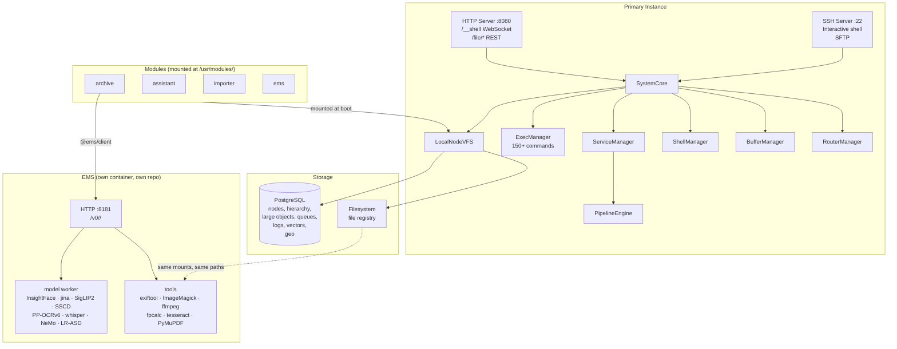
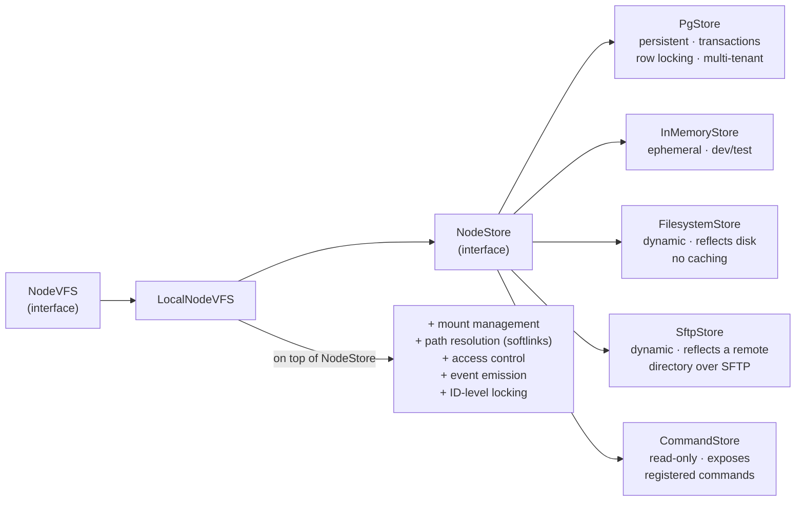
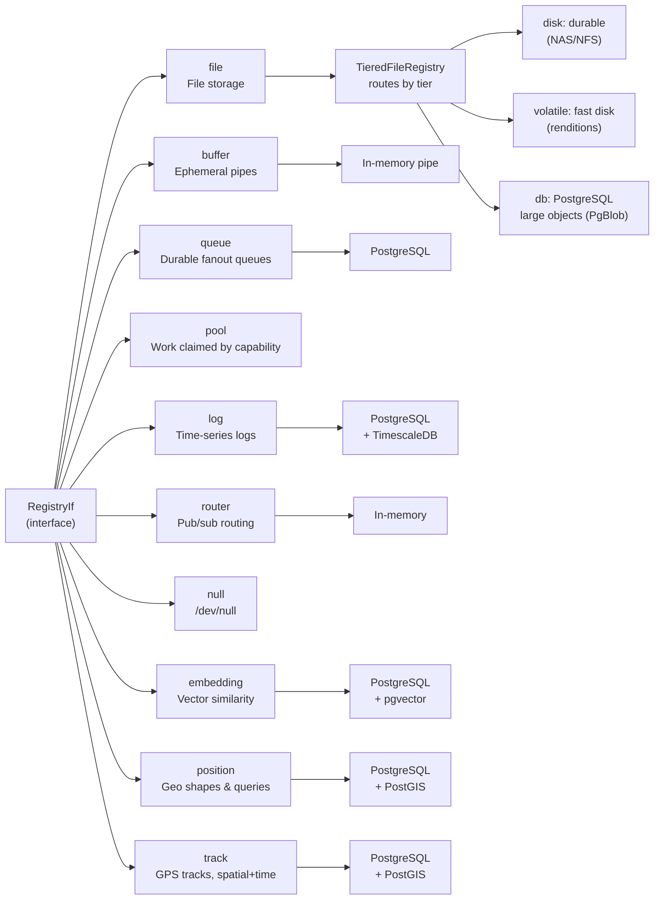
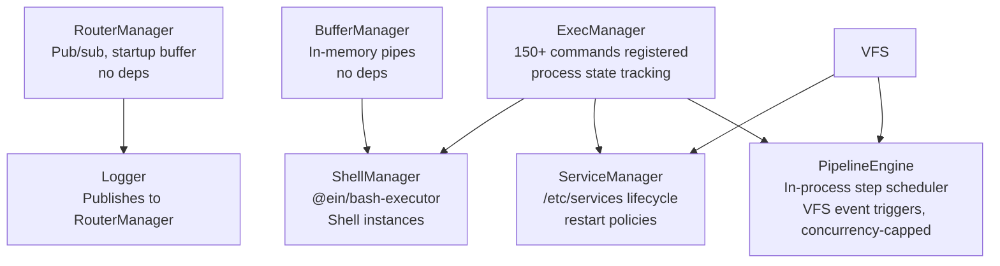
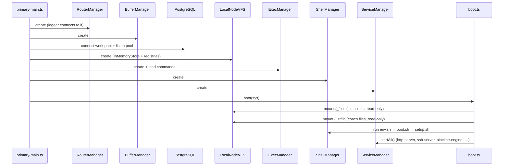

# EiN Architecture

EiN is a CMS for documenting lives — photos, texts, events, connected to people, locations, and time. Everything is modelled as nodes in a virtual filesystem (VFS) backed by PostgreSQL.

The system currently runs as a single **primary** instance with full capabilities (HTTP, SSH, shell, services). What it does with photos, people and places is its modules', and so are the services they reach. A future SSH-based worker model is planned: workers will be stateless processes that SSH into the primary and run the same commands, with the primary keeping all state. The earlier `RemoteNodeVFS`-over-HTTP worker model has been removed.

---

## System Topology



---

## SystemCore

`SystemCore` ([src/system-core.ts](../src/system-core.ts)) is the central hub passed to every command, manager, and service.

```
SystemCore
  ├── vfs: NodeVFS               required
  ├── bufferManager              required
  ├── routerManager              required
  ├── pgPool?                    optional
  ├── pgListenPool?              optional
  ├── execManager?               optional
  ├── serviceManager?            optional
  └── shellManager?              optional
```

The three required fields are always present. The optional managers are wired up during boot of a full instance; the optionality lets lightweight contexts (e.g. tests) construct a minimal core.

### The two postgres pools

`pgPool` is a `PriorityPool` ([src/lib/pg/priority-pool.ts](../src/lib/pg/priority-pool.ts)), a `pg.Pool` that keeps `POSTGRES_POOL_RESERVED` (default 4) of its `POSTGRES_POOL_MAX` (default 20) connections out of reach of background work, so an interactive command never queues behind the crawl. Which class a caller belongs to travels on an `AsyncLocalStorage` ([src/lib/pg/work-class.ts](../src/lib/pg/work-class.ts)) rather than through every VFS signature: a service declaring `"workClass": "background"` in its `config.json` has `ServiceManager` run its whole script inside that context, and everything downstream inherits it. **Untagged is interactive** — the permissive direction, so a context nobody tagged behaves as it always did. A background acquisition is admitted only while `backgroundInside < max - reserved` _and_ `backgroundInside + interactiveInside < max`; the second condition is what keeps background out of `node-postgres`'s own FIFO, where a cap on connections _held_ would otherwise still let it queue ahead of the next interactive acquisition. An acquisition that waits longer than `POSTGRES_CONNECT_TIMEOUT_MS` (default 60 s) fails, on this pool and the listen pool, so a starved pool shows up as failed requests instead of a hung process.

`pgListenPool` is a small separate pool (`POSTGRES_LISTEN_POOL_MAX`, default 4) holding nothing but LISTEN/NOTIFY connections. Four registries — log, queue, pool and track — each keep one for their whole lifetime, and a connection in that state cannot serve a query, so on the shared pool they were a fifth of it standing still before any work arrived. Both are reported per tick in the `runtime` metrics series beside event-loop lag, which is where the two halves of "the shell feels slow" are read together.

---

## VFS Layer

The VFS presents a single unified namespace. `LocalNodeVFS` is the sole implementation of the `NodeVFS` interface; it wraps a `NodeStore` and adds routing, mounting, access control, softlink resolution, ID-level locking, and event emission.



**NodeVFS key methods:** `get`, `children`, `exists`, `resolvePath`, `create`, `createTree`, `ensure`, `update`, `updateMany`, `updateEach`, `rename`, `renameMany`, `link`, `unlink`, `unlinkMany`, `copy`, `open`, `stat`, `statX`, `query`, `aggregate`, `countWithin`, `findLinks`, `findLinksUnder`, `mount`, `unmount`, `subscribe`

### Event delivery

Every mutation runs as `withTransaction(ids, fn)`: the id-locks are taken first, in sorted order,
then a store transaction is opened. The events the mutation produces are **buffered on the
`Mutation` handle** (`mut.emit(...)`, synchronous, returns nothing) and delivered only once the
transaction has committed and every lock has been released. Handlers are still awaited, so a
caller's own write does not return until its subscribers have seen it, and a rolled-back mutation
announces nothing at all.

Delivering inline was a deadlock with no way out. `emit()` awaits its handlers, so a handler that
touched the VFS asked for locks the emitting write still held; on PostgreSQL it did not even need
a lock collision, because the emitting `DELETE` was uncommitted and the handler's own connection
still saw the edge, resolved it, and blocked on a mutex nobody would release. Postgres sees a
promise, the mutex sees no transaction, so neither aborts and the process stays wedged until
restart (the memory store's no-op transactions are why the fast tier never showed it). Two
subscribers — `relations-guard` and `PipelineEngine.watchInternalNodes` — had each discovered
this and scheduled their work off the emitting task; the rule lived in comments and nothing
enforced it. It is now structural: there is no way to reach a subscriber from inside a mutation.

**A copy announces its tree once the tree is whole.** `copy` writes node by node, each a mutation
of its own, and holds every delivery they make (an `AsyncLocalStorage` shared by all
`LocalNodeVFS`, so a mounted destination's too) until the last write, then delivers them in order.
Announced as it landed, a copied photo reached the media bridge before its `metadata/exif`, read as
a new file, and `generate-derivatives` made its `thumbnails/` before the copy could write the
source's there.

**Only the outermost VFS publishes to the queues.** A mounted VFS sees its paths relative to its
mount point, and used to publish them that way: a write under `/tmp` reached every queue consumer
as `/x`, and a pipeline it triggered was skipped with "target node missing". The VFS it is mounted
into now tells it so (`setMounted`), relays its events through the mount subscription with the
path joined onto the mount point, and publishes them only if it is itself not mounted — so nested
mounts rewrite once per level and publish once. The relay subscribes as admin; each in-process
subscriber is still filtered by its own access when the event is re-emitted — the node's read
permission and whether the subscriber could walk to the directory holding it (a path walk, which
`PgStore` answers from its path cache, so an import's burst into one album costs no queries). Production's data
VFS is mounted at `/` under a router-only root, whose rewrite leaves every path as it was.

**A softlink inside a mount is followed by the outermost VFS.** Its target names a path in the
global namespace, which a mounted VFS does not know, so one that meets a softlink on a path walk
does not resolve it: it throws a `SoftlinkRedirect` carrying the target, the directory holding the
link and the rest of the walk. Each VFS on the way up joins that directory onto its mount point,
and the one that is not mounted resolves the target from its root — an absolute target as the
caller's `/`, a relative one from the link's directory as the caller sees it.

### Mirror stores and the sftp mount

`FilesystemStore` and `SftpStore` mirror a tree kept elsewhere — a host directory, a directory on
an SFTP server. They declare `pathAddressed`: a node's id is the base64 of its path within the
mount (`src/stores/path-id.ts`), so it changes when the node moves (`rename` re-reads the moved
node by its new name), and their file registry is handed that path rather than the id. They hold
directories, files and links only; attrs are derived from what the other side reports, not stored.

`mount <path> sftp "host=…,user=…,path=…"` builds an `SftpStore` and an `SftpFileRegistry` over one
shared `SftpConnection` (`src/lib/ssh/sftp-connection.ts`): opened lazily, reopened after a drop
with a growing wait (at most a minute) between failed attempts, and holding a two-second cache of
attributes, listings and link targets that the mount's own writes invalidate. A listing is one
READDIR; `childCount` costs one more per subdirectory, so it is counted for listings only and a
lookup by name (each level of a path resolution) is one LSTAT. The registry's handle reads ahead
and keeps 16 writes in flight. Every node is owned by the mount's `uid`/`gid` (the mounting admin
by default), never by the server's numeric ids; the permission bits are the server's.

An sftp mount is mounted with `publish: false`: its events reach in-process subscribers but never
the router, so no pipeline or bridge is triggered by them. A pipeline would give a file
children (`metadata/`, `thumbnails/`), which a mirror cannot hold. The relay marks such events
`unpublished`, which survives any outer relays.

Mounts live in memory. `mount --save` also records one in `/etc/fstab` (`unmount --save` drops
it), and `05_fstab.sh` runs `mount -a` at boot. There an sftp mount is lazy: it mounts without
waiting for its server and connects when the server answers, so an unreachable host cannot hold
up boot. Mounts use key auth only, since they reconnect when no one is there to type a password,
and trust a host through the admin's `~/.ssh/known_hosts` or a `hostkey=SHA256:…` pin.

The node a mount stands on cannot be removed or moved while the mount is there: `unlink` (so
`rm`, also `rm -r` above it), a `rename` onto it, and a `rename` of it or of anything above it
(within one VFS or across two) fail with `NodeBusyError`, as Unix answers `EBUSY`. A mount keeps
the path it was mounted at, which is what `mounts` lists and its events are published under.
`unmount` looks a path up in the mount table before resolving it, so it reaches a mount point that
a later mount covers — the boot's `/_files`, once `/` is remounted onto PostgreSQL.

### Write durability

Each create, update and unlink tells its transaction what it writes (`Transaction.declareWrite`):
`ephemeral` for the types in [`EPHEMERAL_NODE_TYPES`](../src/vfs/types/ephemeral.ts) — `session`
and `tty`, state that never outlives the process and that `session-reap` removes if it does —
and `durable` for everything else. `PgStore` commits a transaction whose writes were all
ephemeral with `SET LOCAL synchronous_commit TO OFF; COMMIT`, one round trip, so it does not
wait for the WAL flush; one durable write, or a write nobody declared, pins the whole commit.
That flush is what a session's setup waited on under a crawl (tty create 90 ms median, 531 max
in production 2026-09-13, against 4 ms idle), and it is also what every line a pipeline step prints
paid, since each is a tty update. Stores without the distinction ignore the declaration.

Both channels are deferred, the routing-key publish (`system.vfs.<nodeType>.<eventType>`) and the
in-process `vfs.subscribe` handlers, in emit order per mutation. Neither may fail the caller — the
work is already committed, so a delivery error is logged, not thrown.

`created`, `updated`, `deleted` and `moved` carry the node they name; `child-attached` and
`child-detached` carry the **parent**, whichever operation changed its membership (`create`,
`link`, `mv`, `unlink`), so they publish on the parent's type and a consumer that cares about one
kind of container binds one key (`system.vfs.album.child-attached`); one write announces each
container once, however many children it attached there or detached. The published form is slim
— identity only — with the three things a subscriber cannot recover by reading the node fresh:
`changedAttrs` on `updated`, the names of the attrs whose value moved; `attrs` on `deleted`, the
node's attrs as they were when it went; and `fromPath` on `moved`, where the node was before.

A queue, log or track binds routing keys either literally or by pattern — `*` is one segment, `#` is
zero or more, both as whole segments, so `system.vfs.file.*` is every event on a file node and
`media.#` is a whole domain ([src/registries/routing-key-match.ts](../src/registries/routing-key-match.ts)).
The pattern is compiled to a regex in TypeScript and, for the PostgreSQL registries, stored
alongside the keys, so both backends match by the same rules and postgres never parses a glob.
Exact keys keep their indexed path and patterns get a partial index of their own; what a pattern
does cost is traffic, since a wide one puts a consumer back on the firehose that binding narrowly
avoids. A router node takes a pattern too, but only in one direction: its key is normally also
what writes to it publish on, so a pattern-keyed node is a read-only tail — `cat` on a node bound
to `system.vfs.#` follows every mutation in the instance, and writing to one fails. That is a
debugging tool, not a subscription: nothing is durable and a reader between reads misses what is
published in the gap.

### Audit trail

Every node write records who made it: `create`, `update`, `move`, `link`, `unlink` (one name of a
node that lives on elsewhere) and `delete` (the last name, and the node with it). Each mutation
site queues an `AuditRecord` on the `Mutation` (`mut.audit(access, …)`) beside its event, and
`withTransaction` hands the queue to `NodeStore.appendAudit` **inside the transaction, before the
commit** — the opposite timing to events, and the reason the trail is not just a log node bound to
`system.vfs.#`: the log relay drops the oldest events past a 20k backlog and a whole batch when a
flush fails. A record here exists exactly when the change it describes does.

A record carries `uid`, the session or pipeline run (`Access.sid`) and the write it was set off by
(`Access.cause`), the node's id, type and path (and for a
move the old path), and the values that changed: attrs as `{ from, to }` on update, all attrs on
create and on delete — enough to see and restore what a node held — and
`mode`/`uid`/`gid`/`tier`/`softlink` on update. An update that changed none of these (a setup step
re-applying the mode a directory already has, which the primary's boot did for every staging
directory) leaves no record. A value over 8 KiB serialised is kept as its size. Ids are monotonic ULIDs, so id order
is write order. `session` and `tty` writes are not recorded. Pool, queue, log and track content
and mount/unmount leave no record; a file's content write does, as the size/`sha256` update it
ends in.

Pipeline steps write as admin, so their records say uid 0, and what they carry instead is where
the write came from. Every VFS event names the record its node's write left (`NodeEvent.auditId`,
published as `auditId`), and a domain fact the archive bridge derives from it names the same write
(`DomainEvent.write`); an event whose write changed nothing the trail keeps (an upload's
truncating open) stands for the subject's latest record instead. An instance either starts keeps it
with the writer's uid as `triggerWrite`,
and `pipeline rerun` and `pipeline heal` carry it to the run they make. Each step
runs with `sid` `pipeline:<pipeline>/<subject node id>` and `cause` that record id
(`stepAttribution`), handed to the shell as `runAndCapture`'s `attribution`, which every command and
redirection the step runs, however deep, writes with. So `audit -v --id <derived node>` shows the
run and the cause, `audit --record <cause>` the write that started it, and `audit --cause <id>`
everything that write set off. A step's own write sets off the next pipeline the same way, so
following `cause` record by record walks back from a face to the upload. A run started by hand,
or by a fact derived from no write, has a `sid` and no `cause`.

The attribution also carries `creator`, the subject node's creator as the instance recorded it
(`triggerCreator`). An administrator's access that has one creates nodes in that name: their
`birthtime` uid is the person who made the subject, not admin, so the renditions, faces and
metadata derived from someone's photo count as theirs (`search --creator`). Owner and
`changetime`/`modtime` stay the step's own.

A mount's `noaudit` option names subtrees, in its own paths and separated by `:`, whose writes
leave no record either (a move is recorded unless both ends lie inside). The primary instance
mounts its pg root with `noaudit=$VAR_PATH`: `/var` is machine state nobody authors, and on fry
pipeline instances and their steps under it were 61% of the trail's 5.4 M rows after twelve days
(ein/core#340), most of them for instances the pipeline pruner had already removed.

Whether a store keeps a trail is its own `auditing` flag: `PgStore` always (table
`<prefix>_audit`, indexed by uid, node, path and cause; a trail made before `cause` existed gains the column at boot, the one `ALTER` boot runs, and only when the column is missing), `InMemoryStore` only when constructed with
`audit: true` (the test VFS), the command and filesystem stores never — so `/tmp` never grows an
unread trail in memory. Records are written with the storing VFS's own paths; `vfs.audit()`
(administrators only) walks the mounts, rebases their paths onto the mount point and merges in id
order, which is how the router-only root reads the pg trail mounted at `/`. The `audit` command
(`audit [path] --user --id --record --cause --op --type --since --until --after -n -v`) is the shell's view of it. Nothing prunes
the table: what is left grows with content writes, a crawl's or a re-embedding's included.

**Reading forward.** A query reads newest first; with `after: <id>` (`audit --after`) it reads the
records after that id, oldest first, so a reader follows the trail by passing the last id it read,
and `nodeTypes` (`--type`, repeatable) narrows it to writes to nodes of those types. In
PostgreSQL that is a range of the primary key walked forward, with the path prefix and the types
as filters, which stays a primary-key range in the generic plan a prepared statement gets too (a
test explains it over a million records). A follower must not read the newest id as "everything
before is read": the id is taken when the write is made and the record inserted in the write's
own transaction, so a transaction that commits late appears after a later id was already read.
So a follower keeps its place some minutes behind the newest record it read, and the ids it read
after that place, and reads from there each time; the staging organizer keeps ten minutes
([auto-albums.md](../modules/archive/architecture/auto-albums.md#the-organizer)).

### Write-time size and hash tracking

Raw content writes go straight to a registry handle (`open → handle.write`), so the VFS never sees them and `attrs.size` / the event stream would go stale. To fix this, `open()` wraps **writable file handles** in a `SizeTrackingHandle` ([src/vfs/size-tracking-handle.ts](../src/vfs/size-tracking-handle.ts)) that, on each flush point (`sync`/`writeEOF`/`close`), refreshes `attrs.size` via `vfs.update` — which emits the usual `'updated'` `NodeEvent`. So every write flush produces an event and `attrs.size` stays correct automatically (uploads, `edit`, shell redirects), rather than depending on an explicit `file-sync` (still needed for `mimetype`). This is what lets `tail -f` on a file **subscribe** to appends instead of polling; log follow instead rides the log registry's blocking read. The flush is skipped when **nothing was written** since the last report, not when the size came out the same — a same-length overwrite moves the content without moving `attrs.size`, and it is the node write that carries `modtime` and the event. That is what makes `modtime` a usable staleness signal for anything cached off a file's content (the `#!ts` bin cache keys on it), and it is why a truncating `'w'` open reports even if it never writes: the truncation itself already changed the file.

**`writtenAt` rides along too**: the ISO time of that report, i.e. when the content last changed. `modtime` answers "did the node change", which every attr update also does — a pipeline step writing `facesAt` moves it — so it cannot say when the _bytes_ changed. SFTP reports `writtenAt` (falling back to `birthtime`) as a file's mtime, which is what keeps rsync and backup tools from re-sending a photo every time the pipeline learns something about it, and a client's SETSTAT (`rsync -t`, `put -p`) sets it. Content that never passed through the VFS (the legacy import's symlinked originals) has none until it is next written.

**`sha256` rides along in that same write.** A content hash is a property of the bytes exactly as
their length is, so the two belong to the same moment; the handle already holds every byte, which
makes the digest free where `file-sync` re-reads the whole file. Before this it existed only where
somebody remembered to call `file-sync` — two derivative steps did, which is why 99% of derivatives
carried one and essentially no original did, leaving `media-reindex` unable to fire and
`duplicates`' exact mode with nothing to group on (ein/core#265).
A streaming digest only equals the file's digest when the handle sees the whole file in order, so it
is kept **only for a write that starts from an empty file and stays sequential**: a truncating open,
or any open of a file that was empty (an SFTP client creating with `EXCL` sends no `TRUNC`). A seek
landing exactly where the digest already ends does not count as movement — that is the SFTP write
path, which addresses every packet by offset and so seeks before each one, and treating those as
movement would make every upload blind on its first packet. Real movement (a rewind, an append to or
a read-write open of a non-empty file) falls back to reading the finished bytes back at close (`statX`, which streams and hashes) — one extra
read on the uncommon path, so that `attrs.sha256` is present after _every_ write rather than only
after sequential ones. Intermediate flushes on that path report `null`, clearing the attr until the
read-back replaces it; clearing rather than keeping the old value is deliberate, since a stale hash
would make `duplicates` group unrelated files and make the ETag serve the wrong bytes, and a process
that dies mid-write should leave no hash rather than a wrong one.

Bytes that never pass through the VFS at all cannot be hashed as they go: the legacy import symlinks
them into the file store and takes `size` off the dump, and an external tool writes a host path
directly. For those, **`exif-extract` measures the hash at index time** — `vfs.statX` streams the
file and hashes it, and the result lands in the same file-node write as the rest of the content
facts, `size` included (the dump's figure is a claim, not a measurement). It is measured only when
the attr is absent, so a hash the write path already produced is never paid for twice, and it is
done there because that step is where every consumer of the hash begins: `exif.sourceSha256` is what
lets `media-reindex` ever fire. One full read per newly-indexed file, on a step that already ran
exiftool over the same bytes. A file already carrying an index from before this is not re-read —
that backfill is ein/core#265.

### Attribute queries

`vfs.query` / `vfs.aggregate` enumerate nodes by their attrs without walking the tree — the only viable way to answer "all photos from 1995-2000" over a corpus of ~130k file nodes, where a recursive `children` walk is not.

Types live in [src/vfs/query.ts](../src/vfs/query.ts); [src/vfs/query-eval.ts](../src/vfs/query-eval.ts) holds the reference semantics that the memory store runs directly and the PostgreSQL builder ([src/stores/pg/query.ts](../src/stores/pg/query.ts)) must agree with. A shared conformance suite holds both stores to it.

Deliberately not a general query DSL: conditions are AND-ed, never nested, and there is no OR — a filter needing OR becomes a second query whose results the caller merges.

- `queryNodes` / `groupCount` / `countWithin` are **optional** on `NodeStore`. Filesystem and command stores simply contribute nothing.
- Comparisons are **text** comparisons under `COLLATE "C"`, matching PostgreSQL's `->>`. Good for ISO timestamps and mimetypes; numeric ranges would need a cast and are unsupported (note this makes the query layer unsuitable for coordinates, where text order is not numeric order).
- `AttrRef` is a top-level attr name or `{ path: [...] }` for a nested value such as
  `attrs.relation.from`. Either form may appear in `{ coalesce: [...] }`, which is how
  a coalesced attr reference is expressed. Every path segment is validated before PostgreSQL
  interpolates it into the JSONB projection; values remain bound parameters.
- `eq` is strict about a missing attr but `ne` is lenient — so `derived != true` keeps rows never tagged as derived, without needing OR.
- `contains` is the one condition that is **not** a byte comparison: it folds case on both sides and treats LIKE metacharacters in the value as literal text. It is what a name search box compiles to, and it is served by a trigram index rather than a range (see below).
- Ordering by an attr **excludes** rows lacking it, which keeps keyset paging free of null-ordering cases.
- An order compares bytes unless it names a language (`orderBy.collation`, one of `NAME_LANGUAGES`: `en`, `sv`), which sorts names as that language's readers do: case does not split the list, and in `sv` Å, Ä, Ö follow Z where `en` files them under A and O. PostgreSQL orders and bounds the cursor under ICU's collation for the language (`"sv-x-icu"`), the memory store with `Intl.Collator` for it; the two agree. Only the order is collated — conditions on the same attr stay byte comparisons — and an index serves it only when declared in that collation (core's `name_sorted_<language>`, one per language).
- An order with `match` ranks rows by how well the attr matches that text instead of by its value (`MatchRank`, case folded): `0` the value is the text, or the text and an extension; `1` it starts with it; `2` it holds it elsewhere; `3` it does not. The rank is the row's sort value, so the cursor pages it like any other. Beside a `contains` on the same attr it is how a name search takes the best of all its matches rather than the first by id; no index serves the order, so PostgreSQL ranks every row the trigram index found and keeps the best.
- The keyset cursor bounds `a.node_id`, the attrs row, rather than the equal `n.id`: PostgreSQL carries only equalities across a join, so a bound on `n.id` reaches an attrs index scan as a filter, and every page of a walk would read it from the start again.
- Query rows carry no link count (`count` is `0`): the query path skips the LATERAL join `getNode` uses.
- `query` is access-filtered — the node's own read permission, and a path to it the caller could walk (see _Reachability_ under Access control) — and fans out across mounts. `aggregate` counts in the store, and for anyone but an administrator only what `query` would return: the store is handed the caller and counts a node it may read whose stored reach admits it (see _Reachability_). Use it to size UI controls, not to list data.
- **The query contract: fewer than `limit` entries means there are no more.** `LocalNodeVFS` reads its store until it holds `limit` readable, reachable rows or the store has none left: it asks for what is still wanted from an administrator's or a reach-keeping store's query (the memory and pg stores are handed the caller and return only rows it may read whose stored reach admits it), twice that from any other store, drops what the caller may not read or reach, and asks again from after the last row. While a run of hidden rows goes on each request doubles the one before, up to 1,000 rows, though never below twice what is still wanted. A feed therefore never ends early behind another user's private rows, and a caller paging a query stops at the first short page. The stores keep the same contract: `queryNodes` answers fewer rows than asked only when exhausted. Each mount answers the same way, and the answers are merged in order.
- **`counts` and `minCount`.** An aggregate's `counts` names lists of conditions, and each bucket carries `counts[name]`, the rows meeting that list, from the same pass (`COUNT(*) FILTER (WHERE …)`); names are identifiers. `minCount` keeps the buckets counting at least that many (`HAVING`), which makes "the checksums two files share" one statement. Across several stores a bucket's count is a sum, so `LocalNodeVFS` asks the mounts for every bucket and the store under its root only for those that could still reach `minCount` with the most any bucket gathered elsewhere, then filters the merged buckets; with a router-only root and the data store mounted at `/` that is `minCount` itself.
- `aggregate` groups on an ordered tuple of attr projections and/or node columns (`group: [{ ref: 'pipelineName' }, { ref: 'status' }]`). Bucket keys are positional tuples in the same order. The attrs JSONB has no key holding the node's type, so `{ column: 'type' }` is the only way to count nodes per type — and unlike an attr group it excludes nothing for a missing key, so those buckets sum to the whole tree. Measured at 82ms over 482k nodes on the live corpus, served by `${nodesTable}_type_idx`. `{ column: 'id' }` is one bucket per node — the ids of every match, beside any attr groups, with no node read and no path resolved — for a command that ranks a large set and then reads only the page it shows through `getNodesByIds`. An attr group with `each: true` reads an array element by element (a `LATERAL` over `jsonb_array_elements_text`): a node counts once under each distinct element, so `{ ref: 'labels', each: true }` counts how many nodes carry each label, and the buckets need not sum to the nodes matched.

PostgreSQL gets expression indexes on the collated `takenAtUtc` and `mimetype`+`takenAtUtc` projections, emitted from the same `attrSortExpr()` the query builder uses so the two cannot drift. They are deliberately **not** partial on `derived`: that predicate arrives as a bound parameter, so a partial index would never match and would silently degrade to a full scan. A third index covers the collated `sha256` projection and serves the checksum lookups: one `= $1` for a file's copies, which is also the arrival check every staged media file gets in `exif-extract` and every decision about a staged duplicate finding (an `in` over up to 500 checksums: an unscoped query in id order whose `in` is on an attr leading an index is read value by value, a lateral `= k.v` lookup per value, so its plan, the generic one too, is an index lookup per checksum however long the list), and for a `duplicates` scan `in` lists of 500 checksums (`= ANY($1)`), ordered by checksum and paged from a cursor; this one **is** partial (`WHERE (attributes->>'sha256') IS NOT NULL`) — most rows carry no checksum, and a strict `= $1` or `= ANY($1)` lookup implies `IS NOT NULL`, so the planner can still use it. The same partial shape covers `embeddingType` (a batch pass paging through one kind of embedding, from its cursor), `personId` (a person's faces), `devicePath`+`takenAtUtc` (a camera's media, filter and ordering from one index) and the pipeline-instance columns. A module declares its own in `mod.json` `indexes`, made by `mod setup` (`ensureAttrIndexes`); a key may be a nested attr (`duplicate.inbox`), and the partial attr may differ from the keys. Archive's `duplicate_found` is one: `(duplicate.inbox, duplicate.kind, duplicate.where, node_id)` where `duplicate.kind` is set, so a staged inbox's duplicate findings are a range, a page of one class (equalities on all three keys, the node-id keyset) comes off it in order with no sort, an inbox's counts and finding ids read its prefix, and the markers and trashed forms that carry no `kind` stay out of it (`src/stores/pg/test/attr-index-paging.test.ts` holds these plans, generic ones too). A declaration with `using: 'statistics'` makes no index, only the planner's statistics on one attr's text: for `IS NULL` on an expression it knows nothing about PostgreSQL assumes one row in two hundred, so `missing` on an attr few rows carry looks so selective that reading the whole attrs table and hashing it beats reading a subtree's rows by key. Archive's `duplicate_deferred` is one, for staging's Files tab (`search --within … --missing duplicate.deferred`); with it the listing reads every table as it does without the condition (`src/stores/pg/test/missing-plan.test.ts`, generic plans too).

Substring search gets a different index type. `%foo%` cannot be rewritten into a range, so no btree can serve `contains`; PostgreSQL gets `pg_trgm` and a GIN index over the _uncollated_ `name` projection — uncollated because that is the expression the `contains` branch emits, and a mismatched expression is silently ignored by the planner. Before it, the name half of a media search was a capped scan (pages of 1000 file rows compared in JS, up to 20 000), which cost the cap whatever the query and, past it, decided whether a name matched by node id order. PostgreSQL can only use a trigram index for values of three characters or more; a shorter one degrades to a scan that stops early because it matches nearly everything.

#### Subtree queries: `within` and `notWithin`

`within: <path>` limits a query or an aggregate to the nodes in the tree under that path: its
children, and the children of every node below it that is neither a file nor a softlink. A file's
own children (`metadata/`, renditions, a sidecar) are not within its directory, and a softlink is a
member but is not followed. Albums, people and other containers are entered like directories. A node
linked in two places is within if either place is. The root is resolved with the caller's access,
which needs read and execute on it, as listing it does, and the query goes only to the store holding
the root (`LocalNodeVFS` routes it through the mount that holds that store): what is mounted inside
the tree is not within. `notWithin: <path>[]` leaves the nodes within any of those roots out, by the
same rule. Its roots are resolved with administrative access, since excluding can only remove rows,
and a root that does not exist is ignored. Nothing is copied onto nodes for either: the subtree is
computed from the hierarchy table when asked. The store sees them as ids (`StoreNodeQuery`
`withinId`, `notWithinIds`).

The memory store computes the member set from its edge map and filters the nodes before
`query-eval.ts` runs, which is the reference. `PgStore` chooses between two plans that answer alike:

- **P1 reads the members.** A recursive CTE walks down from the root through every node that is
  neither a file nor a softlink, the distinct children of that tree are materialized once, and the
  attrs rows are read by joining them, with the query's conditions, keyset, order and limit. It is
  chosen for a subtree of at most 20,000 member edges, and for any subtree when the order is one no
  index leads with (a `coalesce`, say).
- **P2 walks up from a batch.** The query without its scope is read from the cursor in index order —
  `taken_utc` and the like, or the attrs primary key in id order when there is no order, which keeps
  one import's nodes together because ULIDs are arrival order — a batch at a time, starting within a
  root at twice the rows still wanted (at least 64), with only `notWithin` at an eighth more than
  them, since leaving trees out drops few rows, and doubling up to 1,000. One recursive walk up the
  hierarchy per batch, from the rows' distinct parents (a page in time order is mostly a few albums'
  pictures) through nodes that are neither files nor softlinks and stopping at a root, says which
  rows lie within the root and within none of `notWithinIds`; those are kept in order until the
  page is full or the index has no more. A query with only `notWithin` is always P2.

The size that chooses between them is a lazy count of member edges up to 20,001, which stops as soon
as it has that many, remembered per root for 60 s (256 roots). A stale size only costs a slower plan.
Which attrs lead an index is recorded as `createSchema` and `ensureAttrIndexes` create them. The
threshold, the batch and the cache time are `PgStore` options (`queryPlan`); the PostgreSQL tier runs
the conformance suite with the threshold at 0 (every subtree by P2) and at infinity (every subtree by
P1). An aggregate within a root joins the materialized members. `notWithin` is an anti-join on the
hierarchy's edges under the excluded trees' nodes, which an init plan collects into an array once:
a CTE scan cannot run in a parallel worker, so joining the excluded members themselves would make
an aggregate over the whole archive serial, while the array reaches the workers, each hashing the
edges under it off an index led by `parent_id`
(`src/stores/pg/test/unlisted-plan.test.ts`).

#### Unlisted trees

A directory whose `unlisted` attr is `true` holds what is not in the library yet: the archive marks
each staging area, `/home/<user>/staging`, with it (`staging init`). A view of the whole library
leaves out everything at or under one: `search`'s timeline driver passes the roots as `notWithin`,
its facets and the `facets` command count with them, and every other driver's candidates (text,
`--like`, a label, a subject, a region, the groups holding matches) are dropped by path. The text
providers that answer `notWithin` are handed the roots too, so a staging area spends none of their
hits (media-ingestion's "Text outside the unlisted trees"). A search
that names a place leaves out only the roots inside it: `--within` an unlisted tree, or a place in
one, lists it as usual, and `--under` a container lists whatever it links. A module's view of the
library does the same through `@ein/client`: `unlistedRoots(vfs)` for `notWithin`, and
`unlistedIds(vfs, ids)` for nodes held by id (the archive's map: one parent-link read for the files
and one path resolution for their distinct parents).
`src/lib/search/unlisted.ts` finds the roots with administrative access — counts are not
access-filtered, so another user's tree must be left out too — off core's `unlisted` attr index, and
keeps them per VFS until a directory is created or changed with the marker, or moved or removed,
and for 60 s at most. Only the directory's owner or an administrator sets or clears the marker
(`assertOwnerAttrsUnchanged` in `src/vfs/assert-access.ts`): write access to a shared directory is
not enough to hide it from everyone. Only what lies in the tree is left out: a file's own children
are within the file, not its directory, so an aggregate over regions does not see where their file
is. `person-list` counts a person's faces and voices per file while there is an unlisted tree, and
leaves out the files in one (`unlistedIds`); `person-check` and `person-fixup` count them all, as a
person held only in staging is no orphan.

`vfs.countWithin(access, path, cap)` is that count with the caller's own cap: how many nodes are
within `path`, `cap` meaning at least that many (a node linked twice within may count twice). It is
what a caller asks before it reads a subtree whole: `search --within --layout` answers a complete
layout only for a subtree of at most 20,000.

#### Paged and typed children

`children` and `childrenMany` list only the children the caller may read: a node closed to it is
left out, as `query` leaves it out, so a private album in a shared folder is not shown to others at
all. `childCount`, and the `childCount` on each listed entry, count only the children the caller may
read, so an album card's count leaves out the photos kept private inside it, and the child edges a
listing carries (`childLinks`, `ls -lC`) leave them out too. The PostgreSQL and memory stores count
them in one read per listing (`NodeStore.countReadableChildren`); for the filesystem, sftp and
command stores the VFS reads the children's edges and access columns (an `lstat` each).
`{ all: true }` counts every child: `rm`,
`rmdir`, a move replacing a directory and emptying a trash batch ask it whether a directory is
empty, `copy` refuses a directory whose listing is shorter than it, and the recursive access walk
reports the difference against the directory. Writes
that act on a whole directory do not list it: a move or rename takes the hidden children along,
`rmdir` refuses a directory that lists empty, and a recursive unlink deletes hidden children too,
as Linux's `rm -r` does, since removal needs write on the directory only. What a user meets because
of this is in [the node tree](user/node-tree.md#what-you-cannot-see).

`children(…, { page: { limit, after } })` lists `limit` children in name order after the one named
`after`, reading the store on past children the caller may not read; a page shorter than `limit` is
the last. PostgreSQL serves it from the hierarchy's
`(parent_id, name)` primary key, in that column's collation, and the stores that read a whole
directory anyway (memory, filesystem, sftp, commands) page what they read in code-unit order. An
unpaged listing keeps its `(position, name)` order. `types` lists only children of those node types,
chosen in the store. A page cannot be combined with a name `filter`, which is applied after the
store has read (`NodeInvalidOperationError`). `ls --limit N [--after NAME]` pages a directory this
way, reading on past hidden names so a page fills, and with `-a` adds no `.` or `..` to it; its
answer is still the entries, and the caller passes the last name back. `find` hands `--type` to the store at its last level (`--maxdepth`, where
it descends no further), and its JSON entries carry each match's `childCount` (`FindEntry`).
`album list` pages the albums under a root the same way, in store order, and reads whether each
holds `files/` with one `getChildLinksByIds` for the page.

### Batch resolution

Several VFS/store resolution hooks exist purely because doing the same work per-item is
pathologically slow:

- **`NodeStore.resolveChain`** — one downward path from a known root. PostgreSQL returns the root
  and every reached node from one recursive CTE, replacing the root fetch plus one lookup per
  segment, and only the columns a walk checks (mode, uid, gid, acl, softlink). `LocalNodeVFS` still
  replays traversal permissions, mounts and softlinks itself, and falls back to ordinary stepping
  when the returned chain ends early.

  `PgStore` answers a walk it has seen before from memory ([path-cache.ts](../src/stores/pg/path-cache.ts)).
  The cache holds edges, not paths: `(parent, name) → child`, or "no such child" where a walk
  stopped, and each node's access columns. Renaming a directory changes one edge and leaves every
  path below it valid. Nothing expires. Each store write drops the edges or node it changed when
  its transaction ends (`createNode`, `linkChild`, `unlinkChild` and `moveChild` their edges, an
  `updateNode` or `updateNodes` of props and `deleteNode` the node). A walk that was in flight across that moment
  caches what it read except the keys dropped since it started, so writes elsewhere do not keep it
  from being cached; the last 4096 drops are remembered, and a walk older than all of them caches
  nothing. Attrs are not cached, so the most frequent write, attrs on a file, never touches it. A
  walk inside a transaction bypasses it. This is exact only because the primary is the one process
  writing these tables (ein/core#509).

  `FilesystemStore` walks with one `lstat` per segment, all issued at once, where stepping costs
  about four in sequence per segment. The chain ends at a softlink, which `lstat` does not report
  as a directory, so the VFS follows it by its own rules rather than the host's. The site's
  static files live on such a mount below two softlinks (`/var/www/default` → `/var/www/ui` →
  `/usr/lib/ui/ui`), so every asset request pays this walk (ein/core#440).

- **`resolveIdPaths` / `resolveIdEntries`** — absolute paths for many ids at once. The per-id `resolveId` walks to the root calling `getParents`, materializing every ancestor node in full, once per id. `PgStore.resolvePaths` replaces the whole thing with one recursive CTE over `(parent_id, child_id, name)`: measured on the live corpus, **1,100 ids in ~0.26s against ~23s** one at a time. `resolveIdEntries` additionally returns each path's direct `parentId`, which the walk knows anyway — a media file's GPS child resolves straight to the file.
- **`getNodesByIds`** — bulk node fetch, likewise skipping the link-count join. Filtering a page of candidates with a `get` per candidate pays N round trips; once path resolution was batched, this became the dominant cost in region search.

- **`getParentLinksByIds`** — which parent each of many ids hangs under and under what name, building no path at all. One indexed query on the hierarchy table: **13,605 ids in ~35ms**, where the recursive path walk over the same ids costs ~220ms and then hands back strings the caller is going to throw away. It exists for callers holding a batch of ids from a registry that need to know what each one _is_ before deciding which few are worth resolving in full — the map's clustering tells a `<file>/position` from a `<location>/position` by its parent alone. Like `resolveIdEntries` it reports only what the caller can reach: a link whose parent is not a directory the caller could walk to and pass through is left out.

- **`NodeStore.getParentLinks`** — the hierarchy edges pointing at a node (`{parentId, name}[]`), which is all path resolution ever needed from `getParents`. `resolveId` used to call `getParents` and then filter the parent's children down to the matching name, i.e. aggregate a directory's entire child list to learn one string. Measured on a child of the 1,571-entry `/albums`: **4.04ms → 0.055ms** per level, and `resolveId` pays it once per level.

- **`childrenMany` / `updateMany`** — the listing and the write a recursive access change makes (see _Recursive access changes_). `childrenMany` lists many directories in one `getNodes` of the directories, which it checks as `children` does, and one `getChildrenMany` of their children; `updateMany` writes a batch with one `getNodes` under row locks, one `updateNodes` and one audit insert. A subtree is then a few round trips per level and per 128 nodes, rather than a path resolution, a read, a write and a commit per node.

All of these are optional on `NodeStore` (`resolveChain`, `resolvePaths`, `getNodes`, `getChildrenMany`, `updateNodes`, `getParentLinks`, `getParentLinksMany`) and fall back to the per-item path. `getParents` itself is unchanged and still returns full nodes — it just no longer sits on the hot path.

The general lesson, and why there is no denormalized coordinate copy: **the fix for "N slow lookups" here was to make one batched lookup, not to duplicate the data.** Region search went 23s → 0.6s on batching alone, beating a denormalized `lat`/`lng` variant (1.2s) that had to be kept in sync on every write.

The second lesson, from searching two people at once (2026-09-20): **intersect ids before materializing anything.** A subject's media set is a `Set` of file ids — for a person, archive's `subject-person` builds it from backlinks, the `personId` query and two `getParentLinksByIds` hops from face to `regions/` to file — and only the driving group (`search/subjects.ts`) resolves paths and reads nodes, after every other group and the region have cut it down by id. Two people intersect 12 000 and 5 000 ids to 142 files, and those 142 are what gets resolved and read: 8.0 s → 2.0 s under a crawl in production. Text hits carry their file id for the same reason (`search-media` climbs from the embedding to the file in batched parent hops), so a page of 500 candidates is one `getNodesByIds`, not 500 `get`s.

---

### Batched moves and links

`renameMany(access, moves, { failIfExists, relink, signal })` moves many nodes as `rename` moves
one, 128 to a chunk, and a chunk is one lock set and one transaction. Before the transaction it
resolves each distinct parent once, reads every source's and destination's edge in one
`findChildLinks`, and the softlinks whose target is a source or lies under one in one
`findSoftlinksUnder`; those links join the parents, the moved nodes and any node a destination
name holds in the lock set. Inside, it reads them all again under row locks and checks every move
as `rename` does, then every link: it must be one the lock set holds — otherwise the chunk is read
and tried once more — and one the caller may write, or the chunk fails. Only then does it write:
one `moveChildren` statement for the edges and one `updateNodesEach` for the links. A link takes
the longest moved source its target starts with (moving `/a/b` to `/x` makes `/a/b/c` `/x/c`, and
`/a/bc` is not under `/a/b`), and a relation link's `relation.peerLink` follows the same moves, so
two related photos filed together keep both halves. The events follow the commit: per move
`moved`, per parent one `child-detached` and one `child-attached`, per link `updated`. A move that refuses — into its
own subtree, onto a name another move in its chunk takes or leaves, onto a taken name with
`failIfExists`, from a source that is gone — fails alone, before anything is written; a source that
is gone while its destination is there is a move an earlier call made (`already`), so a cut-short
call can be made again. Moves inside a mount go to that mount's VFS, and a move between stores
falls back to `rename`'s copy. The links another store holds, and those to a node moved between
stores, are re-pointed after the last chunk by the outermost VFS, the one that reaches every store,
through `findLinksUnder` and `updateEach`.

The links are found through `<nodes>_softlink_c_idx`, a partial index on
`(softlink COLLATE "C")`: a path's subtree is the byte range `[path/, path0)`, one range scan
whatever the database's collation, and `findSoftlinks`' exact lookup reads the same index. The
ranges' link ids are gathered into an array before their rows are read: the planner cannot estimate
a range per parameter, and handed the ids as a subquery it reads the whole nodes table to hash-join
them, seconds per lookup on an archive of a few hundred thousand nodes. Boot
builds it once, in place of the default-collation `<nodes>_softlink_idx` it drops; on 3M nodes with
1M links that took half a second locally.

`updateEach(access, changes)` is `update` with a change of its own per node, batched as
`updateMany` is, in three statements per batch (`updateNodesEach`); a batch ends before a node it
already changes, so two changes to one node are made in order. Both find the paths that share a
directory together: the directory resolved once, and the edges they name and those nodes read in one
statement each, here or in the VFS mounted there; a path onto a mount point or a softlink to follow,
or that is not there, is resolved alone. `unlinkMany(access, paths)` removes
the edge each path names — a softlink there itself, never followed — 128 to a transaction, with one
`unlinkChildren` and one `deleteNodes` statement each; a node that would lose its last link while it
has children, a parent the caller may not write and a path with nothing at it fail alone. With
`recursive`, the subtrees of a transaction's worth of targets are first emptied together, as one
recursive `unlink` empties its own, so `trash empty` of 2,000 entries is 16 walks, not 2,000. A
batch's storage deletes run after its commit, eight at a time.

What filing 2,000 staged files with their derivatives costs on a local PostgreSQL, and what the
same work costs one node at a time: `renameMany` 0.6 s and 194 queries; `unlinkMany` of their 2,000
suggestion links 0.2 s and 160 queries, against 9.3 s and 20,000 for an `unlink` each; and
`share-set --reference` over the 2,000 paths, one walk for all of them, 1.2 s and 524 queries,
against 22 s and 36,000 for a walk per path.

## Registries

Registries are a unified resource management layer sitting alongside the VFS. All implement `RegistryIf` ([src/registries/types.ts](../src/registries/types.ts)) with `touch`, `open`, `exists`, `stat`, `delete`, `list`, `count`.

Each registry set belongs to one `LocalNodeVFS` backend and is private to it. Node operations
resolve their target backend before selecting its registry; cross-backend operations such as
embedding and location search are exposed as `NodeVFS` methods that recurse through mounts. Code
outside the VFS does not select a registry directly, because the process root and a mounted data
store deliberately have different registry sets.

`LocalNodeVFS` calls a registry's `touch` (on create and update) and `delete` (on a final unlink)
after the node's transaction commits, still under the node's locks. A PostgreSQL registry takes
its own pool connection, so a call made inside the transaction would hold one connection while
waiting for a second, and as many concurrent writers as the pool has connections would wait on
each other forever. It also means a rolled-back create leaves no storage and a rolled-back delete
keeps it.



Each registry has a memory implementation (dev) and a PostgreSQL implementation (production).

**Tiered file storage.** The `file` registry is a `TieredFileRegistry` ([src/registries/file/tiered-file-registry.ts](../src/registries/file/tiered-file-registry.ts)) — a thin router holding references to the (unchanged) backing registries and delegating each op to one of three tiers per `tierOf(opts)` ([tier.ts](../src/registries/file/tier.ts)):

- **disk** — durable, slow: originals and frozen RAW `versions/`. Root `FILE_ROOT_PATH` (a RAIDed NAS over NFS in production).
- **volatile** — fast, regenerable: thumbnails, face crops, transcodes. Root `VOLATILE_FILE_ROOT_PATH` (a local SSD); defaults to the disk root, so a single-disk install is unchanged.
- **db** — PostgreSQL large objects: former blob content (comments, life-events, secrets), kept transactional and in `pg_dump`.

`tier` is a **node prop** (a `NodeSpecialProps` field with a dedicated column, like `softlink`), **set once at creation and immutable thereafter** — the bytes physically live on the tier they were first written to, so changing it would strand them; `vfs.update` rejects a change with `NodeTierImmutableError`. The resolved tier is `props.tier ?? (attrs.sourceId && !attrs.frozen ? 'volatile' : 'disk')`. `LocalNodeVFS` merges `props.tier` into the `opts` bag it threads to the registry on `touch`/`open`/`stat`/`statX`/`delete` (`tierOpts`); `exists`/`list`/`count` fan out across backends since ids are globally unique ULIDs.

---

## Managers



| Manager        | Location                                            | Responsibility                                                            |
| -------------- | --------------------------------------------------- | ------------------------------------------------------------------------- |
| RouterManager  | [src/managers/router/](../src/managers/router/)     | Pub/sub fan-out, buffers until release                                    |
| BufferManager  | [src/managers/buffer/](../src/managers/buffer/)     | Ephemeral in-memory pipes, backpressure                                   |
| ExecManager    | [src/managers/exec/](../src/managers/exec/)         | Register and run commands, track process state                            |
| ShellManager   | [src/managers/shell/](../src/managers/shell/)       | Create shell sessions, bash AST execution                                 |
| ServiceManager | [src/managers/services/](../src/managers/services/) | Background service lifecycle, restart policies, stdout/stderr log capture |
| PipelineEngine | [src/managers/pipeline/](../src/managers/pipeline/) | In-process, concurrency-capped step scheduler triggered by VFS events     |

A pipeline trigger is decided in-process for as long as it can be. Its declarative guards come
first and cost no process: `match` starts it only when every named field's glob matches,
`unless` skips it when every one does (`unless: {nodePath: '/home/*/staging/**'}` keeps a whole
subtree out at no process per write). The derived-file guard, `skipIfExists` and `skipIfAttr` cost
a node read, and the `filter`/`skipIf` scripts, run last, a turn on the engine's shared shell.
The trigger model is in [data-flow.md](architecture/data-flow.md).

An interactive shell keeps its command history as bash does, in
bash-executor: each line typed is history-expanded (`!!`, `^old^new`) and kept
under `HISTCONTROL` (`ignoreboth` unless set) and `HISTIGNORE`, the lines of
one command joined into one entry, and `history` and `fc` are its builtins.
The prompt asks for more (PS2) while a command is unfinished. The line itself
is edited by the executor's `LineEditor`, readline's emacs keys (`C-r`, `C-o`,
`C-p`, `M-.`, kill and yank) over that history; `Readline` only draws it. The history file is bash's too, and the executor reads
and writes it: `HISTFILE`, `$HOME/.bash_history` unless set, a plain text
file, cut to `HISTFILESIZE` and read as the shell starts (after `.bashrc`, so
it can set the sizes; `HISTSIZE` is 1000 unless set). Each command is added
to its end as it runs (`history -a`), and `histappend` is on, so sessions
sharing the file add their own lines rather than writing over each other's;
closing the shell saves and cuts it again. Shells that are not interactive
keep and write no history.

Tab completion is bash's too, and the executor does all of it:
`executor.completeTab` finds the word as readline does, gets the matches —
from the `complete` specification that applies, else bash's own (variables
after `$`, command names, file names) — and puts them in the line as readline
does: the one match quoted, a `/` after a directory and a space after anything
else, or the prefix several share; the Tab after one that changed nothing
lists them, which `Readline` lays out in columns. `complete`, `compgen` and
`compopt` are its builtins. The interactive shell defines its defaults before
`.bashrc` runs, so a `.bashrc` can add its own per command or replace them:
`complete -D -F _ein_complete`, a function that passes `COMP_WORDS` to
`completion-arg`, which completes from the command's spec (paths it answers
are file names to readline); and `complete -I -o bashdefault -F
_ein_commands` for a command's name — aliases, builtins, functions, keywords
and `completion-commands`'s names on PATH, which leave out group
subcommands. A command node carries its spec; a script on PATH is asked for
its `--help` only when it declares one — a `#!ts` bin, or a bash bin that
begins with its `arg` lines — since asking any other script runs it. A bash
bin types an argument `path`, `user`, `group` or `command` for it to be
completed as one, and what it passes on (`arg --rest`) completes as paths.
Builtins have no spec: the ones taking names get bash's own `complete -v`,
`-a`, `-b`, `-c`, `-A shopt` and `-j`; the rest complete paths. Which node counts as a directory, for the `/`, is
`readDirectory`'s say: a directory node, or one with children.

Assistant conversations use the same append-only primitive under the private
`$HOME/.chats/` directory: one `log` node per conversation, with one user or
assistant message per entry. The log node's attributes carry its display title,
last activity time, and message count so the chat history can be listed without
reading every transcript. `assistant-ask --chat <id>` reads that user's log and
appends both sides of the new turn; conversation tabs are presentation state in
the browser, not storage. The guest, who writes nothing, keeps no log: where the
archive is open to it, its one conversation is held by the browser and sent as
`assistant-ask --history`, and a change it asks for is never proposed — the model
is told that changing anything needs signing in.

### Lanes

Work nobody is waiting on runs in the **bulk lane**, below everything else, so a large import
goes on in the background while what a person just uploaded is processed first. A domain event
says so with `lane: 'bulk'` (`DomainEvent.lane`, `@ein/api`); one without a lane is in the normal
lane. The engine runs every job a bulk event starts `LANE_OFFSET.bulk` (100) priority points
lower ([types.ts](../src/managers/pipeline/types.ts)): its trigger job in `/var/pools/triggers`, the
instance it becomes (instance attr `lane`), each pooled step's job, and each inline step's place
at the engine's semaphore. Pipelines' priorities span 0 to 100, so no bulk job outranks a normal
one; a claim takes bulk work whenever no normal work it can run is ready, so bulk work is put
behind, never stopped. A pool's aging lifts a job by at most its `agingMax`, which kept below
the offset reorders a step's bulk jobs among themselves and never past the same step's normal
ones (the pools have no aging unless an operator sets it).

A subject announced again keeps one trigger job, and the higher priority: a normal announcement
lifts a bulk trigger job still waiting into the normal lane, and the run is in the lane its
trigger job is in when it is claimed, not in the first announcement's. `pipeline heal` keeps a
run's lane; `pipeline rerun` and `pipeline start`, a person's asks, run in the normal lane.

Core never decides a lane. The archive's bridge does, per fact, from the staging category the
fact's subject is in (a category's `lane` setting; `staging category <c> --lane bulk`), and
`media-scan` stamps its facts the same way ([modules.md](architecture/modules.md#staging)).

---

## Command System

Commands are plain async functions with a `.spec` metadata property, registered in [src/managers/exec/commands/mod.ts](../src/managers/exec/commands/mod.ts).

```typescript
const myCmd = async (cmd: Command): CmdReturn => {
  await cmd.writeLn(cmd.args[0]);
  return 0;
};
myCmd.spec = { name: 'my-cmd', effect: 'read', args: [{ name: 'val' }] };
```

Every spec declares its **`effect`**: `read` if running it never changes anything, `write` if it
always does. A command that does both is `read`, and marks what makes it a write: a flag with
`writes: true` (`attrs -s`), an argument with `writes: true` (a value to set) or
`writes: ['create', …]` (the subcommands that write), and a flag with `dryRun: true` turns a writing
command into a report (`--dry-run`, `-n`). A command that reads an expression rather than flags
lists its words that change the effect under `words`: `find` has `-delete`, which writes wherever
it stands, and `-exec`, whose command up to `;` or `+` is judged as a command of its own. An
argument with `runs: true` is a command the call runs, from that word to the end of the line, judged
the same way: `xargs rm` is a write, `xargs grep x` a read. A bash bin declares the same with
`arg --effect read|write`, `arg --writes <name> [value…]` and `arg --group` (a dispatcher to
`<name>-<sub>`). [`judgeLine`](../src/managers/exec/effect.ts) reads a whole shell line against
these specs — pipes, lists, loops, substitutions, redirections — and answers read or write with
reasons; anything it cannot vouch for, a command without `effect` included, is a write. The chat
assistant runs a read at once and shows a write to the user first.
`src/modules/test/command-effects.test.ts` requires an `effect` on every command on PATH.

A spec marked **`admin: true`** is an administrator's command: managing services, pipelines, pools,
modules, accounts and mounts, reading the audit trail, and every daemon (the same test requires it
of a spec marked `daemon`). `ExecManager` refuses it to anyone else, exit code 126, before it
starts — `--help` included, and whichever way it was reached: by name, by path, through a group
dispatcher or as a module's `#!ts` bin. Its node in `/usr/bin` is `0544`, executable by the
administrator alone, so tab completion, a group's `--help` and the command catalogue that `docs
commands` and the assistant read all leave it out for anyone else. A command that only some of its
uses reserve for the administrator (`mount` with arguments, `config set` on a system setting,
`trash empty --all`) checks that itself.

**Input.** A command reads its stdin through `cmd.stdin` (`@ein/client`'s `Input`): `chunks()`,
`lines()` and `text()`, each going on where the one before it stopped. A terminating signal ends
them, cancelling the read in progress, so a command waiting on a stdin nothing writes still stops.
A filter that takes FILE operands loops over `operands(cmd, files)`
([src/managers/exec/input.ts](../src/managers/exec/input.ts)), which yields stdin when there are
none and for `-`, reports a FILE that cannot be opened as `<command>: <file>: <why>`, and sets
`failed`. The text filters write each line as it comes, so `tail -f <log> | grep x` shows matches
while the log grows. `openStdin()` is the raw handle, for a command with a read loop of its own
(`ssh`).

**Moving.** `mv SOURCE… DEST` is one `renameMany` (see _Batched moves and links_): the sources go
into DEST when it exists, a single one to DEST's path otherwise, and the softlinks at or under each
moved path follow in the same transactions (`--no-relink` leaves them; `-n` refuses a taken name).
Its JSON answer is `MvAnswer` (`@ein/api`). A source that does not move is named on stderr and in
`failed`, and the command fails only when none moved, since the API shell drops the answer of a
command that exits non-zero and a partly made move must still say what it moved.

**Expanding.** `unzip [-n | -o] [-d DIR] ARCHIVE`
([unzip.ts](../src/managers/exec/commands/node/unzip.ts)) reads the archive through a zip.js
`Reader` over its VFS handle, range by range, and streams each entry into its file node, so a
multi-gigabyte zip costs its central directory and one read buffer, not its size. The entries are
walked twice. The first pass writes nothing: zip.js refuses a name with a `..` component or an
absolute one, which refuses the archive, and the bytes of the files that will be written are
summed against the disk tier's free space (`df` on `EIN_FILE_ROOT_PATH`, read then), refusing
unless 1.1 × that fits; with no disk root published (a store in memory) the space is not checked.
The second pass makes the directories and writes the files, each created, filled through the
upload's attrs collector (size, sha256, mimetype from its bytes) and dated with the entry's time as
`writtenAt`. A file already at an entry's path is left at the entry's size (`-n`, the default, so a
run again goes on where one stopped) and is a failed entry at another size; `-o` writes over it. A
file with no sha256 is one whose write never ended and is written again, and a file this run
created and could not fill is removed. An entry that fails is named on stderr and in `failed`, the
rest are still expanded, and the command exits non-zero, so `unzip … && rm ARCHIVE` keeps the
archive. Its JSON answer is `UnzipAnswer` (`@ein/api`). The archive module's `staging-unzip`
pipeline runs it for a zip written into a staging category, on the media pool, once the zip's
upload has ended (its `sha256` is stored): an `updated` event while its bytes are still arriving
starts nothing.

**Categories:**

| Category   | Examples                                                                                                                                                                                                                                                                                                                                                                                                                                                                                                                                                                                                                                                                                                                                                                                                                                                                                                                                                                                                                                                                                                                                                                                   |
| ---------- | ------------------------------------------------------------------------------------------------------------------------------------------------------------------------------------------------------------------------------------------------------------------------------------------------------------------------------------------------------------------------------------------------------------------------------------------------------------------------------------------------------------------------------------------------------------------------------------------------------------------------------------------------------------------------------------------------------------------------------------------------------------------------------------------------------------------------------------------------------------------------------------------------------------------------------------------------------------------------------------------------------------------------------------------------------------------------------------------------------------------------------------------------------------------------------------------ |
| node       | `ls`, `du`, `cat`, `cp`, `mv`, `rm`, `rmdir`, `unzip`, `chmod`, `chown`, `acl`, `share-info`, `share-set`, `share-link`, `stat`, `find`, `mknode`                                                                                                                                                                                                                                                                                                                                                                                                                                                                                                                                                                                                                                                                                                                                                                                                                                                                                                                                                                                                                                          |
| config     | `config-list`, `config-get`, `config-set`, `config-unset`, `config-publish`                                                                                                                                                                                                                                                                                                                                                                                                                                                                                                                                                                                                                                                                                                                                                                                                                                                                                                                                                                                                                                                                                                                |
| auth       | `user-create` (`--groups`, else `CFG_DEFAULT_USER_GROUPS`, empty for none, as the system's files hold it now — `/etc/environment`, `/etc/config.d`, `/etc/config` — not the shell's environment), `user-list` (primary gid, `mustResetPassword`, `personPath`, `role`; `hasPassword` to an administrator), `group-list` (`role`; `--members`), `user-whoami`, `group-add-member`, …                                                                                                                                                                                                                                                                                                                                                                                                                                                                                                                                                                                                                                                                                                                                                                                                        |
| service    | `service-start`, `service-stop`, `service-restart`, `service-list`, `service-status`                                                                                                                                                                                                                                                                                                                                                                                                                                                                                                                                                                                                                                                                                                                                                                                                                                                                                                                                                                                                                                                                                                       |
| pipeline   | `pipeline-define`, `pipeline-undefine`, `pipeline-start`, `pipeline-status`, `pipeline-cancel`, `pipeline-list`, `pipeline-rerun`, `pipeline-remove`, `pipeline-prune`, `pipeline-restart`                                                                                                                                                                                                                                                                                                                                                                                                                                                                                                                                                                                                                                                                                                                                                                                                                                                                                                                                                                                                 |
| embedding  | `find-similar` (pgvector); `vfs.findSimilar` searches the embedding registry on every mount recursively, not just the root VFS                                                                                                                                                                                                                                                                                                                                                                                                                                                                                                                                                                                                                                                                                                                                                                                                                                                                                                                                                                                                                                                             |
| location   | `find-nearby`, `find-within` (the archive module's; bbox; newest-first and paged by `--cursor`, each row carrying the media node's `takenAt` (wall clock, for display), `takenAtUtc` (the instant the cursor is built from) and `width`/`height`/`angle`/`sar`; `--from`/`--to` filter on the wall clock; `--cell` answers with grid counts instead of contents, for a map viewport; `--facets` with per-day/per-month/per-year occupancy for the rail beside one cell; `--dir asc` pages from a cursor back towards the newest; `--under` keeps it to the media an album or folder shows, as `members` lists them; `subjects-in` counts the people, locations, devices and photographers of those media), `find-containing` (shape covers point), `position-set` (point/circle/polygon, making a missing `position` node), `position-get` (where a list of nodes is: each one's name, type and shape, in one call); `vfs.findNearby/findWithin/findContaining` search every mount recursively; `vfs.getPoints` answers the point of each of many position ids at once — a page of files' `position` children, as the staging organizer reads them — beside `getVectors`, without a search |
| vfs        | `mount` (`--save`, `-a`), `unmount`, `resolve-id`                                                                                                                                                                                                                                                                                                                                                                                                                                                                                                                                                                                                                                                                                                                                                                                                                                                                                                                                                                                                                                                                                                                                          |
| mod        | `mod-setup`, `mod-list`, `mod-info`, `mod-remove`                                                                                                                                                                                                                                                                                                                                                                                                                                                                                                                                                                                                                                                                                                                                                                                                                                                                                                                                                                                                                                                                                                                                          |
| utils      | `grep`, `jq`, `head`, `tail`, `sort`, `uuid`, `date`, `env`, …                                                                                                                                                                                                                                                                                                                                                                                                                                                                                                                                                                                                                                                                                                                                                                                                                                                                                                                                                                                                                                                                                                                             |
| remote     | `ssh`, `scp`, `ssh-keygen`, `ssh-copy-id` (admin and members of group `ssh`)                                                                                                                                                                                                                                                                                                                                                                                                                                                                                                                                                                                                                                                                                                                                                                                                                                                                                                                                                                                                                                                                                                               |
| job        | `detach` (also `detach --list`), `nohup` — `jobs`, `wait`, `kill`, `disown`, `fg` and `bg` are bash-executor builtins over `Shell.jobs`                                                                                                                                                                                                                                                                                                                                                                                                                                                                                                                                                                                                                                                                                                                                                                                                                                                                                                                                                                                                                                                    |
| system     | `top`, `ps`, `who`, `host-metrics`, `df`, `system-info`, `dmesg`                                                                                                                                                                                                                                                                                                                                                                                                                                                                                                                                                                                                                                                                                                                                                                                                                                                                                                                                                                                                                                                                                                                           |
| completion | `completion-path`, `completion-arg`, `completion-commands`, `completion-subcommand`                                                                                                                                                                                                                                                                                                                                                                                                                                                                                                                                                                                                                                                                                                                                                                                                                                                                                                                                                                                                                                                                                                        |

**Group commands.** `pipeline`, `pool`, `service`, `mod`, `user`, `group` and `completion` are thin routers marked `group: true`, sharing [dispatchSubcommand](../src/managers/exec/commands/dispatch.ts): `pipeline status x` becomes `pipeline-status "x"`, with each argument escaped before re-quoting so a JSON payload or a literal `$` survives the second parse. Prefixing reaches _every_ command sharing the prefix, so a spec marked `daemon: true` (`pipeline-engine`, `pipeline-worker`, `metrics-sampler`, `relations-guard`, `http-server`, `ssh-server`) is refused there and named as `service start <name>` instead — `pipeline engine` otherwise started a second engine in the caller's session against the same queue and the same `/var/pipelines` tree, doubling every dispatch with nothing but doubled log lines to show for it. Service start scripts invoke their daemon by its own name for the same reason. As an independent guard, `PipelineEngine.start()` refuses when another engine in this process already holds the same queue.

### Signals & job control

Commands are cancelled cooperatively via a small typed **signal** set ([src/managers/exec/signal.ts](../src/managers/exec/signal.ts)): `SIGINT` (Ctrl-C), `SIGTERM` (service/explicit stop, shutdown), `SIGHUP` (controlling shell went away), `SIGPIPE`, and best-effort `SIGTSTP`/`SIGCONT`. `ExecManager.signal(tty, sig, opts)` delivers to matching running commands (filtering on `forground` / `detached`); `Cmd.kill(sig)` flips the polled `interrupted` flag for terminating signals and invokes an `onSignal(sig)` handler that commands bridge to their own `AbortController`/cleanup. `interrupt(tty)` is just `signal(tty, 'SIGINT')` (foreground only). The delivered signal is recorded on `CmdState.exitSignal`.

`SIGPIPE` is the one a command sends itself: when a pipeline stage ends, the shell closes its input for reading (`pipeCloseRead`, `BufferManager.closeRead`), a write to that pipe throws bash-executor's `BrokenPipeError`, and `Cmd.write` delivers `SIGPIPE` to the command writing. Whatever its function then returns or throws, the manager finishes it with 141 and no exit reason, as bash's default SIGPIPE ends a process quietly. The executor ends a builtin or a `( )` subshell that hits one the same way, so `seq 100000 | head -n1` ends once `head` has its line, and `head` and `grep -q` stop reading once they are done.

`SIGKILL` is the one signal the manager acts on itself. The command is told first, so a compound job can pass it on to its group, and then the manager finishes it — exit code 137, output streams closed, record reaped — whether or not its function ever returns. That is what ends a job parked in an await no cooperative signal reaches, such as a read on a pipe nobody will close. The function is not unwound (a cooperative runtime cannot do that); it is orphaned with whatever it holds, except its access: from `SIGKILL` on, `cmd.access` is the guest's. `kill -KILL <pid>` is the shell side.

- **Ctrl-C** → InputMonitor → `signal(tty, 'SIGINT')` (foreground command only).
- **Shell close** ([Shell.close](../src/managers/shell/shell.ts)) first ends the shell as bash does — its `HUP` trap when the terminal went away rather than `exit` ending it, then its `EXIT` trap (`AstExecutor.trapSignal`, `runExitTrap`), bounded by a grace — and then `signal(tty, 'SIGHUP', {includeBackground, skipDetached})` before tearing down buffers, so running commands stop instead of being orphaned writing to deleted buffers; a short grace lets them unwind. The traps run first so that one can still reach the jobs. WS and SSH disconnects both route here; `exit` ends the interactive loop (`Shell.hasExited`) and its caller closes the shell.
- **Job control is split with bash-executor.** The executor owns the job table (numbering, `%` specs, `+`/`-`, `$!`) and the builtins `jobs`, `wait`, `kill`, `disown`, `fg` and `bg`; the shell provides `ShellIf.jobs` (`JobHostIf`): starting a job, signalling a pid (`ExecManager.signalPid`, which also says whether it exists), `fg`/`bg`, and what `disown` means here. Each `&` — a single command, a `&&` list, a `{ }` group, a subshell, a loop, a builtin, a shell function — reaches `jobs.start` as a piece of the parse tree, which the shell runs as a **dynamic command** of its own (pid `bg-<ulid>`, the job's label being the node's source text) with private stdout/stderr buffers that it forwards to the terminal while attached, `forground=false` so Ctrl-C skips it. The command is what gives the job a pid to signal. The signal is bridged onto an `AbortSignal` on the job's context, which the executor checks between nodes, so a hang-up stops the loop rather than only the step inside it. Each job gets a **`TTY_NAME` of its own — its pid** — so the commands it starts form a group: a signal aimed at the shell does not reach them, and `kill <job pid>` does. An interactive shell announces a finished job at the next prompt (`set -b`: at once) and drops it from the table then; a job `wait` or `fg` took is not announced. The API shell runs each call in a subshell, whose job table goes with it: a later call reaches a job by pid, not `%n`.
- **`disown`/`detach`** (a running job) and **`nohup`** (from the start) mark the command `detached` (SIGHUP-exempt) and re-point its private buffers from the terminal to `/var/logs/jobs/<pid>/{stdout,stderr}.log`, so it survives its shell. The job's fds stay in `fdMap` but are exempt from `Shell.close` (neither closed nor deleted), because the job is still writing to them; `reapJob` closes the buffers for writing so the log pumps drain, then tears them down. The job opens fds of its own — a redirection's pipe, one per `$( )`, one per pipeline stage — before the shell closes and after. Each fd records the jobs whose run opened it (an `AsyncLocalStorage` scope `spawnJob` sets around the job, since the executor's `pipeOpen` names no owner), and `Shell.close` leaves a detached job's fds to the job. It decides what to tear down _before_ its grace period (the fds it has at that moment, by entry identity, so a reused fd number is not mistaken for the old one), and `pipeWrite` after close drops output only for an fd that is actually gone, not for every fd outside the job's two log fds. Both were learned from a detached sweep whose builtins printed nothing inside `$( )` (ein/core#227).
- **A detached job leaves a record**, `/var/logs/jobs/<pid>/status.json`, written on detach and rewritten on exit with the exit code. It is what `detach --list` lists, and the only durable answer: the shell that started the job is gone by then, and `ExecManager` drops a finished command's state after a minute. The record carries the `BOOT_ID` that wrote it, so one left `running` by an earlier boot is reported as **abandoned** rather than running.

This is what makes a long sweep survivable. A multi-step pass is written to a script node and detached with `nohup source <script>` (with `set -e` to stop at the first failure); `detach --list` says whether it is still going and how it ended, and its output is in the log beside the record. `make remote-import DETACH=1` is the same shape for the import sequence.

---

## Node Types

VFS nodes have **props** (common: uid, gid, mode, timestamps, link count, plus the optional special props `softlink` and the immutable `tier`) and **attrs** (type-specific JSONB). Special props get dedicated store columns rather than living in the JSONB attrs bag.

A node deliberately carries **no list of its own children**. It used to, and that made both halves of every write O(siblings): `getNode` aggregated the whole child list (6.6s on a 24k-entry directory) and `updateNode({children})` deleted and re-inserted every sibling row to add one edge. The hierarchy is asked for instead — `NodeStore.getChildLinks` / `getChildren` / `countChildren` on the read side, `linkChild` / `unlinkChild` / `moveChild` (one row each) and their batched forms `unlinkChildren` / `moveChildren` (one statement for many rows) on the write side — with `NodeVFS.children` / `childCount` above them. A directory listing (`NodeChildEntry`) is where the hierarchy facts live: it carries each entry's `name`, `position` and `childCount`, plus its own child edges when the caller opts in (`ChildrenOptions.childLinks`, exposed as `ls -C`).

Every VFS write takes its node ids as an id-level lock set (`IdLockManager`) and then opens a store transaction — locks first, so a caller never sits on a pool connection while waiting for a mutex, and the whole set at once in sorted order, so two writers cannot interleave into a cycle. There is deliberately no way to widen a held lock set. **`unlink(recursive)` is therefore not atomic**: it reads the subtree a level at a time (256 directories per store read), empties it deepest level first in batches of 128 edges, one transaction each as `unlinkMany` removes them, and removes the root edge last; `unlinkMany(recursive)` does the same for all of a chunk's targets in one walk. `updateMany`, one change given to many nodes (the recursive access commands), batches the same way, and so do `updateEach`, `renameMany` and `unlinkMany` (see _Batched moves and links_). Doing any of them as one transaction over the whole subtree is what wedged the instance — the transaction pinned rows for every node already deleted while releasing each node's mutex behind it, so another writer could hold a mutex and block in Postgres behind that transaction while the delete waited on a mutex that writer held. Postgres cannot see JS mutexes, so nothing was ever aborted (2107 pipeline instances, ~19k nodes, zero progress in 18 minutes, subtree write-locked until restart). The cost is that a reader can observe a half-emptied directory and a failure leaves the tree partly deleted — it stays reachable throughout, so re-running the unlink finishes it, exactly like `rm -r` on a real filesystem.

A create is **one store call, not three**: `NodeStore.createNode` writes the node row, its attrs row and the hierarchy edge naming it under the parent as a single statement, and the store's own `(parent_id, name)` uniqueness constraint answers the name collision — nothing reads the parent's children first, and nothing writes the link count back afterwards (`props.count` is derived from the edges, so `createNode`/`linkChild`/`unlinkChild` keep it true and `NodePropsUpdate` has no `count`). A create is therefore path walk, `BEGIN`, one parent read for the access check, one write, `COMMIT` — five round trips, from eight.

`NodeVFS.createTree` writes a **whole subtree as one transaction**, with the events delivered together after the commit, and the siblings of each level in one store call where the store has `createNodes` (one statement on PgStore). Only the existing parent is locked; every deeper parent is created inside the transaction, so nothing outside it can name a child under one before it commits. A pipeline instance — the instance node, `steps/` and a node per step — is the case it exists for: six separate creates meant six transactions, six commits and six walks down the same path, and each transaction pinned a pooled connection while the trigger path was already the busiest writer. It also retires an ordering hazard, since a subscriber reacting to the root node's `created` event can no longer observe the subtree half-written. How much survives a failure part-way is the store's to say: PgStore rolls the whole subtree back, while a store with no real transaction (`NO_OP_TRANSACTION`, as in `InMemoryStore`) keeps whatever landed first.

An attrs update is a **patch** (`NodeAttrsUpdate`): an omitted key is left untouched, and a key set to **`null` is removed**. Without that there would be no way to express deletion at all, since omitting a key is indistinguishable from "leave it alone". Both stores honour it — PgStore merges the non-null keys then strips the null ones (`(attributes || $1::jsonb) - $2::text[]`). Reads treat a stored null as absent on both sides (`projectAttrText` mirrors `->>`), so `exists`/`missing` queries agree regardless.

Access control is POSIX-style owner/group/other mode bits plus an optional grant-only ACL (`props.acl`, a list of `{ mode, uid?, gid?, link? }` entries). `verifyAccess` (`src/lib/access/`) checks admin bypass (`isAdmin`: an `admin` access, an `elevated` one — see _Elevating a sign-in_ — or the administrator's uid 0, as root's is on Linux; its group is gid 0, and being in it makes nobody an administrator) → owner → group → other → ACL entries (additive; ACL never restricts). A share link is a principal of its own (see _Share links_): a uid from `LINK_UID_BASE` (`0x40000000`) up, which no account or group is ever given, in no group, that never writes and whose entries stop granting once its link (`access.link`) has expired; the guest never writes either (`isVisitor`). The `acl` command displays/edits it (`-m`/`-x`/`-b`; `-b` clears the user and group entries and leaves links' entries, which `share-link` gives and takes; it prints one as `link:<uid>`). Group grants require `access.gids` to reflect real memberships, so every sign-in — the shell's `login`, SSH and SFTP alike — builds its access with `userAccess` (`src/lib/auth/member-gids.ts`; `accessOfUser`, exported to modules, reads the user node and builds the same access for work done on an account's behalf), which derives `gids` from membership links: a child of `<group>/users` counts only when it is named after the account and is a softlink to that account, `/etc/users/<name>` (absolute or relative), as `group-add-member` makes it; anything else there makes nobody a member. Everything that reports or weighs membership — `group-list --members`, `group-members`, `group-info`, `user-groups`, `user-id`, `group-is-member`, `share-info`'s effective list and `user-delete`'s check on an account's own group — goes by the same rule (`memberNames`). A session's `gid` is the account's `gid` attr, its primary group, and appears in `gids` alongside `USERS_GID`, which every signed-in person carries by design; `verifyAccess` consults only `gids`, never `gid`, so the primary group grants exactly like any other membership. A uid or gid is the identity ownership and ACL entries name — never the node — so `user-create`, `group-create` and the legacy import all refuse to hand one out twice. Deleting the account or group takes its id off every node first (`NodeVFS.releaseOwner`, one bulk statement per store, through every mount, unaudited and without node events; a share link turned off is released the same way): `user-delete` hands what it owned to `--to` (default the administrator) and `group-delete` to `--to` (default gid 0), and both drop every ACL entry naming the id, so a later holder of that number inherits nothing. `user-delete` also deletes the user's own group (same name, gid = uid) unless someone else still belongs to it or has it as primary group; `group-delete --force` moves users whose primary group it is back to their own group, never to the heir.

A password is `/etc/users/<name>/.password`, the administrator's, `0600`, which its user can neither read nor replace: scrypt's own 96-byte format (logN 16, r 8, a 32-byte salt, a header checksum and an HMAC keyed by the derived key), base64. `src/lib/auth/account-password.ts` is the one place that sets, checks or asks after an account's password: SSH password login and the shell's `login` sign in through its `passwordSignIn` (the account the name or e-mail address names, then the password, with one `authentication failed` for an unknown account, a wrong password and none set, each costing one hash — against a dummy when there is no stored one — and answered no sooner than 1 s after the check began, which hides what a hash at any cost takes, and only then `loginRefusal`, so neither the answer nor its time tells a guesser which accounts exist). Every password check, `user-elevate`'s too, begins with `src/lib/auth/sign-in-throttle.ts`: past five failures a client address is refused for a backoff that doubles to 15 minutes, and an account is slowed by up to 10 s per attempt but never refused, so guessing cannot lock anyone out; a warning is logged at the fifth failure and each doubling, and `user-elevate`, `user-passwd` and `user-list` use it too. The KDF is `src/lib/auth/password.ts`'s, which runs it on `node:crypto`, native and off the main thread, so a login costs the process ~150 ms of a worker thread rather than its event loop (hashes made before 2026-09-13 are logN 17 and cost ~300 ms until re-set). The format carries its cost, so `CFG_PASSWORD_HASH_LOGN` (the test tier sets 10) changes only what a new hash is made with; it is read from the process's environment (a tty's `launchEnv`, the SSH server's), never from a shell's own, which whoever is at it could lower. A new primary's admin gets its first password once boot is through (`src/init/admin-password.ts`): the deployment's `INITIAL_ADMIN_PASSWORD`, read from the process's environment and never put in a shell's, since the boot shell's is what every service starts with; without one, a random password printed to the log once.

**Accounts.** Only a node of the right type is an identity: sign-in (`Shell.login`, the SSH
server), a shell's name and home, the account commands (`user-list`, `user-whoami`,
`user-resolve`, `user-id`, `user-passwd`, `user-create`) and `share-info`'s effective list take a
`user` node with a numeric uid (`isUserNode`), membership counts only `group` nodes with a gid
(`isGroupNode`), and a cookie names only a `session` node (`isSessionNode`). Another node at the
same path, `uid` attr or not, is nobody to them. `ls -l`, `acl`, `ps` and `who` name a uid or gid,
and tab completion offers names, from every child of `/etc/users` and `/etc/groups`, whatever its type.

An account is the `user` node `/etc/users/<name>`, the administrator's (`0755`), holding the
account's attrs — `uid`, `gid` (the primary group), `name`, `email`, `inactive`,
`mustResetPassword` — its `.password` and its `person` link. Its home, `/home/<name>`, is an
ordinary directory the account owns (its own group, `0755`): `user-create` makes both and
`user-delete` removes both, and nothing of who the account is lives in the home, so its user
writes the home freely and none of the account. `user-update` lets an account change its own
`name` and `description`, written as the administrator, as `user-passwd` lets it change its own
password; everything else on it is the administrator's to change.
Sign-in — the shell's `login`, SSH and SFTP — takes a username or an account's e-mail address
(`accountByLoginName`, `src/lib/auth/email.ts`): a name with `@` is the one account whose `email`
attr it is, any other name is lower-cased, as usernames are (`accountNameProblem` in `@ein/api`
refuses capitals and `@` in a new name). The new-user form suggests a username from the person's
name (`suggestUsername`), and the legacy import names an account made from an e-mail address the
same way. Sign-in then reads the account at `/etc/users/<name>` and the groups
under `/etc/groups` from the fixed layout (`src/lib/paths.ts`), never from `USERS_PATH` or
`GROUPS_PATH` in the shell's environment, which whoever is at the shell can change; the session's
`HOME` is `/home/<name>`. Only an administrator creates a node of those types
(`assertIdentityCreatable`, for every create and so for `cp`) or hard-links one (`ln`): what it is
created with is who someone is, and a hard link would give the same account, group or session a
second name. An account's number is fixed once it exists — `LocalNodeVFS.update` refuses a change
to a user node's `uid` or a group node's `gid` attr from anyone, the administrator included, since
ownership, ACL entries and sessions name the number, never the node. Only an administrator
changes a user, group or session node's owner and group, or a session's `access` and `secret`
(`assertIdentityUnchanged`), since write access to a session is not enough to change whom it acts
as. A session's stored access is read back as uid, gid, gids, `elevated` and
its ids alone (`storedAccess`): the `admin` flag is a capability code grants for one call and never
comes from storage, and the guest is never elevated. A group's `users` directory, which holds its membership links, is `0750`: its members
may see who else is in it, not add anyone, and `group-list --members` lists a group's members only
where the caller may list that directory.

`user-create` and `group-create` take a name only as `accountNameProblem` (`src/lib/api/users.ts`)
allows: at most 64 characters, lower-case letters and digits of any script and `_`, `.` and `-`,
starting with a letter or `_` — never with a digit, because commands read a word that looks like a
number as a uid or gid, and never with `@`, which marks an e-mail address at sign-in. A new account's own group is a group already holding its name when that group's gid
is free as a uid, which then becomes the uid; otherwise it is made with the uid as its gid, and a
node under `/etc/groups` by that name that is not a group makes `user-create` refuse. A uid
picked for it is past every account's and is never another group's gid, the guest's uid or
`USERS_GID`. The legacy import (`import-users-groups`) makes its accounts the same way, each with
its own group on a new uid, and gives the legacy groups new gids past those: the legacy archive drew uids
and gids from one counter, so its numbers would clash. The other imports renumber the ownership,
ACL entries, creators and authors they carry by slug (`modules/importer/lib/ids.ts`). The accounts and groups boot makes carry a role (`src/lib/auth/roles.ts`), which
`user-list` and `group-list` report: the administrator and the guest, and the groups `admin`,
`guest`, `users` and `ssh`. None of them can be deleted, the guest can neither be disabled nor
given a password, and `users` and `ssh` are never an account's own group. `group-update` changes a
group's title and description only: it refuses `--gid`, since a group's gid is set when it is
created, and any flag it does not know.

**Changing an owner.** As on Linux, only an administrator gives a node to another user, and anyone
else may put it only in a group they are in (`assertOwnershipAllowed`, in `LocalNodeVFS.update` and `updateMany` and
for the props of every create); write access is still needed as before. Without it a user could
make what they wrote read as someone else's, or file it in a group they are not in. The default
sharing — what anything created as shared starts with — is an owner, a group and a mode
(`CFG_DEFAULT_SHARE_OWNER`/`GROUP`/`MODE`) resolved by `resolveDefaultOwnership`, and a setting no
file holds takes the default `options.ts` declares, so an unset group is `users`, as `config get`
reports. Its owner and group are the administrator's choice, so the server applies them:
`share-set --default-owner` writes the ownership as an administrator, with an `updateMany` guard
that refuses any node the caller could not write, checked under its lock. Archive's `album create`
and staging publish (each narrowing or widening the mode by its creator's `CFG_USER_DEFAULT_SHARE`,
`applySharePreference`) and the sharing dialog's "Use default" all go through it.
`share-set --reference <node>` gives a node another's group, mode and access list under the same
rule, its owner unchanged: a staged file put in an album (`album add`) is shared as the album is
that way.

**The guest never writes.** A request or shell without a session acts as the guest, so
`verifyAccess` refuses it write on every node, whatever the mode or access list grants — its own
`/home/guest` included. It may still read and traverse what the other bits give, which are the
system's: content never uses them (see _The other bits are the system's_), and it reads content
through a grant to its group, the sharing dialog's visitors row. Whether the administrator opens
the archive to it is `CFG_GUEST_BROWSING`, off unless set (on for a public demo) and read by
[guestMayBrowse](../src/lib/config/read-settings.ts) from the system's files. Until it is on, the
guest (`isGuest`: not a share link's visitor) gets the sign-in surface and nothing else: the exec
manager refuses every command whose spec is not `guest: true` (`login`, `logout`, `user-whoami`,
`share-link`, `config` and `config-list`) with `sign in first`, before it starts, as it refuses an
`admin` command. Its shell holds it to the same list (`Shell.refusesGuest`): every builtin and
every other command, by name or path, refuses it, and nothing of the shell's own reaches the VFS —
a redirection or a file test finds no file there, a glob matches nothing, and the API socket's
`vfs.*` and `log.*` messages answer `sign in first`; only the shell's own bashrc runs as before.
`GET /file`, `POST /archive` and `GET /archive` answer it 401 (`refusesGuest`),
while `get-default` still serves it the site's own pages (`site`). The web UI sends it to sign in
(`user-whoami` tells it `guestBrowsing`; see [UI](architecture/ui.md#signing-in-and-the-guest)),
and the assistant's language model serves neither it nor a link's visitor (`mayUseModel`).

**The other bits are the system's.** They give everyone — the guest and anyone signed in — the
public surface every principal needs to run: `/`, `/etc`, the commands, the UI bundles, the
modules' files. Content never uses them to share: `/archive` and `/archive/tags` are `0771` (made
by `02_archive.sh`), so the content roots under them and what is made there give others
pass-through and nothing to read, and what imports, auto albums and stacks create gives others no
read. Homes are `0751` (`HOME_MODE`, which `user-create` and the importer give them) for the same
reason: what is made in one gives others nothing until its owner grants it, and a grant inside
still reaches whoever it names through the home. Accounts are listed from `/etc/users`, so a home
need not show its contents for that. Every account reads content through the `users` group,
which every session carries; visitors who are not signed in through a grant to the guest's group
(`g:guest:r-x`, the sharing dialog's visitors row). The importer turns an old mode's read for everyone into the `users`
group's. `chmod -r` with a symbolic mode changes the bits it names on each node and keeps the
rest, as coreutils' does, so `chmod -r o-rw /archive` clears what content made before still gave
others.

**A new node's ownership.** Its owner is its creator and its group is its parent's — Linux's setgid directory, applied to every node because any node can hold children here. Its mode is `modeUnder(parent)`: everything for the owner, read and traverse for the group plus write where the group could write the parent, and for others only the read and traverse bits the parent gives them — so a group's shared folder stays writable for the group as it fills, the system tree under the `0755` root stays `0755` as Linux's does (being in the `admin` group gives no write to `/etc`), a folder shared with everyone shows what is added to it later (a Linux default ACL does the same), a group's folder shows nothing new to the guest or to people outside the group, and others' write is never inherited; an explicit `uid`/`gid`/`mode` in the create props wins, within the rule for changing an owner above — which is how a home gets its account's own group. Its access list is its parent's, as a Linux default ACL carries down, unless the create props name one: a person, group or share link granted an album sees what is added to it later. So a family album's uploads, and the faces, thumbnails and metadata the pipeline (running as admin) adds under them, share the album's group and grants whoever created them, while everything under `/home/<user>` stays in that user's group. `mv` keeps a node's own access, as on Linux. `copy` is a create in the destination and follows the same rule; the copy keeps its source's mode less what a create there would not give — group write where the parent has none, and others' write — as `cp` applies the umask, so a module's `etc/` file checked out `0664` lands in `/etc` as `0644`.

**Reachability.** A path walk asserts execute on every directory it passes. Everything that finds a node _without_ walking a path — `query`, `findLinks`, `resolveId`/`resolveIdPaths`/`resolveIdEntries`, `getNodesByIds`, `getParentLinksByIds`, `getChildLinksByIds`, and the registry lookups (`findSimilar`, `findAllPairs`, `getVectors`, `getPoints`, `trackSummaries`, `findNearby`, `findWithin`, `findContaining`) — applies the same rule: a node is returned only if the caller can read it and at least one of its paths has execute on every ancestor, root included; a path is returned only if it is one of those. That is what makes a directory's mode govern what is under it whatever the members' own modes: `/home/<user>/staging` is 0700 and the uploads in it keep the default 0775, so without it every signed-in person's Media feed, map and search listed another person's staging. A hard link elsewhere makes a node reachable through that path alone. Across a mount, the mounted VFS checks its own tree (its root first) and the outer one checks the mount point's ancestors — only when the mount actually answered something, since most mounts answer nothing. Admin skips all of it.

The memory and pg stores keep the answer on the node (`src/lib/access/reach.ts`, `src/vfs/reach.ts`): `reach`, a number naming a formula of who can get there — `reach(root)` is everyone, and `reach(n)` the OR over n's parents p of `reach(p) AND passes(p)`, `passes(p)` being who p's mode and access list give execute, written as grantees (`*`, `u:N`, `g:N`, `a:N` for a share link while it is live) rather than resolved. Each distinct normalized formula is stored once (`<prefix>_nodes_reach`, tens to a few hundred on an archive); a store deletes the classes no node refers to when it boots and in the background after it has made 256 new ones, skipping while a write is using them and trying again after the next one, and every store drops the deleted ones from its cache before its next write computes a reach, so a deleted number is never written; per caller the store evaluates every class once and keeps the numbers that admit it, so a lookup by id is one row read and a set test (`NodeStore.reachable`), and `aggregate` and `queryNodes` filter on `n.reach = ANY($admitted)` plus the node's own read. Group membership and link expiry are judged when the caller reads, so changing them rewrites nothing. Every store write that gives a node a parent, takes one away, or changes who a node lets through recomputes the reach below it in its own transaction, a level at a time and only below the nodes whose reach changed, reading all of a child's parents so a hard link from elsewhere counts (`refreshReach`); a plain chmod of a large folder therefore rewrites its subtree. Releasing a deleted account's or group's id refreshes below every node that named it and refuses to commit while any reach still names it, since whoever is given the id next would be let through. A table made before the column is filled from the root at boot, in one transaction. `reach-check` (administrators) judges a sample of nodes for every account, the guest and every share link both ways — `getNodesByIds` by reach, `resolveIdEntries` by walking each path — and lists the uids and gids reach still names that nothing holds. A path is still judged on its own — of a node linked twice one path may be open and the other not — so the calls that hand back paths (`resolveId*`, `query`'s `absPath`, `findLinks`) and event delivery keep the per-path ancestor check: `PgStore.resolvePaths` returns each path's ancestor ids from the same recursive CTE and `getOwnership` reads mode/uid/gid/acl without attrs. A node with a single path, trash included, whose reach admits the caller is open along that path, since its reach was made from it alone; `query` reads the ancestors only of rows linked more than once. A store keeping no reach (filesystem, sftp, command) has its ids judged through their few distinct parent directories (`traversableDirs`).

**Trash.** One more path rule applies to everyone, admin included: a path inside a user's trash
(`isTrashPath`: `/home/<user>/.trash/…`) is never offered by `pathsIn` (so not by `query`,
`findLinks`, `resolveIdPaths`/`resolveIdEntries`) nor by `resolveId`. `trash put` moves a node
into an entry directory there, `<entry>/<name>` carrying `{origPath, trashedAt}`: the entry
directories are made in one `createTree` and the nodes moved in one `renameMany` with relinking
off, each entry directory reached from the trash or batch by its id rather than resolved alone, at
most 2,000 paths per put. `/home` and `/archive` share the root store, so the node keeps its id and its faces,
transcripts and vectors keep pointing at it, and the links to it keep their target, so they work
again once it is back; with no path left it drops out of every list built on those lookups:
search, timelines, map hits, a person's faces. Opening the trash path itself (`ls`, `GET /file`)
works as before. `trash put --batch [<id>] [--label <text>]` puts the entries of one discard into a
**batch**, `<batch>/` with `{batch: true, label?, trashedAt}` holding at most 2,000 entry
directories, made on first use and refused past the cap; `trash list` shows it as one row (`type:
'batch'`, with its `count` from `childCount` and its `label`), and the entries put into it answer
`<batch>/<entry>` as their id. `trash restore` reads each id it is given directly, never listing
the trash: an entry, one entry of a batch (`<batch>/<entry>`), or a batch, `--limit n` entries at a
time with `remaining` in the answer, the batch going once it is empty. A restore renames the nodes
back in one `renameMany`, each under its old name or `name (2)` beside a newcomer. What counts in
the store without resolving a path (`aggregate`, the map's cluster counts) still includes a trashed
node until it is removed for good: by `trash empty`, which takes a batch like an entry, or by the
`trash-purger` service, after `CFG_TRASH_RETENTION_DAYS` (30) counted from the entry's or the
batch's `trashedAt` (a batch's is that of the last entries put into it).

**Scratch.** `/tmp` is a memory mount, so whatever is left there holds memory until a restart. The
`tmp-sweeper` service removes a file directly in it once it has not changed for
`CFG_TMP_RETENTION_HOURS` (24); directories, mounts such as `dev-modules` among them, are left alone.
What a reader puts there — a picture to search with — is never indexed: the archive bridge ignores
the whole subtree.

**Recursive access changes.** `chmod -r`, `chown -r`, `acl -r` and `share-set` all descend through one helper, `applySubtree` (`src/managers/exec/commands/node/share/walk.ts`). It reads the whole tree before writing anything, a level at a time with `childrenMany` — every directory of a level in one read of the directories and one of their children — and keeps each node as the entry its directory listed it under. So a softlink is written as the link node itself and never its target — the trap that once made `rm -r` on an album of linked-in members delete the media — and no write resolves a path, nor loses its way through a directory the change has already closed. It stops at mount points, recognised from `vfs.mounts`; it visits a node once however many parents it hangs under; and a descendant that refuses is counted rather than aborting the walk, the way `chmod -R` behaves over files someone else owns; children the caller may not read are not listed to it, so they are counted against their directory, without their names. A change may edit each node's access list rather than set one (`-m`, `-x` and `-b` of `acl` and `share-set`, the entry `share-link create` adds): each node's list is worked out from the list it has, as `setfacl -R` does, so what a node lists beyond the edit — a link on a folder inside — stays. The descendants are written by one `updateMany` per distinct resulting list, usually one: batches of 128 nodes, each one lock set, one locked read, one `updateNodes` and one commit, never a transaction over the subtree (see the locking rules above). The root is written last, so what it says — `share-info` reads it — is never ahead of its subtree, and Ctrl-C stops the walk between batches with the root as it was. `share-set --reference`, which gives every path it names the same access, walks them all at once (`applySubtrees`): each level of every subtree is one listing, a directory holding many of the roots and not many more besides (at most 16 children per root) is listed once to find them, any other root is resolved by its own path, so one root in a wide directory reads nothing of its siblings, and each root is still written after its own subtree and fails alone.

It reads the **whole tree before writing anything**, and writes the **root last**, because the change being applied can remove the access the walk itself depends on: traversal needs execute on every ancestor, so a user who reaches a folder through the other-bits and sets it to `0770` would otherwise be unable to resolve a single path underneath it and would silently change nothing but the folder. Root writability is asserted up front instead, so a failure there is still the command failing before any work is done.

**The access pin.** `attrs.accessPinned` (`ACCESS_PINNED_ATTR`) holds a node's access against a change made further up. A recursive apply always writes the node it was aimed at but skips a pinned node **and its whole subtree**, which is what lets one photo stay private inside an album that is otherwise shared. Set with `share-set <path> --pin` / `--unpin`, and written to the root only — stamping it onto every descendant would make the next change from above a no-op. A share link given to a folder skips it the same way. Core indexes the attr (`access_pinned`), so `share-info` lists the pinned nodes below a folder — its `exceptions` — by query rather than by walking the folder. A `search` hit and a `--layout` row say whether the file is pinned (`pinned`), and an `ls -l` entry carries the attr, so the album page locks the tiles and folder cards of what keeps its own sharing for a reader who may change the album.

**Share links.** A link opens a node, and everything below it, to whoever has it, without signing in (`share-link`, `src/managers/exec/commands/node/share/`). Each link is a principal: a uid of its own from `LINK_UID_BASE` up (`newLinkUid`, past every link's; `user-create` and `group-create` refuse that range), with no account and no home. Its record is a `share-link` node under `/var/links` (mode 0600, the administrator's), named by the link's id — the first 16 hex of the sha256 of its token (22 letters and digits) — and holding the token, so whoever may change the node can copy the link again, its uid, the target node's id, its creator, `expiresAt` (30 days unless given another or none) and how often it was opened. `create` adds `{ uid, mode: 0o5 }` to the node and to every node below it the creator may change, as an access-list edit (see _Recursive access changes_). `open <token> --session` — the web UI's `/s/<token>` page runs it as the guest — makes the shell and the session node act as the link (`linkAccess`: its uid, no groups, `link: { id, expiresAt }`; `Shell.actAsLink`, the way `login --session` writes the session), in place of any link opened before, so every later connection of that browser, its `GET /file` requests included, reads what this link opens and nothing an earlier one did; the other bits, which are the system's, it gets like anyone (see _The other bits are the system's_). Someone signed in who opens a link stays themselves. A missing, mistyped or expired link gets one answer, so a guesser learns nothing. Signing in from a link becomes the account. `remove` (and `reap`, which the session-reaper service runs over the expired ones) releases the link's uid from every node in every store (`releaseOwner` of kind `uid`), wherever a node went since — so turning a link off reaches a photo moved out of the album — deletes the record, and turns every session node and open shell acting as it back into the guest. `set --expires` changes the expiry in the record, the sessions and the shells alike. `share-info` lists a node's links (tokens for those who may change it) and leaves their entries out of its grants, and `user-whoami` answers a link's principal as the guest, with the link it acts as and what it opens.

**The sharing dialog.** `share-info <path>` answers the panel in one round trip: owner, the node's own group, mode, ACL, pin, the node's title, its links (tokens only for a caller who may change it), the pinned nodes below it (`exceptions`, by the `access_pinned` index), whether visitors may browse (`guestBrowsing`), each group grant's `role`, the default sharing as resolved for the node's owner (`default`, with whether the node is on it), and, for a caller who may change it, every group and active user to add. A user — the owner, a grant, one to add — carries `personPath`, the target of its `person` link (read as the administrator; the picture behind it is read as the caller), whose cover the row shows. The guest is refused: who has access names people and groups. The panel (`SharePanel`, `src/builtin/ui/src/client/components/Share/`) is one list — the owner, then every grant with **Can view** / **Can edit** / **Remove access**, an add box above, and visitors who are not signed in as one more row, a grant to the guest's group, where `guestBrowsing` is on or that grant is already there; the group every signed-in person carries (role `everyone`) reads "Everyone with an account". On content the other bits reach only the accounts, so the dialog opens on a draft (`openingDraft`) that shows what they give as that group's grant, and a save writes it there and clears them; `share-info`'s `preset` is `everyone` for a grant to visitors. Above them the draft's visibility (`draftVisibility`) and two presets that replace the rows: **Default** (`defaultDraft`: the `everyone` group views it, nobody else) and **Private** (`privateDraft`: the owner alone). The rows are a draft (`lib/share.ts`): Save sends one `share-set --mode … -b -m …` that walks the subtree once — a dialog issuing `chmod -r` plus one `acl -r` per row would walk a large album once per changed row — and `-b` leaves link entries alone. The link section (albums only, whose page reads nothing outside them) creates, copies, re-times and deletes links at once, each action with its own spinner rather than Save's, since a link copied before a save would open nothing; it says when each expires and how often it was opened. The exceptions section lists what keeps its own sharing, each with **Share like the album** (`share-set <path> --reference <node> --unpin`), and **Share all like the album** reaches every one of them, those past the listed `EXCEPTIONS_SHOWN` too (`share-set <node> --pinned-below --reference <node> --unpin`, which finds them by the `access_pinned` index). Its stored _effective_ list is withheld from non-administrators because it reveals group membership; an administrator's hover on a group row lists its members (`group-members --limit=50`), each with the cover of the person its `person` link names (`personPath`). `share-set` reports `{ ok, updated, pinned, skipped, failed, failures }` (`ShareSetResult`) and exits 0 on a partial failure — the API shell drops the payload of any command that exits non-zero, which would hide a mostly-successful apply; `--strict` restores the `chmod -R` habit. The album page carries **Share** in its header, a chip under its title (`SharingChip`, from the album's own ownership by `ownershipVisibility`: Public when a link opens it or visitors are granted it where they browse, Restricted when neither the `users` group nor the other bits read it, Private when nobody but the owner does, and no chip when every account reads it) and **Share** in the selection bar (`ShareSelectionAction`): chosen media shared like the album (`--reference <album> --unpin`) or given their own (`share-set … -b -m … --drop-links --pin`), so the album's changes and its link pass them by; the dialog opens on their own sharing when every chosen item's hit says it is pinned. Person, device, location and track pages carry `ShareButton` in their menus.

| Type        | Key attrs                                                                    | Backed by                                |
| ----------- | ---------------------------------------------------------------------------- | ---------------------------------------- |
| `directory` | —                                                                            | PgStore / InMemoryStore                  |
| `file`      | name, mimetype, size, sha256, sourceId, frozen (+ immutable `tier` prop)     | file registry (tiered: disk/volatile/db) |
| `buffer`    | capacity                                                                     | buffer registry                          |
| `queue`     | routingKeys                                                                  | queue registry                           |
| `pool`      | agingSeconds, agingBoost, agingMax, leaseMs, maxAttempts, backoff\*          | pool registry                            |
| `log`       | retention, routingKeys                                                       | log registry                             |
| `router`    | routingKey                                                                   | router registry                          |
| `null`      | —                                                                            | null registry (holds nothing)            |
| `embedding` | embeddingType, capacity                                                      | embedding registry                       |
| `position`  | none of its own (the shape is content); a file's carries the reverse geocode | position registry                        |
| `track`     | description, routingKeys; the summary is the registry's (`trackSummaries`)   | track registry                           |
| `command`   | name, args, flags                                                            | CommandStore                             |
| `session`   | secret, access, env, expiresSec, bootId                                      | PgStore                                  |
| `tty`       | rows, cols, env, cwd, bootId                                                 | PgStore                                  |
| `user`      | uid, name, description, lastLogin                                            | PgStore                                  |
| `group`     | gid, name, members                                                           | PgStore                                  |
| `softlink`  | target (path)                                                                | PgStore                                  |

Node types are free-form strings; modules define their own (e.g. `exif` and `album` in
[modules/archive/types/media/](../modules/archive/types/media/)). What each is for, for a reader, is `CORE_NODE_TYPES`
([src/lib/reference/node-types.ts](../src/lib/reference/node-types.ts)) and each module's
`mod.json` `nodeTypes`; `docs node-types` joins them with a count per type. An `album` behaves as a directory:
it holds its files, and links the ones added to it from elsewhere (`album add`) as softlink
children — except a file from a staging inbox, which `album add` moves into it, since a link would
point into a directory only the inbox's owner may enter.

`position` and `track` are core's because they are storage, not meaning: each is a registry with
its own spatial index (and for a track, `POST /track/<path>` for a live tracker), which a module
cannot provide. What a position or a track _is for_ is the module's: archive's locations are its own
`location` nodes with a `position` child, and archive decides that a device's route is its child
`track`, and owns `/archive/locations`, `/archive/devices` and every command over them.

**Relations** (spec 6.1) are pairs of softlinks under each node's `relations/` directory,
created by `relate <a> <b> <label> [--reverse <label>]`. Each link carries
`attrs.relation = { label, peerLink }`. The `relations-guard` core service subscribes to
softlink `deleted` events and removes the reciprocal link, so deleting either side (or the
whole node) never leaves a dangling half; `unrelate` removes both sides explicitly. A move
(`renameMany`, so `mv` and filing out of staging) re-points the links at a moved node or anything
under it, and their `peerLink` with them, in the move's own transaction.

The guard **queues** each removal rather than unlinking inline, so a bulk delete does not put one
cleanup transaction per event in flight against the connections the deletes are using. It no
longer has to: a handler that writes to the VFS is safe now that events are delivered after the
commit (see **Event delivery** below), which is what it was working around.

**Family tree** (`people` module) builds genealogy on the same softlink-pair primitive but
with named directories instead of `relations/`: a person carries `parents/<name>` ↔
`children/<name>` pairs and symmetric `partners/<name>` pairs (each link's
`attrs.relation` adds `kind` — blood/adoptive/step/foster, or partner/married/engaged — and
partner `from`/`to` dates), reciprocity again maintained by relations-guard. Mother/father is
_derived_ from the parent's `gender` at query time (so Swedish can say farmor vs mormor);
siblings are derived from shared parents, not stored. The kinship engine
(`modules/archive/lib/people/genealogy.ts`, shared via the `@archive/people/genealogy` import alias) turns
the graph into a term in English or Swedish (`person how-related`, language via
the archive language, `CFG_LANGUAGE`), enforces acyclic parents (`person set-parent`), and lints/repairs
integrity + date consistency (`person check` / `person fixup`).

**Reading the graph for a drawing.** `person family-tree` renders it as indented text;
`person graph` answers the same question as nodes and edges, for a UI that lays them out. It
returns a _slice_ — two generations each way by default — and the client grows it by asking again
rooted at whichever card was expanded, so the command carries no expansion state and a graph
reaching back to the 1600s never arrives at once. Two invariants make the drawing possible: an edge
only ever names people who are also in `nodes`, and `parentCount`/`childCount` are the real totals
counted a level past where the walk stopped, so `parentCount > parents.length` is exactly "there is
more up there". Partners are pulled in so a couple draws as a couple but are never walked
_through_ — a spouse's ancestry is a different tree. The layout itself is pure and lives in the UI
([src/builtin/ui/src/client/lib/family-layout.ts](../src/builtin/ui/src/client/lib/family-layout.ts)),
measured and asserted the way `justified-layout.ts` is.

**One life as a feed.** `person timeline` merges what happened to one person — birth, death, event
files, moving house, partnerships, their children's births, and the albums holding photos of them —
into the same `TimelineEntry` shape the corpus-wide `timeline` emits, so the UI draws both with one
card. It is unpaged, because a life is tens to low hundreds of entries. It uses only kinds core
already has — including `move`, which core grew once it had a source for it, so the same residence
reads identically here and in the corpus-wide feed. The album half comes from `search --subject person:X --group-by album`, which groups a
subject's matches by the album holding them in one pass over the set the search command materialized
anyway.

**Unnamed people.** Face recognition mints a person for every identity it finds, long before
anyone has said who that is (face recognition, in the archive module's `architecture/media-ingestion.md`). Those live at
`<people>/unknown/<ulid>` marked `attrs.unnamed`, and are ordinary `person` nodes in every
other respect. The separate directory is the whole trick: everything that lists people
(`ls -l /archive/people`, `search-people`, `usePeople`) reads the **direct** children of the people root,
so an unnamed person is invisible to all of it without a single filter, while
`vfs.query({types:['person'], where:[{ref:'unnamed', op:'exists'}]})` finds exactly them.
`person name` moves one to `<people>/<slug>`; `vfs.rename` re-parents the node so its **id
survives**, which is what keeps every face pointing at them valid — a copy-and-delete would
strand all of them. `person merge` folds one person into another (faces re-pointed by id,
events moved, relation pairs recreated on the destination rather than moved, since each
peer link records an absolute path).

**Labels/tags**: `label add/remove` keeps `attrs.labels` (string[]) on the node — the
queryable source of truth — and mirrors it as softlinks under `<tags>/<label>/` for browsing
(`labels` lists the global registry: the labels with at least one link). The relations-guard also cleans a deleted node's tag
links; `label prune` sweeps any dangling links manually. Users bookmark nodes with
`star <path>` → softlinks in `$HOME/stars/`.

**Label suggestions** (archive, `@archive/labels/*`, ein/core#339). `label-model train`
learns a label from its pictures: logistic regression over the SigLIP2 picture vectors of the
files it is on and the members of the albums it is on, against a random sample of the archive's
vectors and what was rejected for it (`label-model reject`). Over unit vectors the model is a
direction, so its unit weights are a query vector and its floor a cosine; both are kept as
`attrs.model` on the tag directory, beside `attrs.rejected` (node ids). Cross-validation by
labeled file and album measures each label, and one whose held-out pictures are not found again
is reported as not learnable. A word of the vocabulary in the archive's language (`CFG_LANGUAGE`)
that is not used enough to measure gets its English prompt's text vector instead, on a tag
directory that links nothing and so is no label. `search --like <tag directory>` ranks by the
model, leaving out what carries the label or was rejected for it. The archive's `label-models`
service keeps every model and word trained (`train --all --if-stale`, hourly); a model is stale
when its members or rejections changed, or after a week. Training runs on the event loop and
yields every 5 ms.

---

## Root Layout

The tree is four regions, and which region a path belongs to is the whole reason it sits where
it does. [src/lib/paths.ts](../src/lib/paths.ts) is the single source of truth for all of it —
`boot.ts` exports the table into the boot shell as `$ARCHIVE_PATH`, `$LOGS_PATH` and the rest,
`SystemTestHarness` builds its environment from the same call, and everything in `src/` and
`modules/` imports the constants (modules and browser code through the `@ein/paths` alias,
which is its own leaf so it can be imported without dragging core's graph behind it).

```
/archive   albums/  people/  locations/  devices/  tracks/  tags/
/home      <user>/ — staging, .chats/, .config, .bash_history, .password
/etc       bashrc  bashrc.d/  layout  environment  config  groups/  modules/  files/  init/  services/
/var       logs/{system,metrics,services/}  sessions/  queues/  pools/  pipelines/  www/  lib/modules/
/usr       bin/  lib/{core,ui}/  modules/  docs/
/dev       null  events  pipeline-events
/tmp       scratch (a file left a day is swept), dev-modules/
```

`/archive` is content: what someone would be upset to lose. Everything else is reconstructible
from the code plus a reimport, which is what the split is for — before it, `/albums` sat beside
`/etc` and `/logs` with nothing to say which was which.

`/etc/layout` carries the table above as `export` lines (`pathExports()`), with the host's storage
tier roots, for shells opened after boot: `/etc/bashrc` sources it, and `09_env.sh` rewrites it
whole at boot whenever it differs, so it never holds a variable core no longer exports.

`/var/lib/modules` holds the modules `mod install` installed: a filesystem mount of the
deployment's folder for them (`MODULE_INSTALL_PATH`), so they are kept outside the store and the
image, each linked into `/usr/modules` as the deployment's own are from `/tmp/dev-modules`
([Module System](architecture/modules.md#installing-a-module-from-its-repository)).

Every `/var` directory is created eagerly by `00_mount.sh`. They used to appear lazily —
`/queues` and `/pools` when the pipeline engine first started, `/www` when a module was set up —
so `ls /` read differently on a fresh instance than on one that had done some work.

Service stdout and stderr are separate `log` nodes at
`/var/logs/services/<name>/{stdout,stderr}.log`. `ServiceManager` frames arbitrary process
output into one JSON-string entry per line, so `tail -f` follows the log registry directly;
interactive `tail` renders those string entries as plain lines. The nodes are truncated when
that service starts, matching the earlier file-log behavior.

Browser routes are independent of this: they are written out in
`src/builtin/ui/src/client/routes.tsx` and in each module's `mod.json`, so `/albums` remains the
URL for the albums page while the nodes behind it live at `/archive/albums`.

## Boot Sequence



### Configuration

Settings are environment variables named `CFG_*`, and the transport is the one every shell
already uses: `/etc/bashrc`, sourced by `Shell.open()` once the I/O buffers exist and before
the tty node is created, so the node is written once with the sourced environment in it. Five
layers resolve in this order, narrowest first:

| Layer       | Where                    | Written by                                                 |
| ----------- | ------------------------ | ---------------------------------------------------------- |
| user        | `$HOME/.config`          | `config set` on a `scope: user` option                     |
| system      | `/etc/config`            | `config set` on a `scope: system` option, admin only       |
| module      | `/etc/config.d/<module>` | a module's own `etc/config`, linked there by `mod setup`   |
| environment | `/etc/environment`       | `config publish` at boot, from the container's own `CFG_*` |
| default     | the option table         | —                                                          |

`/etc/bashrc` sources `/etc/environment`, then every `/etc/config.d/*`, then `/etc/config`, then
`$HOME/.config`, and the four lines are kept as the _last_ lines of the file by
[config-publish](../src/managers/exec/commands/config/config-publish.ts) — sourcing is last-wins. The same
command rewrites `/etc/environment` whole at every boot from the `CFG_*` the container was started with
(`make container-run`, or the deployment's settings), so it holds exactly this boot's. `Shell.login()` sources `/etc/bashrc` a second time, because `$HOME` only names
the signed-in person after authentication and the web UI's shell opens as guest.

After `/etc/bashrc` a shell sources `/etc/bashrc.d/<group>` for each group of its sign-in that has
one, by name (`groupEntriesFor` in [member-gids.ts](../src/lib/auth/member-gids.ts); an
administrator is in `admin` whatever its gids say), and only then the interactive shell's
`~/.bashrc`. It is where `mod setup` puts the PATH line of a module kept to groups
([modules](architecture/modules.md)).

`CFG_` is the prefix for anything a settings page can own. Bootstrap facts read before a VFS
exists (`POSTGRES_URL`, `FILE_ROOT_PATH`, `TZ`, `LOG_LEVEL`) and the test gates
(`EIN_TEST_PG`, `EIN_TEST_CONTAINER`) deliberately keep their own names.

An instance owns the database `POSTGRES_URL` names. A pg mount's tables are named after the mount
alone (`root_nodes`, `root_logs_<log id>`), so two instances on one PostgreSQL server each take a
database of their own, or a schema of their own through their role's `search_path`.

**Keys are in no shell.** A setting named `CFG_*_KEY` is a secret, `type: 'secret'`: a key EiN
sends to another service (`CFG_EMS_KEY`, `CFG_LLM_KEY`). Every shell, the guest's included, sees
the layers above, so a key never enters them. Boot leaves it out of the shells' environment and
`config publish` out of `/etc/environment`; the deployment's key stays in the Deno process's own
environment. `config set` writes the administrator's to `/etc/keys`, mode 0600 and owned by the
administrator, which `/etc/bashrc` does not source; it wins over the deployment's. `config list`,
`config get` and the settings pages say whether a key is set and where, never what it is. The
code that calls the service asks `serviceKey(cmd, key, urlKey)` from `@ein/client`
([read-settings.ts](../src/lib/config/read-settings.ts)) when it makes the request. That reads the key as the
administrator, and gives it only when the caller's address setting is the one the system's files
hold: any shell can put `CFG_EMS_URL=…` in front of a command, and the key would otherwise go
to whoever answers there.

**The option table** ([src/lib/config/options.ts](../src/lib/config/options.ts)) holds no values.
It is the label, type, default, and the services that read each setting at start. A module
declares its own options under `config.options` in `mod.json`; `mod setup` registers them into
the live table and `mod remove` drops them. That is
what lets `ems` own the media service's address and `media` its worker capacities without core
knowing what either means.

**A module's choice of a setting.** Where exactly one command does a job, core names it in a
setting whose default is core's own behaviour, and a module that does the job better sets it:
`CFG_SEARCH_PARSER` (what reads the search box's words; empty searches them as words) and
`CFG_COMMAND_FINDER` (what `docs find` asks; empty matches words against command names and
descriptions). Two more name a command for a module that needs one, and core reads neither:
`CFG_LANGUAGE_MODEL` (a language model, answering `LanguageModelReply`) and `CFG_TEXT_EMBEDDER`
(texts as vectors, answering `TextEmbedding`). Archive's `etc/config` sets the parser, the
assistant's the finder and the language model, ems's the embedder, each to its own command. `mod
setup` links that file as `/etc/config.d/<module>` rather than copying it with the rest of `etc/`,
so `mod remove` takes it back; the settings page shows the value as coming from the module, and a value the
administrator sets wins. Two modules setting the same key: the later file by name wins, as sourcing
does. `parse-search` and `docs find` read the setting when they run (`readSettings`), not from the
shell's environment, since the web UI's shell outlives a settings change.

**A shell re-reads its settings before its next command.** Every write to `/etc/bashrc`, a
layer it sources or a group's `/etc/bashrc.d/<group>` counts up a version ([settings-version.ts](../src/lib/config/settings-version.ts));
a shell given a command on its own context — typed, from the web UI, or a step the pipeline
engine or a pool worker runs — sources `/etc/bashrc` again first when the version moved since it
last did. Every setting starts from what the shell was opened with, so one the files no longer
hold falls back as in a new shell, and the sourcing happens in a subshell whose difference is
copied over at once, so a step starting meanwhile never sees a setting half re-read. A command
already running keeps the environment it started with, and so does a script that keeps running:
a service's loop, and every command it runs.

**Changing a setting restarts what reads it only at start.** An entry names the services that
read it when they start — a worker's capacity, a service's interval, a loop service's commands
— and `config set` runs `service restart` for each, and only for services that are actually
running: a service someone stopped is not brought back by a settings change. `http-server` and
`ssh-server` name none: restarting either from the settings page would drop the connection
carrying the request, so their entries carry a note saying when the change takes effect instead.

**Policy is read from the files.** Anything that reads a setting as _policy at the moment it is
applied_ — the default sharing, a person's sharing preference, from a service's loop as from
the web UI — goes through [readSettings](../src/lib/config/read-settings.ts), which reads the
files rather than the environment. It starts from the caller's
environment, though, which anyone may set on their own command line, so a
setting that decides what the caller is allowed is read with `readSystemSettings` instead
(`guestMayBrowse`, `defaultUserGroups`): the files under `/etc` alone, the deployment's included.

---

## Servers

### HTTP (`:8080`) — [src/servers/http/](../src/servers/http/)

| Route                     | Handler                               | Purpose                                                               |
| ------------------------- | ------------------------------------- | --------------------------------------------------------------------- |
| `/__shell` (WS upgrade)   | `shell-handler` / `api-shell-handler` | Interactive terminal or JSON-RPC command execution                    |
| `GET /file/<path>`        | `get-file`                            | Stream file from VFS (ETag via sha256)                                |
| `PUT /file/<path>`        | `put-file`                            | Write exactly this path, creating or replacing the file; detect MIME  |
| `POST /file/<dir>/?name=` | `post-file`                           | Upload into a directory; a taken name is stored as `name (2).ext`     |
| `POST /archive`           | `post-archive`                        | Park a selection of paths, answer with the URL that downloads it      |
| `GET /archive/<token>`    | `get-archive`                         | Stream that selection as one stored (uncompressed) zip                |
| `POST /log/<path>`        | `post-log`                            | Append JSON entries to a log node (`ts` backdates)                    |
| `POST /track/<path>`      | `post-track`                          | Append fixes to a track node (tracker device ingest; dedupes on `ts`) |
| `GET /*`                  | `get-default`                         | SPA fallback, vhost support                                           |

File responses own the VFS handle until their body finishes, fails or is cancelled.
`file-body` pulls bounded chunks directly from the handle and closes it at the
requested byte limit (also for ranges); request aborts release it after any
in-flight read settles. This is required for database-tier files: an unclosed
large-object handle retains a pooled connection and transaction after EOF.
HEAD, conditional and unsatisfiable-range responses never open a content handle.

`get-default` serves a site from `/var/www`: the directory named by the request's host, or
`/var/www/default`, a softlink `www set <name>` points at one of the others. `www reset`, which the
http-server service runs when the link is missing, points it at `ui`, the browser shell, where it is
built, and at `core`, a bare terminal page, otherwise; `www set core` switches to the terminal page
and `www set ui` back.

**Bulk download** is two requests, not one, because the list of paths is too long for a URL and the
download itself has to be a plain navigation rather than a POST. `post-archive` resolves the paths as
the posting session, names the entries from their basenames (disambiguating collisions), and parks
them under a random token for `ARCHIVE_TICKET_TTL_MS` (5 minutes,
[archive-tickets.ts](../src/servers/http/archive-tickets.ts)); `get-archive` resolves the same list
again as the session presenting the token — so the token names a list rather than granting access —
then streams the files through zip.js with `level: 0` and `zip64`. Nothing is written to disk and
there is no `Content-Length`.

Two WebSocket modes on `/__shell`:

- **Interactive** — raw bytes piped to xterm.js. Browser terminals include a validated `terminalId`;
  the HTTP server keys the shell by `(sessionPath, terminalId)` and keeps it alive for
  `CFG_TERMINAL_RECONNECT_GRACE_SEC` (300 seconds by default, read from the settings at each detach)
  after the socket detaches. A permanent output pump feeds `@xterm/headless` while nobody is
  connected, preventing pipe backpressure and
  retaining 1,000 lines of screen/scrollback state. Before opening those sockets, browser pages
  arbitrate ownership of their terminal workspace over `BroadcastChannel`: reloads retain it, while
  a concurrently opened tab that inherited a copy of `sessionStorage` replaces the copied terminal
  ids with a fresh, closed workspace. Reattachment first receives an ordered
  `{ type: "restore", snapshot, rows, cols, pwd, resumed }` message, then live output. A newer socket
  replaces an overlapping older attachment; a token keeps that old socket's eventual close event
  from detaching the replacement. Logging out keeps the session path, so the registry follows
  session nodes: when a session's logged-in user leaves it (`logout --session`) or the session is
  deleted, every terminal under it ends with `terminal-exit`, and the UI's `logout()` also replaces
  its stored workspace with a fresh, closed one. Clients without `terminalId` keep the legacy
  one-socket lifetime.
- **API** — JSON `{ id, command }` → JSON `{ id, result }` (used by UI hooks), `exec.cancel [id]` —
  which hangs up that running exec as Ctrl-C would, and with it every script the command started
  through `cmd.execute`, so a superseded search stops and its EMS requests close — plus `vfs.*`
  methods (incl. `vfs.subscribe` node-event push) and `log.follow`/`log.unfollow` — a log tail that streams
  existing entries and then live appends via the log registry's blocking reads (no polling); used by
  the UI for realtime tracks. The socket watches its session node and closes with code 4003 when
  the session is expired or deleted; the UI then reloads the page to get a new, guest session.

**Ending an account's sessions.** `user-disable` and `user-delete` sign the account out of
everything already open (`src/managers/exec/commands/auth/sessions.ts`): each session node it
holds becomes an expired guest session, so its cookie is refused and its terminals and API sockets
end as above; every shell acting as it (the process-wide set behind `signOutShellsOf` in
`src/managers/shell/shell.ts`, which keeps a closed shell while a detached job of its runs, since
the job's steps start under the shell's access) is logged out to the guest and its jobs killed; and the SSH server, which watches user
nodes, ends the account's connections, SFTP included. Every command still running as the account —
background and detached jobs included — gets `SIGKILL` through `ExecutionManager.signalUid`: a job
meant to outlive its owner's access belongs to a service account. The administrator can be neither disabled nor deleted.

**Elevating a sign-in.** A member of the `sudo` group (made at boot, like `ssh`) may make a sign-in
of theirs the administrator's by entering their own password again, as `sudo` does on Linux:
`user-elevate` (`Shell.elevate`) checks the password, `loginRefusal`, and membership as it is now —
`isMemberOf` in `src/lib/auth/member-gids.ts`, read from the group rather than from the gids the
session got at sign-in — and sets `elevated` on the shell's access; `admin`, a core bash command,
is `user-elevate` under a short name for a terminal, whose prompt then ends in `#`, as the
administrator's does, with the name in red when PS1 is the default (`expandPS1`, `defaultPS1`). With `--session` it sets it on
the session's stored access too, and on every shell of the session acting as the same account, so
the pages, API sockets and terminals the session opens from then on are the administrator's; the
web UI offers it as Administer in the account menu to whoever `user-whoami` says `mayElevate`, and
shows an elevated sign-in with an Admin badge. `user-elevate --off` takes it back the same way; a
sign-in or sign-out replaces the access and so ends it. Taking someone out of `sudo` — by
`group-remove-member`, `user-set-primary-group` away from it, or by removing or moving the
membership link by hand — ends every elevation of theirs at once: the shell manager watches
`GROUPS_PATH` and the user nodes (`src/managers/shell/elevations.ts`), and after each change checks
every account holding an elevation against the group as it is now. One no longer a member has its
session nodes and shells lose `elevated` (`unelevateShellsOf`), and every command it started
elevated and is still running killed (`signalUid` with `elevated`), before the write returns. Group membership itself stays the administrator's to change, as
every `group-*` write is.

### SSH (`:22`) — [src/servers/ssh/](../src/servers/ssh/)

Password and public-key auth, interactive shell, and SFTP subsystem for file tree access. Keys are
read from the user's `~/.ssh/authorized_keys` in the VFS on every attempt and honoured only when
the home, `~/.ssh` and the file are owned by the user or the admin, give no write to group or
others and grant none by ACL — sshd's StrictModes, which matters more here because a new node's
default mode is group-writable. Lines with options are skipped rather than half-honoured.
`loginRefusal` (disabled account, pending password reset) is asked before any credential, by the
shell's `login` (so the web too) and by both SSH methods (`src/servers/ssh/authorized-keys.ts`). Each `shell` and `exec`
channel gets its own session node under `/var/sessions`, unlinked when the channel's shell closes.
A connection whose account is disabled or deleted is ended (see above).
An SFTP upload is filed as an HTTP one is: closing the write handle stores its size and sha256
(above), and the SFTP close adds the mimetype sniffed from the file's first bytes, so the bytes
decide what the pipelines see; a name decides only over a sniff that cannot tell (a camera RAW's
over text, bytes or TIFF, a `.json` sidecar's over text, an `.xmp` one's over text or XML;
`refineMimeByName`).

### Outbound SSH — [src/lib/ssh/](../src/lib/ssh/)

`ssh`, `scp`, `ssh-copy-id` and the sftp mount connect out as an EiN user through `connectSsh`,
on the `ssh2-ts` client. What OpenSSH keeps in `~/.ssh` is kept in the user's home in the VFS:
identities (`id_ed25519`, `id_ecdsa`, `id_rsa`, offered in turn through an in-process agent, a
passphrase asked for only once the server accepts that key), and `known_hosts` in OpenSSH's
format (hashed entries and `@revoked` understood). Questions — an unknown host key, a password, a
passphrase — go to the person at the terminal; with none (the API shell, boot, a mount's
reconnect) an unknown host is refused. Only the admin and members of group `ssh` may connect out,
since a connection reaches whatever the host can. `ssh` relays the terminal in raw mode, which is
why these are core builtins: `@ein/client` does not give module commands raw mode or resize.
`~/.ssh/config` is read for the settings EiN acts on (`readSshConfig`; the command line wins).
`scp` works over SFTP and writes a file copied in as an upload does, so the pipelines take it in;
`-p` carries a file's modification time as its `writtenAt`.

### The session cookie

`get-default` is the only response that mints a session and issues the cookie — once per navigation
rather than once per asset. _Navigation_ is the literal test, not just shorthand: `get-default` is
also the SPA fallback, answering any unresolvable path with `index.html`, so a stale bookmark, a
missing asset or a scanner would each mint a node nothing will ever present again. It reads
`Sec-Fetch-Mode: navigate`, falling back to an `Accept` that prefers `text/html` — the arm that runs
over plain HTTP on the LAN, since browsers attach `Sec-Fetch-*` only to potentially trustworthy
origins.

EiN serves plain HTTP itself; HTTPS is a TLS-terminating proxy in front of it. The cookie is
`Secure` when the request says it came over HTTPS (`X-Forwarded-Proto: https`, or `proto=https` in
`Forwarded`), so one server answers both. The header is believed from any client: claiming HTTPS
over plain HTTP only earns a cookie that client's own browser will not send back.

The cookie is written with `Path=/` explicitly: without it a browser derives the path from the
request URI, so an entry on a nested route (`/system/pipelines/<p>/<id>`) scoped the cookie to that
subtree, the shell WebSocket at `/__shell` was outside it, and `get-shell` minted a `BOOT_ID`-
stamped session instead — `login --session` then wrote the authentication into a node that died
with the socket. The document also re-issues the cookie for a session it already knows, so
`Max-Age` bounds idleness rather than counting from when the session was first minted. `Max-Age` is
`CFG_SESSION_MAX_AGE_SEC` (24 hours by default) and a new session's `expiresSec` is
`CFG_SESSION_EXPIRES_SEC` (12 hours), read from the settings whenever a cookie is written or a session
created, so a change applies from the next navigation without restarting the HTTP server.

Every request that presents the cookie, each asset a page loads among them, reads the session node
to check it. It writes the session's `lastActivity` only when that is a minute old or more
(`SESSION_ACTIVITY_FLOOR_MS`), so a page of fifty icons costs one write rather than fifty.

It is `SameSite=Lax`. A link followed from mail or a chat — a share link above all — is a cross-site
navigation, which a `Strict` cookie is left behind on; the document would then mint a session whose
cookie replaces the reader's own, signing them out. `Lax` still keeps the cookie off every cross-site
request that is not a top-level GET: an upload, and the shell's WebSocket.

### Session and tty lifetime

**Who is signed in, and what runs.** Every `Shell` knows where its input comes from (`origin`:
`ssh`, `ssh-exec`, `terminal`, `web`, `service` or `system`, given by whoever constructs it), when
it opened and when it was last used — a keystroke, or a request or typed line on its own context;
a command running another passes its own and is not counted. `who` lists the open `ssh`, `terminal`
and `web` shells of the process-wide set behind `signOutShellsOf`, and `ps` lists
`ExecManager.states()`, which in this one process is every process; a process whose name and
arguments do not say what it runs carries a `label` in its `CmdOpts` (a background job's source
text), shown in place of its arguments. Both give anyone but admin
only their own: a command line can carry what its author would show no one else. `top` draws both
beside the system dashboard's commands, each read on its own cadence.

A `tty` node exists only while the `Shell` that opened it does. SSH and legacy interactive WebSocket
shells close with their channel/socket. A resumable HTTP terminal instead belongs to the HTTP
server's terminal registry: losing its browser socket only starts the reconnect grace timer. It
closes immediately on an explicit terminal-tab close, shell exit, logout, or HTTP-server shutdown, and on
timer expiry otherwise; normal shell close still sends `SIGHUP` to attached jobs and preserves the
existing detached-job behavior. This protects only browser reloads and short network interruptions
while the EiN process is alive — surviving a server/container restart would need a separate
process boundary such as tmux.

Most sessions under `/var/sessions` are no more durable — an SSH channel's, or a WebSocket client's
that never received the cookie, because `Deno.upgradeWebSocket` returns a 101 whose headers cannot
carry `Set-Cookie`. All three are stamped with `BOOT_ID`
([src/lib/boot-id/](../src/lib/boot-id/)), a ULID minted once per process, so a sweep can tell a
stranded node from a live one — something no timestamp can answer, since a shell is dead the moment
its process is, however recently it was used.

The `session-reaper` core service runs `session-reap` hourly (first pass at boot). It removes ttys
stamped with another `BOOT_ID`, sessions likewise stamped, cookie-backed sessions past
`lastActivity + expiresSec`, and unstamped/unexpiring sessions older than `--stale` (24h — nodes
from before the stamp existed). **A session holding a live tty is never removed**, whatever its
clock says: an open terminal can go a day without an HTTP request, and expiry alone would collect
the session out from under it.

---

## Detailed sections

The larger subsystems are documented in their own files under [architecture/](architecture/):

- [architecture/modules.md](architecture/modules.md) — the module system: `mod.json`, import maps, staging of `#!ts` bins.
- [architecture/module-manifest.md](architecture/module-manifest.md) — every `mod.json` field: what it is, its shape, what reads it.
- [architecture/ui.md](architecture/ui.md) — the UI layer: the shell, `/docs`, navigation, the system pages, metrics.
- [architecture/data-flow.md](architecture/data-flow.md) — data-flow examples: album listing, domain events, pipeline trigger, file upload.

Keep this file for the core; a change to a subsystem above belongs in its own file. A module documents
its own architecture in its repository's `architecture/`: the archive its media ingestion, media on
any hardware, staging and its pages for finding things; the assistant its chat; ems how EiN uses EMS.

---

## Testing

Three tiers share one discovery root (`deno test src/ modules/`, co-located `test/` dirs):

```
Fast tier (default)          PG tier (EIN_TEST_PG)      Container tier (EIN_TEST_CONTAINER)
deno task test               make test-pg                  make container-test
in-memory everything         registry conformance suites   real media pipeline E2E on committed
VFS/commands/HTTP/boot/      rerun against PostgreSQL      fixtures inside the EiN image,
services/pipeline (stubs)/   (LOB, queue, TimescaleDB,     against a running EMS (ML steps
module contract              pgvector) + PgStore           asserted as attempted)
```

Key pieces ([src/testing/](../src/testing/)):

- **SystemTestHarness** — boots an in-memory primary; `boot: true` runs the real init
  scripts under instance mode `test` ([src/init/files/init/test/](../src/init/files/init/test/))
  with ShellManager + ServiceManager (pipeline-engine service runs; network services stay
  disabled since the harness owns HTTP on a random port). The instance hashes passwords at
  `CFG_PASSWORD_HASH_LOGN=10` ([src/lib/auth/password.ts](../src/lib/auth/password.ts)): the
  cost is written into the hash, so every login the tier verifies follows it, and scrypt's
  production cost (~300 ms per hash and per verify) stays out of a tier that boots and logs
  in over a hundred times. `fileRoot` swaps the file registry
  to disk so a process outside EiN, such as a test's EMS stub, can read node content. `modules: [...]` selects which repo
  modules get `mod setup`. `rootMount: true` keeps the full memory store and registries in a
  mount at `/` beneath a router-only root, matching the production VFS boundary so commands
  cannot accidentally depend on registries being attached to the root. `pg: { pool, prefix }`
  (the PostgreSQL tier, from `pgTestContext`) keeps the nodes, the db file tier and the queues in
  tables under the prefix instead, so a test can count what a command costs there in statements.
- **Registry conformance suites** — parameterized over a factory and run against both the
  memory and PostgreSQL implementations (and the disk and SFTP ones for files), pinning parity (every
  registry has both). An invariant that does not depend on the backend is a step there, never
  a test in one backend's own file; those hold only what is the backend's own (durability,
  pooled connections, SQL plans). Where an invariant is invisible through the public surface —
  what the queue relay retains — the factory supplies a probe into its storage.
- **Module contract suite** ([src/modules/test/module-contract.test.ts](../src/modules/test/module-contract.test.ts)) —
  the executable spec of the module interface: installs a fixture module and asserts every
  observable effect of `mod setup`/`mod list`/`mod info`/`mod remove`, including that
  `mod remove` reverses setup (bashrc PATH line, services, pipeline definitions, /var/www symlink).
  `mod-groups.test.ts` pins where a module kept to groups puts its PATH line and navigation, and
  that the shell, `ui-nav` and `mod list` give it to its groups' members alone.
- **Reachability suite** ([src/modules/test/reachability.test.ts](../src/modules/test/reachability.test.ts)) —
  walks the import graph from the entry points (`src/*-main.ts`, the shell's client, every
  module's `bin/`, `services/` and `etc/`, its manifest `exports` and `ui.routes`, the files
  `deno.jsonc` tasks name) and fails on a `.ts`/`.tsx` under `src/` or `modules/` it does not
  reach. Tests, `scripts/`, `eval/` and `src/testing/` are not entry points, so a file only its
  own test imports is dead. It also fails on an export of a reached file that nothing else uses:
  a script's import counts, a test's only when the file uses the name itself, and the module
  contract's files (`scripts/contract.ts`) are used whole. The graph is
  [source-graph.ts](../src/modules/test/source-graph.ts); a file or export kept on purpose goes
  in the suite's `ALLOWED_FILES` or `ALLOWED_EXPORTS` with its reason.
- **Gates** ([src/testing/gates.ts](../src/testing/gates.ts)) — `pgTest`/`containerTest`
  wrappers and `pgTestContext` (per-run table prefixes + drop-sweep teardown).
