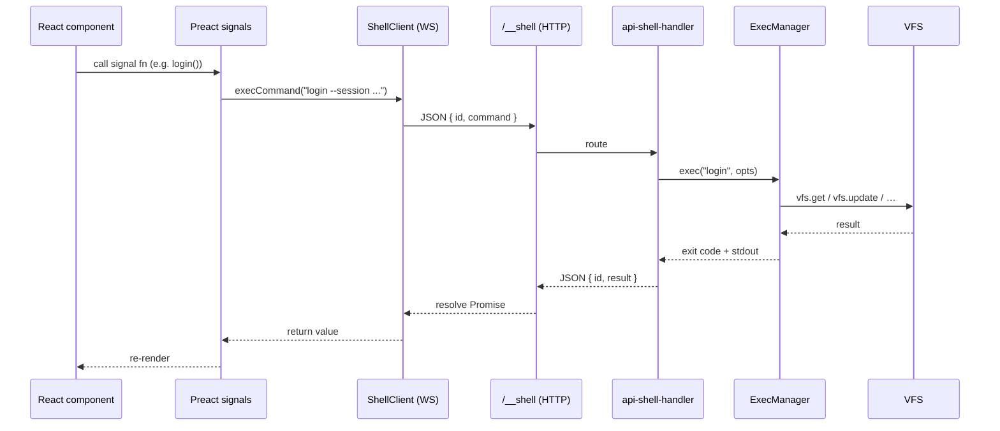

# UI Layer

Part of [EiN Architecture](../architecture.md), which holds the core: topology, VFS, registries, managers, commands, node types, boot and servers.



File I/O bypasses the shell and goes directly to the REST endpoints: `GET /file/<path>` to read, `PUT /file/<path>` to write a path (the code editor's save), and `POST /file/<dir>/?name=` for uploads, which never replace a file — a taken name is stored as `name (2).ext` and the answer's `path` says where.

### Uploads

Every upload goes through one queue, `signals/upload.ts` over the pure `lib/upload-queue.ts`.
`addToQueue(files, target, { keepFolders, label })` queues files into a target directory: a path,
or a function that makes or finds it when the first file is sent and answers its path (asked once
for the files queued with it). The queue makes every directory it uploads into itself, with
`mkdir -p` of up to 100 at once (only the deepest of them; a directory above one made is made with
it), before the first file of each goes; a page never runs `mkdir` for an upload. With
`keepFolders`, each file goes into the target plus the folders it was in below what was dropped or
picked: a dropped folder's files carry them as `relativePath` (from the drag's directory entries),
a folder picker's as `webkitRelativePath`; a `..` in them fails that file. Four files are sent at
once, each one `POST /file/<dir>/?name=`.

The queue keeps counters per `addToQueue` batch, changed as each file moves (queued, being sent,
stored, failed, and the bytes), so a progress event costs the same at five files as at five
thousand; the signals are published from them at most every 250 ms:

- `uploadSummary` — `UploadCounts` of every file since the last Clear: `queued`, `active`, `done`,
  `failed`, `renamed` (stored under a numbered name), `bytesTotal`, `bytesDone`;
- `uploadSummaryByTarget` — the same by target directory, with the `label` it was queued with;
  `uploadsUnder(byTarget, path)` (`@ein/ui/lib`) sums the targets at or under a path, which is how
  a staging category counts the uploads into its folders of the day;
- `uploadActive` — the files being sent; `uploadFailures` — the last 200 failures, while every
  failed file is counted and retried; `isUploading`;
- `uploadBatchDone` — once the queue drains, the target directories that took a file (the
  directories given, not the folders made under them);
- `cancelUploads()`, `retryFailed()`, `clearFinished()`.

`UploadDropzone` (`@ein/ui/components`) is the drop target. With `path` (what a page's
`actions.upload` takes) it covers the window and its pickers are raised through `openRef` (files)
and `openFolderRef` (a folder, an `<input webkitdirectory>`); the page header offers the folder
picker as Upload a folder under ⋮ when the action has `keepFolders`. With `targets`, a drag of files
raises an overlay of tiles, one per target, and the files go into the one they are dropped on. The
top bar's `UploadIndicator` shows the summary, each target's progress, the files in flight, the
failures, and Cancel, Retry failed and Clear.

Module API 54.0.0 (a major version) removed `uploadQueue`, `UploadItem`, `overallProgress`,
`activeUploadsCount`, `cancelUpload` and `clearCompleted`, and moved `UploadTarget` from
`@ein/ui/signals` to `@ein/ui/lib`. A module reads progress from `uploadSummary` or
`uploadSummaryByTarget`, cancels with `cancelUploads`, and lets the queue make its upload
directories rather than running `mkdir -p` before queueing.

## User documentation (`/docs`)

The docs section has two halves: a written **guide** and a **reference** read from the running installation, under one `EntityDetailHeader` with a search over both.

**The guide** is end-user markdown in the VFS under `/usr/docs` (`$DOCS_PATH`; not the developer docs in this repo's `docs/`). `/usr/docs` is a plain directory (a read-only mount can't host child links), assembled at boot by [08_docs.sh](../../src/init/files/init/primary/08_docs.sh):

```
/usr/docs/
  guide/            read-only fsmount of repo docs/user (EXTERNAL_DOCS_PATH)
  modules/<name>/   softlink to the module's docs/ (per module, by `mod setup`)
```

The docs source is baked into the image ([src/Containerfile](../../src/Containerfile) `COPY docs docs`) and live-mounted in `make container-run` (`docs/user → /docs-dev`). The sidebar walks `guide/` with `ls -l` (`useDocs`); a module's pages are shown on that module's reference page instead. `DocView` reads a body via `GET /file/<path>`, fills `{{host}}`, `{{ssh.port}}`, `{{user}}` and `{{origin}}` with this installation's values (so `ssh-sftp.md` shows commands that work as copied), and `Markdown` renders it with `react-markdown`: relative image/link URLs resolve to `/file` and to other guide pages, an absolute link to anything but a `.md` file is an app route (`/docs/commands`, `/profile?tab=preferences`), and fenced code is highlighted by `HighlightedCode`.

**The reference** pages (the `docs` routes in [routes.tsx](../../src/builtin/ui/src/client/routes.tsx), [pages/docs.tsx](../../src/builtin/ui/src/client/pages/docs.tsx), components in `components/Docs/`) are generated, never written:

| Page        | Route                                   | Source                                                                                                                                                                                                                                                                       |
| ----------- | --------------------------------------- | ---------------------------------------------------------------------------------------------------------------------------------------------------------------------------------------------------------------------------------------------------------------------------- |
| Commands    | `/docs/commands`                        | `docs commands` — core's per-user command catalogue ([catalogue.ts](../../src/lib/commands/catalogue.ts)): every command on the reader's PATH, its `CmdSpec` and the module whose `bin` it was found in; the search box ranks with the assistant's `assistant-commands find` |
| Settings    | `/docs/settings`                        | `config list`                                                                                                                                                                                                                                                                |
| Environment | `/docs/environment`                     | `docs env`: `CORE_ENVIRONMENT` and each module's `mod.json` `environment`, with the caller's shell values (never for `deployment` variables or secret-looking names), plus whatever the shell has set that nothing describes                                                 |
| Node types  | `/docs/node-types`                      | `docs node-types`: `CORE_NODE_TYPES` and each module's `mod.json` `nodeTypes`, joined with a `vfs.aggregate` count per type, so a type in use but undescribed still shows                                                                                                    |
| Modules     | `/docs/modules`, `/docs/modules/<name>` | `mod list`, joined in the client with the four above by owner, plus the module's own markdown                                                                                                                                                                                |

Each answer is fetched once per page load and shared by every docs page (`useReference.ts`). The header search (`?find=`, not `q`, which the app header's own box reads on every route; `DocsSearch`) ranks every source locally with `textScore` (the `matchesText` rule, name weighted over description, letters-in-order as a last resort) and merges the command index's `find` hits, which search by meaning when EMS can embed. Code is highlighted without an editor: `HighlightedCode` runs the language's CodeMirror parser once and draws `highlightTree`'s ranges as `mrx-tok-*` spans, coloured for both schemes in `theme.css`; a fence without a language is an EiN command line, a small `StreamLanguage` of its own that marks the command word, flags, `KEY=value` prefixes, strings and variables.

**UI structure:** [src/builtin/ui/src/client/](../../src/builtin/ui/src/client/)

- `index.html`, `main.tsx` — the entry: the stylesheets, `lend.ts` (what module bundles read from the shell), and the page's router over `routes.tsx`, which cross-fades to another page (`lib/page-crossfade.ts`): a push or a step through history that changes the path runs as a view transition, whichever link or button took it; a replace, or a change of search or hash alone, swaps in place
- `routes.tsx` — the shell's routes, written out: each path with its page, and `handle: { fullBleed: true }` on the ones drawn edge to edge, which `Layout.tsx` (the app's frame) reads instead of a list of paths — any other page gets an `md` gutter from its wrapper (`.mrx-page`, declared as `--mrx-page-gutter`), not from AppShell's padding, which AppShell slides with the sidebar and the drawer; a module's routes are not here but in its `mod.json`, added from the manifest when first needed (see [modules](modules.md)); a `*` child draws "Nothing here" for a path nothing matches, and the root's `ErrorBoundary` a page that failed to load or draw, both inside the frame (`components/RouteProblem/`)
- `pages/` — the shell's own pages (the home page `/`, docs, login, profile, settings, stats, system and pipelines, nodes), named after what they show, not their path. The rest are their modules', under each module's `ui/pages/`: archive's — at its root `/search`, `/year` and the `/timeline` redirect, the routes that draw its entries on the home page (`/news/album`, `/events/anniversary`, `/onthisday/media`), `/media`, `/map` and `/looks-like` (the Search page's `search.label` panel); under its areas people's (`ui/people/`: `/people`, a person, `/people/unknown`), location's (locations, and tracks: the devices that recorded one), media's (albums, and the lightbox's route `/media/<path>`), staging's and device's — and assistant's (`/chat`)
- `root/` — the favicons, the web manifest and its icons, the link-preview image, copied to the top of the built shell; `public/` the fonts and patterns, under `/public/`
- `components/` — the kit: display parts and the frame (a page that is waiting shows `PageLoader`:
  the mark with its kites lit in turn, a third of them at a time, running round the hat; anything
  smaller that waits — a field, a button, a row, a list's next page — shows Mantine's `Loader`, which
  the theme draws as `HatRunLoader`: the hat's outline with a third of it lit, running round), no module's data or commands (ein/core#442 moved those to the modules that own them — the album card, the timeline cards and feeds, the media grid's cover, time and stack actions, the unknown-people and split-person screens, the event form — and the chat's signals to the assistant). Chart (a line, bars or a pie of labelled values over `@mantine/charts`) and Markdown (sanitized, highlighted, its links and images resolved by the caller), which keep those packages in the shell for module pages, CodeEditor (the shared code editor, below), Layout, Map (plain-leaflet MapView + shape/track/marker layers, shape editor; vendored `leaflet.css`), MediaGrid (and `MediaStrip`, a group's two-row preview), Pipeline, SectionStream (a long list of sections one height until opened, below), ShortcutLegend (a docked line of the keys on screen), Search (the shared `SearchInput`, `SearchPills`, `ListFilterInput`, result cards), EmptyState (what a page with nothing to list shows: a muted hat cluster, a line on how it fills, and the actions that fill it), People (the family tree, drawn from a graph in the kit's own `FamilyGraph` shape, which archive's `person-graph` answer satisfies), Terminal, Upload. Archive keeps its own parts in its `ui/`: the timeline scrubber, the face crop, `EntityPicker`, the current-residents card, the media type filter, the lightbox's sidebar, faces and count toggles, its audio and video players (one transport, `useMediaTransport`), and the album, capture-time and map-state helpers
- `hooks/` — `useSearch`, `useMentionComplete`, `useMediaSelection`, `useSectionSelection` (sections whole, their items one by one, and items taken out, never listing a whole section's items; a range across sections takes the rest of the first, those between whole and the head of the last), `useCommandQueue` (a page's serial queue of commands for decisions drawn at once, which asks before a reload while any waits), `useLasso` (a mouse's rubber band over a page, below), `useDropTarget` (a place pictures dragged on the page drop, below), `useElementWidth`, `usePipelines`, `useNodeEvents`, … (archive's data hooks — `usePeople`, `useLocations`, `useMapTracks`, `useMapMedia`, `useMediaTimeline` and the rest — are in its `ui/`)

## Navigation

The sidebar and the top bar's buttons are configuration, not code. Every module may ship
`ui/nav.json`, linked by `mod setup` as `/etc/ui/nav.d/<module>.json`, and the shell's own is
`src/client/nav.json`, copied into the built shell and linked by boot as `/etc/ui/nav.d/ui.json`; the administrator's `/etc/ui/nav.json` and the user's
`~/.ui/nav.json` are laid over them in that order. `ui-nav` ([nav.ts](../../src/builtin/ui/lib/nav.ts))
resolves the layers for the reader and the shell loads its answer before it draws anything
(`signals/nav.ts`, once the auth check says who reads). One format for all of them:

```json
{
  "sections": [{ "id": "browse", "label": "Browse", "order": 30 }],
  "sidebar": [{ "id": "archive.devices", "section": "browse", "label": "Devices", "icon": "device-camera-phone", "to": "/devices", "order": 50 }],
  "topbar": [
    { "id": "ui.create", "title": "Create", "label": "Create New", "icon": "plus", "order": 20 },
    { "id": "archive.create-album", "parent": "ui.create", "title": "Album", "icon": "photo", "color": "blue", "action": { "dialog": "/albums/new" } }
  ],
  "panels": [{ "id": "archive.duplicates", "slot": "nodes.tools", "label": "Duplicates", "icon": "copy", "route": "/duplicates?path={path}" }],
  "hide": ["archive.albums"]
}
```

A **panel** is a module's route drawn inside another page, at a place the page
names (`slot`), so the page shows the module's part without knowing the module: `nodes.tools`, a
tool in the node explorer's tool pane, whose route gets the current row's path for `{path}`
(archive's Duplicates); `system.tabs`, a tab of the system dashboard (ems's media service);
`system.overview`, gauges beside the host's CPU and memory on the dashboard's overview (ems's GPU);
`stats.sections`, a section of the statistics page (archive's life events; drawn at once, while
core's node charts stand as skeletons until their count is in); `search.explore`, a
section of the Search page before anything is asked (archive's people, places, years and labels); `search.label`,
drawn above the Search page's results while it asks for exactly one label, whose route gets the label's
tag directory for `{path}` (archive's "Looks like", for the signed in); `home.start`, a way to
begin under the home page's News while it is still empty (archive's Import media, for the signed in); `about.services`, a
tile on the About dialog for a service EiN uses (ems's media service, the assistant's language model). The page draws each
with `RoutePanel` (`components/Surface/`), the surface router of the dialog and the drawer with a
`panel` kind: no frame of its own, and a navigation that leaves the route opens on the page. A route
an answer names is drawn the same way — a chat card, an entry on the home page — and where the
page's own loader and error would not fit, as in a list of entries, `loading` and `failed` say
what stands in for the route while it loads and if it fails. A panel's route must not share its
first segment with the pages it links to, or the link opens inside the panel.

An entry is known by its id (`<module>.<name>`): a later layer naming an id changes the fields it
gives and keeps the rest, a new id adds an entry, `hide` takes entries (or whole sections) away. Two
modules giving one id is a warning and the first keeps it; an overlay may change anything. Entries
marked `admin` are left out for everyone else, those marked `signedIn` for the guest (a top-bar
dropdown takes its rows with it), and an entry missing a field, naming an unknown
section or an action of no known kind is left out with a warning (`ui-nav` prints them; the browser
logs them). A top-bar entry is a button, or a dropdown when other entries name it as their `parent`;
`phone: false` leaves it out below `sm`, and `place: "search"` stands it beside the search box rather
than with the others on the right. A button or row may name a `shortcut` (`alt+R`, Mantine's hotkey
form): `ui-nav` keeps it for the first entry in top-bar order to name that key, and drops it with a
warning from a dropdown, a later entry, a key it cannot read or one of the shell's own (`SHELL_KEYS`); an overlay's `null` takes it away.
The header binds every entry's key with `useHotkeys` (outside text fields; an Alt+letter by the
key's place, since a Mac types another character for it), runs it as a click would, and shows it in
the tooltip and beside a row; the `?` overlay lists them with the app's own keys
([signals/shortcuts.ts](../../src/builtin/ui/src/client/signals/shortcuts.ts)).

What a module gives the UI is navigation entries and routes, nothing else, and an entry's action
says where to open a route — the same route can be shown all four ways:

- `{ "navigate": "/devices" }` opens it as the page;
- `{ "dialog": "/devices/new" }` opens it in the shell's dialog, over the page;
- `{ "drawer": "/chat" }` opens it in the shell's side drawer, or closes the drawer when it shows
  that route already;
- `{ "fullscreen": "/media/…" }` opens it full screen, over everything, until Back or Escape;
- `{ "run": "album-random", "navigate": "/albums/{path}" }` runs a command and opens what its JSON
  answer says (`{key}` filled from the answer, URI-encoded; a `null` leaves the segment empty).

Search, the upload indicator, the terminal and the account menu are the shell's own, fixed parts of
the top bar; the terminal is a keyboard tool, left out on a phone. The Create menu is the shell's dropdown (`ui.create`) with no rows of its own: each
module adds a `dialog` row for its `new` route — `/albums/new` (media), `/people/new` (people),
`/locations/new` (location), `/devices/new` (device; its list page opens it with a scan proposal's
make and model in the query). The random-album button is media's, beside the search box: `album-random`
and the album it names. The account menu is the shell's dropdown too (`ui.account`, signed in only), drawn on the
reader's avatar rather than as a button of its own: the rows modules give it, the reader's own
pages, stand under _Me_ and above the shell's own rows (Profile, Trash, Shortcuts, About, Logout) — media's Favourites.
Staging, the reader's own inbox and a place of daily work, is a sidebar entry instead, below Media in
the `main` section, shown to the signed in only; its Import media is a row of the Create menu, which
opens the `/staging/import` route as a dialog.
A member of the `sudo` group also has _Administer…_ there, which asks for their password again
(`ElevateDialog`, `user-elevate --session`) and loads the page again as the administrator; an
elevated sign-in has an orange ring round the avatar and a shield at its lower left, and
_Leave admin mode_ in its place.

The account menu's _About EiN_ opens the shell's `/about` route in the dialog
([pages/about.tsx](../../src/builtin/ui/src/client/pages/about.tsx)): its header is a hero band
(`AboutHero`, the route's `handle.hero`), the mark and the name over the hat field in all of the
mark's colours; then what EiN is in two short paragraphs, tiles for core's
version and commit, the module API and the uptime (`system-info`), every installed module with its
version and the module API range it is written against (`mod list`, which lists modules only), the
`about.services` panels, and in the bar at its foot the host, instance, PostgreSQL and Deno
versions. It stands on the page's own ground (`ground: 'base'`), since its tiles are raised cards. It is 1040 px wide
(`ABOUT_WIDTH`, a `dialogSize`), and from `md` the modules stand in a column beside the rest
(`.mrx-about-body`), so a laptop screen shows all of it without scrolling; below that it is one
column.

**Dialog, drawer and full screen** ([components/Surface/](../../src/builtin/ui/src/client/components/Surface/))
each render their route with a router of their own — a memory router over the shell's route
table, with module routes patched in as for the page, started only once its `RouterProvider` has
subscribed (one started when made can finish before then under a page drawn in a transition, and
the provider never hears of it) — inside the page's router, with its location
and route context hidden so the inner router neither refuses to nest nor resolves against the
outer match. A navigation inside that leaves the surface opens on the page instead: in the dialog
any navigation (the dialog closes), in the drawer and full screen one outside its route's first
segment (the chat moving between `/chat/<id>`s, the lightbox between `/media/<path>`s, stay). A route asks where it is with `useSurface()`
(`kind`, `close()`, `openPage(to)`; on a page `close()` goes back), and gives the dialog its title,
icon, pattern and size in its `handle` (`{ title, icon, pattern, dialogSize }`), and may give a
`hero` component for a band of its own in place of the icon and title, and the `ground` it stands on. The drawer keeps the
width it was dragged to in localStorage; it and its top-bar button, lit while it is open, step
aside on its route's own page — the chat page is the drawer's chat at full size. The drawer
slides over the page, and the page makes room for it once it is in and takes the room back the
moment it starts out (`drawerRoom` in `Layout.tsx`): the page lays out once each way rather than on
every frame of the slide, which on a grid of pictures is what made it judder. Below `md`, where the
drawer covers the page, it is a history entry: opening it pushes the page's own location with the
drawer's route in its state ([lib/drawer-entry.ts](../../src/builtin/ui/src/client/lib/drawer-entry.ts)),
so Back closes it, and `DrawerHost` keeps it in step with the entry the page steps to — Back and
Forward bring it to what the entry holds, and another page opened over it (a link out of the chat)
closes it, so the page never changes out of sight beneath it; a replace that keeps the page's path
leaves it be. Beside the page it is no part of history. The kit's
`CommandForm` is what the `new` routes are built with: fields (`FormFields`: text, textarea, number,
select, timezone, checkbox, coordinates with a map), a command made from them, and a page to open
when it has run; as a page it heads itself with the handle's title.

**Every dialog is a `Dialog`** ([components/Surface/Dialog.tsx](../../src/builtin/ui/src/client/components/Surface/Dialog.tsx)),
the route dialog's frame as much as a page's own: a header band over the einstein-hat field (`HatField`)
in a `pattern`'s accent — the pattern of the pages of what the dialog is about, so creating a person is
headed in the people pages' purple, a location in the locations' teal, and a deletion for good in red (`danger`)
— with the kind's icon in a glassy tile of the accent, the title, an optional subtitle (a path, a
count, the question being asked) and badges beside it (`aside`), and the close button, all in white on
the band. Its controls take the pattern's colour too (`PATTERN_CONTROLS`): the primary colour's
variables are re-pointed on the content box, `--mantine-color-<primary>-*` as well as
`--mantine-primary-color-*`, since a control given no colour asks for the primary colour by name, at
the darkest shade of the hue that white text reads on. A disabled button is a step above the
dialog's ground, and a red one red-8, for the same reason. Its buttons are `DialogActions`, the body's
last child: a bar across the foot, over the
same field in grey (`neutral`, `kind='foot'`) that fades out upward — a hint of structure, without
the entrance or the glints — and with a quiet line at its left (`hint`) for what pressing them does.
`onSubmit` makes the body a form, so Enter in a field submits. Widths are four (`sm` 460 px for a
confirmation, `md` 560 for a short form or a choice, `lg` 700 for a form two fields to a row, `xl`
920 for a map or a tool), chosen so a dialog is wider than it is tall: a form's fields stand two to a
row where they pair (`FormField.half`), and a map stands to the right of the fields it goes with, as
tall as they are, until the form is too narrow for two columns (`.mrx-form`, a container query).
Only the body scrolls, between the header and the bar, which stay where they are: the content box
holds the two and does not scroll, and the body has the page's kind of scrollbar
(`bindScrollbar`, below) from the header's foot to the bar's top, its length following the bar's
height. A floating dialog has a hairline edge against the dimmed page, a ring a few steps lighter
than anything in it; a full-screen one is the page and has none. Every close button stands in the
same place, in the middle of a header's height at its top right, a hero band's too.

The full-screen surface lives in the page's URL rather than only in memory: `?fullscreen=<route>`
([lib/fullscreen-search.ts](../../src/builtin/ui/src/client/lib/fullscreen-search.ts)), so opening it
pushes a history entry that Back — a phone's back gesture above all — closes, and a reload or a
shared link opens it again over the same page. `FullscreenHost` follows the parameter; a navigation
that stays inside rewrites it in place, and one that leaves (`openPage`, a link) replaces the
surface's entry, so Back from where it led returns to the page beneath. Escape closes it unless the
route has taken the key itself (the lightbox closes a layer over it first) or it is typed into a
field. Its frame is a full-screen modal that fades in, as long as the lightbox's picture takes to
grow out of its tile. An open drawer stays in view beside it: on a desktop the layout lifts the aside above
full screen to the window's height, and the frame leaves it its width (`fullscreenBesideDrawer`),
neither trapping focus nor locking scroll in it, so the chat can be read and typed in beside the
lightbox. The top bar is covered, so the lightbox carries its drawer buttons
(`DrawerButtons`, the chat's) beside its details button. On a phone, where the drawer is the whole
width, full screen covers it and the buttons are not shown.

**The lightbox is a route**, `/media/<path, URI-encoded>` (media's [ui/pages/media-file.tsx](../../modules/archive/ui/media/pages/media-file.tsx), its bundle fetched with the navigation;
[lib/lightbox-route.ts](../../src/builtin/ui/src/client/lib/lightbox-route.ts)). `openMediaAt(index,
list)` opens it full screen over the page that holds the list — a grid, a map, the chat — and the
lightbox walks that list (`albumMediaList`, `currentMediaIndex` in
[signals/album.ts](../../src/builtin/ui/src/client/signals/album.ts)); arrowing replaces the route, so the
URL names what is shown and one Back closes the whole visit. Opened by its URL — a reload, a link,
or `/media/<path>` as a page — it walks the list the page behind offers from that file
(`offerLightboxList`; the timeline offers its list while it is up), whether the list or the route
arrives first, and shows the file alone until then. When the route goes,
by Back or a close, the grid it came from shows where it was left and the picture shrinks back into
its tile. The grid scrolls the tile into view only once the route has left the URL, and marks it
`data-lightbox-returned` then; the shrinking picture waits for that mark, so it lands where the tile
ends up.

Icons are Tabler names (`map-pin`; `heart-filled` for the filled set), drawn by `TablerIcon`, or a
VFS path to an SVG, drawn as a mask in the text colour. The build copies every Tabler SVG beside the
app (`icons/tabler/`), and `lib/tabler-icons.ts` fetches the names a page asks for in one moment as
one `ui-icons` call over the WebSocket and keeps them in localStorage. One request per icon was
tried first: on fry each small static file takes 0.1–0.4 s, and a page's cover downloads held the
browser's six connections while the icons waited, so the sidebar was drawn half without them.

`AppNavbar` groups the pages under the sections' headings, each of which folds
its group away (remembered in `ein.nav.folded`); a folded group still lists the page you
are on. The list scrolls inside the navbar when it is taller than the window. The toggle at
its foot switches to a 72 px icon rail that shows every icon whatever is folded, rules
standing in for the headings. The shell's own entries are grouped by what you came to do, not by
what exists: a home, then querying the archive, then walking its collections, then operating the
thing — Media sits up top because it is the page most visits are for, Devices beside Locations as
what took a picture and, through its track, the other half of where. Nodes and the dashboard are
`admin` entries; Settings stays for everyone, whose Modules tab is not an administrator's alone (its System, Users, Groups and Permissions tabs are drawn for the administrator only). The rail always sits beside the page and pushes it
(`sidebarCollapsed` from `sm` up, `mobileSidebarRail` below, where it is the default); on a
phone the layout drops the navbar's breakpoint so Mantine offsets the page by the rail there
too. There the header's mark, in place of a burger, shows and hides the rail
(`mobileRailHidden`; hidden — the default, since a phone's pictures want the whole width — the
page takes all of it). Below `sm` the labelled list is
a full-width menu over the page instead: the mark opens and closes it, choosing a page closes
it, and "Show labels" on the rail opens it. All three choices are kept in `localStorage`. On a
phone a one-finger swipe to the right across the page or the sidebar does what the mark does to
bring the menu out, and one to the left puts it away (`lib/sidebar-swipe.ts`) — not while a route
is full screen, whose lightbox swipes between pictures, nor under the drawer. A touch that
something under it takes sideways for itself is left alone: a field, an element whose
`touch-action` refuses a sideways pan (the map, the time rail, a story), or one that scrolls
sideways.

On a phone (`usePhone`, below `sm`) a dialog fills the screen, its bar at the foot of it, and one
that only confirms (`floating`) stays a box over the page; either way its buttons, fields,
checkboxes and segmented controls are a step larger to touch, a field's text is 16 px, below which
a phone's browser zooms in on the field it is typed in, and the bar's buttons share its width. The
top bar's create and account menus (`.mrx-topbar-menu`) are wider with 48 px rows. Tabs with a left icon (person, location, device, staging, system, profile) show only their icons
there, the selected tab alone keeping its label, and share one line; a `theme.css` rule on
`.mantine-Tabs-tab` does it for every such tab list, so a new one needs nothing.

## Signing in, and the guest

`Layout.tsx` asks `user-whoami` who reads before it draws anything (`checkAuth`). Someone signed in
gets the app. Anyone else is the guest, sent to `/login` with the page they asked for as `next` —
unless the administrator opens the archive to the guest with `CFG_GUEST_BROWSING`, which
`user-whoami` tells every caller as `guestBrowsing` (read from `/etc` alone, never from the caller's
environment). Then the guest browses what is shared with everyone:

- the navigation leaves out `signedIn` entries: the Create menu, Staging, Favourites, Chat,
  Settings;
- a route whose `handle` says `signedIn: true` still sends it to sign in: profile, settings, trash,
  staging, favourites, the chat and the `new` forms;
- the header has **Sign in** in place of the terminal's toggle and the account menu, and
  `Terminal` is not mounted, so its shortcuts are gone too;
- the access ids the pages decide by (`useAccessIds`) are the guest's own, and `canAccess` never
  lets the guest write, so what write access offers stays hidden; so do the hearts, since
  favourites live in the reader's home.

The login form offers **Browse without signing in** while the archive is open. Signing in and
signing out load the page again (`location.replace`), so nothing read for one reader — the
navigation, the settings, the access ids, what the pages hold — is shown to the next.

A share link lands on `/s/<token>` (`pages/shared-link.tsx`), drawn outside the frame like the
login page: it runs `share-link open <token> --session` and loads the page of what the link opens
afresh (`openRoute`), so that page is read as the link, or says the link no longer works and
offers signing in. A visitor's session acts as one link, the one opened last, which `user-whoami` gives
(`heldLinks`), answering as the guest; someone signed in stays themselves and sees what their account
does; while visitors may not browse, a visitor holding it (`linkVisitor`) is let onto the
pages under what it opens (`withinRoute` against `heldLinkRoutes`) and nowhere else: any other page,
the home page too, asks them to sign in for it, as it asks any visitor, there is no sidebar, the header has the mark and
the name and no search box, and the lightbox shows no details — only the pictures, with Download in
its ⋮ menu as for anyone. Signing in from a link becomes the account.

## Toasts and favourites

`notify({ message, color?, action? })` (`signals/notify.ts`, drawn by `ToastHost` in `Layout.tsx`)
says at the foot of the screen that something happened and offers the one thing worth doing about it,
most often Undo; it leaves after four seconds, eight with an action, and taking the action dismisses
it. `notifyProgress({ message, progress, action? })` follows a long piece of work instead: a bar under
the message, `update` as it goes ("Filing 1,840 of 9,830 photos · 37 of 214 groups"), an action that
does not dismiss it (Cancel), and `finish`, which turns it into an ordinary toast that leaves by itself
(with Undo all, say). It is Mantine's `Notification` in a small host of the shell's own, so a page or module needs no
package to raise one.

Favourites are core's stars: `star <path>...` links each into the reader's `$HOME/stars`, `star -d`
takes them out, `star list` answers `StarEntry[]`. `signals/stars.ts` reads them once into
`starredPaths` and changes it at once on a heart (`setStarred`, put back if the call fails). The grid
reads the set once and passes each tile `starred` (the tile draws a heart in its lower-left corner),
the selection bar's first action is Favourite — Unfavourite when every selected file is one — with an
Undo toast, the lightbox has a heart in its bar (`s`, and in the phone's ⋮ menu), and archive's
`/favourites` lists the stars as an album lists its members.

Every media list's selection bar (archive's `MediaTimeline`) also offers **Add to album** — find an
album by name (`completion-entity`) or make one with the name typed; `album add <album> <file>...`
links the files where the album keeps its members (the album, or an imported album's `files/`) —
a staged file moves there instead, and the lists showing it drop it (archive's `mediaMoved`) —
skips what it already files, refreshes the span, and the toast's Undo removes the new links and
moves the moved files back —
**Set location** — a known place from `location-list` or a point on the map, one
`file-set-position <file>... --lat= --lng=` for them all — and **Label**.
The three take the paths and an `onDone` rather than a selection, so the lightbox offers them for
the one picture it shows: rows of its ⋮ menu (`LightboxActionItems`, which gives them the selection
bar's `menu` layout through `SelectionBarContext` and turns an error into a toast), below its own
rows — the faces, fullscreen, and Download, which saves the original. An album's Edit
changes its name, description and span (`album set`; the span's date fields stop at the first and
last capture, which `album-span --dry-run` answers), a suggested album's only its name (`staging
rename`), and its Upload is a button in the header; Media and Staging have one too, into the
reader's staging, keeping the folders dropped or picked (Upload a folder under ⋮). Upload also
makes the page a drop target (`UploadDropzone`); on a phone its picker offers the phone's photos
and camera.

Delete in the selection bar moves the files the list holds to the reader's trash (`trash put`) and
takes out of the album the links that only file a picture there; nothing asks first, since the
toast's Undo restores the files (`trash restore`) and puts the links back. Move to trash under an
album's, person's, location's or device's ⋮ moves it to the trash the same way. The shell's
`/trash`, opened from the account menu, is the trash directory itself (`~/.trash`) in the nodes
explorer's tree, each entry's row named by where it came from, with a tool pane beside it that
previews the selected node and restores or deletes for good what the selection is in; the page bar
restores everything or empties the lot. Deleting for good always asks first, and counts what is in
each batch. A batch — files discarded together, such as the drops of `merge-duplicates` — is a
directory in that tree whose row reads as its label (or "Removed together") and how many it holds,
and whose children are its entries. Restoring a batch brings it back 500 entries to a
`trash restore <batch> --limit 500` call until none remain; an entry inside one is restored or
deleted alone by its `<batch>/<entry>` id.

## The finder and shortcuts

The top bar's search box is the finder (`components/Layout/HeaderSearch.tsx`): a list under it
while it has focus, wider than the box on a desktop, the screen's width on a phone. Mod+K focuses it,
or, where something lies over the box — a dialog, the lightbox or another full-screen route, or for a
visitor held to a share link, who has no box — opens the same finder in a dialog of its own
(`components/Palette/CommandPalette.tsx`, mounted in `Layout.tsx`, with the hotkey). Whether the box
can be reached is asked of the page at that moment (`openFinder`, `signals/palette.ts`: the element
at the box's centre), so a new overlay needs nothing of its own.

Both draw one list (`useFinder`, `FinderRows`). With nothing typed it lists the sidebar's pages and
the top bar's actions, Create's and the account menu's rows among them, straight from `uiNav`, so a
module's entries are there without the module doing anything; an entry runs through `runNavAction`
as its button would. Typed words give two searches first, _Search for_ the words (the Search page)
and _Pictures of_ them (the media), then the pages and actions they match (`matchesText`) and the
albums, people, places and devices whose names match (`completion-entity`, opened with `openRoute`).
The first row is lit, so Enter takes the words to the Search page, as it always has from this box,
and never guesses which hit was meant; arrows choose another row. A query starting with `>` is for
commands: the ones `docs find` ranks for the words after it, each opening its reference entry
(`/docs/commands#cmd-<name>`) rather than running. Nothing but the cached entity catalogues is read
for plain words, so the box stays cheap to type in. A line at the list's foot says how to reach the
commands. A chosen row empties the box and lets go of it; Escape closes the list or the dialog.

`?` outside a text field opens the keyboard shortcuts (`ShortcutHelp`). A component says what its
keys do with `useShortcutHelp(group, entries)` for as long as it is mounted — the media grid, the
lightbox, the memories story, the nodes explorer — so the list is what is on screen; the app's own
keys (the finder, the help, the terminal's) are always there, with the top bar's `shortcut` keys. It
is only the help: each component binds its keys itself.

## Home

The home page is the shell's ([pages/home.tsx](../../src/builtin/ui/src/client/pages/home.tsx), the
index route, edge to edge) and names no module: modules give it what it shows by command name, as
they give `search` its providers. It opens with the same `EntityDetailHeader` band as the listing
pages, titled Welcome. Under it On this day, one row that scrolls sideways; below that News in the
wider column and Events beside it. Container queries on `.mrx-home` (in `theme.css`) stack the two
columns by the width the page has, the navigation sidebar's taken into account. Each section is
one core command, dated by the browser's own day, painted as its answer lands
([components/Home/](../../src/builtin/ui/src/client/components/Home/)):

| Section     | Command                       | Gathers       | Archive's provider and the route that draws an entry                                                  |
| ----------- | ----------------------------- | ------------- | ----------------------------------------------------------------------------------------------------- |
| On this day | `onthisday <MM-DD>`           | `onthisday-*` | `onthisday-media`: a year that had pictures that day, `/onthisday/media`, a ring round the first one  |
| News        | `news`                        | `news-*`      | `news-albums`: an album somebody made, `/news/album`, who, when, and the pictures that fit the row    |
| Events      | `events --today <YYYY-MM-DD>` | `events-*`    | `events-anniversaries`: a birthday, memorial or wedding anniversary, `/events/anniversary`, the faces |

The commands and the entry shapes are in [modules](modules.md) ("News, events and on this day, by
name"). The page draws each entry with `RoutePanel` at the route the entry names; the route's query
carries what it draws, so the page runs nothing per entry, and a skeleton stands in while the
module's bundle loads and the entry's title if the route fails. Around the entries the page draws
what places them: News is a timeline whose bullet is the author's portrait — `CoverAvatar` through
the account's `/etc/users/<username>/person` link, the account's explicit archive identity — or the
entry's icon; Events is a card that sorts its entries under Today, Coming up (what can still be acted
on) and Recently (nearest first), each with when it falls ("in 9 days", then weeks past a
fortnight); On this day is absent when no earlier year has anything. A section whose command
failed draws nothing but the error above them; an empty News draws the `home.start` panels as its
way to begin. The News row measures itself
with `useElementWidth` and shows only the thumbnails that fit, the last one carrying how many more
there are; the Events row shows the person's face, both partners' for a wedding, and a milestone's
sentence in bold.

The rings are archive's `MemoryRing`, which also head the Media page's unfiltered feed as
`MemoryRings` (from `dayinhistory`). A ring opens its year as a story: archive's route
`/memories/<MM-DD>?year=` (`pages/memories.tsx`), opened full screen so Back closes it. It reads
`dayinhistory` with more pictures a year, and shows them one at a time on black with the
lightbox's Ken Burns motion, newest year first from the ring's year, a bar per picture across the
top filling for five seconds. A tap on the left third steps back, anywhere else on; a held press
pauses, as do space and the pause button; the arrows step. After the oldest year it closes. Its
other button opens the lightbox over every picture of every year, at the one showing.

## Entity detail headers

Album, person, location, device and track pages share `EntityDetailHeader`: the
entity's explicit `coverPhoto` fills the band, sharp, under a shade that deepens toward the title,
with the hat lines as a white strip fading in from the left. The cover is drawn once: the square
avatar is left out when there is a cover, except on a person's page, where the cover is usually a
face crop (`person-cover`) — the avatar draws the crop and the band the photo it was cut from
(`useCover`'s `sourcePhoto`), since a 384 px crop stretched across the band is a blur. Without a
cover the avatar stands in (the page's fallback, or a location's map).
The title, metadata, page actions and any page-level controls sit in that band. The controls
row under the title is for what the page shows — an album's match badge, sort and media-kind
filter, which on a page with tabs stand at the right end of the tabs' row instead — and the actions are the header's corner, given as `PageActions` and laid out the same on
every page (`EntityDetail/HeaderActions.tsx`): Upload, Share and Edit as buttons, in that order,
then ⋮ with the page's own items and Move to trash last. Where the header is 520 px or narrower
the buttons fold into ⋮ as its first group, so the corner is ⋮ alone. Edit is a dialog on every page (`AlbumEditModal`, `PersonEditModal`,
`LocationEditModal`, `DeviceEditModal`), and an album, person, location and device each offer
Share, Edit, Add event (`EventModal`, `person-add-event` on the node) and Move to trash. An
album in a series shows the albums before and after it above its dates and title, each with its cover and
name (`AlbumSeriesLinks`, read by `useAlbumSeries` from `album info`), and its Edit dialog picks
them.
What changes the entity — editing it, its events, cover, sharing, uploads, the trash — is offered
only to a reader who may write its node (`canWrite` on the ownership its answer carries); anyone
else gets the page to look at. The media grid's selection does the same per file: Set time, Set
location, Label and Delete are offered only when the reader may write every selected file
(`canWriteEach`), which each search hit and `--layout` row says through its `ownership`. For such
a reader the album page also locks the tiles (`MediaGrid`'s `markPinned`) and folder cards of what
keeps its own sharing, from the hit's or row's `pinned` and the listing's `accessPinned`. Add to
album lists only the albums the reader may write (each `completion-entity` hit carries its
`ownership`; one named exactly is shown as view only, so no second album of that name is
offered), and a `device-scan` proposal offers Add fingerprint only when the reader may write the
device it names (`existingOwnership`).
Every sort or filter choice in a header is a `HeaderChoice` (`EntityDetail/HeaderControls.tsx`):
the Select or SegmentedControl in full, or folded to an icon button with a menu
(`.mrx-header-wide`/`-narrow`). A page with more than one choice wraps them in `HeaderChoices`,
which folded is a single button whose menu has a labelled section per choice (it renders its
children twice through a context, so it holds nothing but `HeaderChoice`s). List pages put the
filter box and those choices in a `HeaderFilterBar`, which keeps them on one line at any width:
the box shrinks to a minimum (240 px, 360 px for a search box with its buttons), and past it the
bar folds its choices (`data-collapsed`). It measures them in full on every render and whenever
its width changes, so a desktop window too narrow for them folds them as a phone does. Outside a
filter bar a choice folds when the header's container is 520 px or narrower. Scrolled down, every
page's `EntityDetailHeader` stays on screen as its last row (`data-row`): the tabs, else the
controls (a list page's filter bar), else the title. It sticks itself (`data-sticky`, the frame when
it has an edge) with its top as far above the app header's foot as the row sits below the header's
top, less the band's inset, so all above the row goes on under the app header; once only the row is
left (`data-stuck`) what is above it fades, and so does an avatar beside a controls row. The row
keeps, at its right end, ⋮ with every one of the page's actions in it; where the header is wider
than 720 px the page's name, cut off after 28 characters, slides in at its left end as the row's
content moves aside for it, and back out when the header comes unstuck. The row leaves them the
room (`--mrx-header-start`, `--mrx-header-end`). A route in
a dialog or drawer does not stick: it scrolls in its own box. The row's height is
`stuckHeaderHeight`, which `useHeaderHeight` adds to the app header's, and `--mrx-stuck-header-height`
for a stylesheet, so the timelines' sticky dates and rails, the return to a tile, the docs contents
and the settings categories stop below it. While the header scrolls, `--mrx-header-hidden` says how
much of it is under the app header, and the backdrop's top follows it, so the Year page's histogram
shrinks into what still shows. The band's inset at the sides and foot (`--mrx-header-inset`) is the
page body's padding, so the header's controls line up with the content. A query changed from a
filter bar while the page is scrolled goes back to the top, where its answer starts. A page scrolled a screen down offers Back to top
(`BackToTop`, from the layout), back to the header's actions: a round button in the page's lower
right corner, beside an open drawer and under it where it covers the page, and gone while a
selection bar is up. A timeline's rail ends above it (`--mrx-scrubber-bottom`).
**The page's scrollbar is the shell's** (`PageScrollbar`, from the layout, drawn by `bindScrollbar` in
[components/Layout/scrollbar.ts](../../src/builtin/ui/src/client/components/Layout/scrollbar.ts),
which also draws a dialog's and the terminal's, inside xterm's element in the gutter xterm keeps
for a bar). The page scrolls on
`<html>` and the browser draws no bar for it, since one that comes and goes — with the page's
length, a dialog's scroll lock, a time rail — changes the width of the page and of the top bar.
The shell's bar is a thumb over the page's right edge, from the app header down and beside an open
drawer; it takes no width, so nothing moves when it comes or goes. It is there while the page is
longer than the window, follows the scroll, and can be dragged or pressed on its track; by touch it
shows only while the page scrolls. A box that scrolls inside the page does so in Mantine's
`ScrollArea`, whose thumb is drawn the same (`theme.css`: no track, the same width and colour), not
in the browser's own bar: the chat's recent chats, the users, groups and modules in Settings beside
the open entry (`PaneScroll`). What scrolls on its own inside a dialog without one, an editor, has
a thin bar in the thumb's colour.
**A box is bordered when it is worked in.** A box on the page is a raised surface (`Paper`'s default
in `theme.ts`); one that holds what the reader works in — a list to filter and pick from, a form,
an editor — also has a hairline border (`withBorder`): Settings' fields and lists, the profile and
login forms, the recent chats, the people, device and location editors, staging's suggestions and
duplicates, the suggested locations on a location's page. One that is only read, as the home page's
cards, the docs' reference cards and the system dashboard's are, has none. What it takes to be
worked in:

- Fields to fill in, or entries to pick or decide on one by one: the owners, residents and homes
  lists, whose rows open in the editor above them, or a pipeline's instances, ticked to rerun or
  remove. A button or a link offered beside what is read does not count (a service's restart,
  "Link existing media", "All owners"), and neither do controls that change only how the box shows
  what it holds (the log's level filter and pause).
- It counts only while the reader can do it. A box that turns into a form when editing, or whose
  rows only someone who may change them can pick, is bordered only then
  (`withBorder={editing}`, `withBorder={editable}`).
- Tiles in a grid are entries, not boxes — entity and album cards, unknown people, voices, the
  trash, a device scan's proposals: none is bordered, and a pick shows as an outline. Parts of a
  read box are not boxes inside it either: the media service's lanes are columns of its Executing
  card.

An overlay — menu, popover, dialog — has a shadow instead. On a phone a box that would fill
the page's width is no box: Settings' users, groups and modules lists and panels drop the border, the
surface and their padding there, so what they hold uses the width inside the page's gutter.
A page whose body is a tool that wants the height — the chat, the nodes explorer — opens with `PageBar`
instead (`EntityDetail/PageBar.tsx`): the same pattern band, one line high, with the title at the
left and the page's controls at the right, wrapping below the title when they do not fit. The chat
page's bar holds the new-chat button (and the recent-chats menu on a phone), with the recent chats
beside the chat in a bordered box under a filter over their titles. The map page has no header at
all: the map fills the page under the app bar. Its type menu (`MapTypeMenu`) and base-map picker
(`MapBaseLayerPicker`) are stacked buttons in its top-right corner; the picker shows each base layer
as one tile of where the map is looking rather than by name, and replaces Leaflet's own switcher
there (`MapView`'s `layerSwitcher={false}`; its `baseLayer` follows the URL's `base`, and without
one is the street map, the first of `BASE_LAYERS`, in either colour scheme; the dark canvas is a pick
in the picker). The search
box and year slider float over the foot of the map as one translucent panel (`.mrx-map-search`),
the box above a hairline and the years below it, on the same kind of track as the Year view's: a
step per year that holds pictures. The box is a search, not a filter, and is worded
as one ("Search this view"): the map holds cell counts rather than pictures, so there is nothing in
the browser to narrow as you type; its text is sent on the arrow or Enter to `find-within --q`,
which runs the full `search` (embedded, ranked, capped at 500) inside the view. People, locations and
labels picked with `@` go as `--person`/`--location`/`--tag` id sets; the years and the type apply
at once.
An album's, track's or person's description in the header is a `HeaderDescription`: the start of one
line, at most 24rem wide, as plain text (`plainMarkdown` takes the Markdown marks off), and when cut (or broken into
lines) a click opens the whole text, as Markdown, in a dialog. Text people write — descriptions of albums, files, people,
locations and devices, and events — is Markdown: typed in the kit's `MarkdownEditor` (CodeMirror with a toolbar and a
preview), shown by `Markdown` with `breaks` (every line break kept, a legacy `<br>` one too; archive's `UserText`), and
as `plainMarkdown` where only a line of text fits, on cards and in hover titles. A person's header carries names, years, current home, contacts and the photo
count, and leaves out gender; below `sm` it drops the contacts too. The person page's Info tab
(`PersonInfoTab`) lists everything `person-info` returns — names, gender, full dates, every contact
with its type, allergies, homes with their spans, family links and the whole description — on
every screen size.
A location's and a device's pages follow the person's: tabs in the URL (`?tab=`), opening on Info.
A location has Info (map, details, current residents, geocoding suggestions to pick), Timeline
(`location-timeline`), Media and Residents; its Edit dialog (`LocationEditModal`) writes the
details through `location-update` and the shape through `position-set <location>/position`. A device has Info (settings,
relinking, current owners), Timeline (`device-timeline`), Media, Track (the route it recorded,
`track-read`; a track's timeline entry opens it, and the Map draws every track) and Owners. Residents, Owners and
a person's Homes are the same inline list with the same add/edit/remove, and the headers show
the current ones (`CurrentPeopleLine`) as a person's shows their current home. The three
timelines are one hook, `useSubjectTimeline`. A location with coordinates and no cover photo draws
its card's `StaticMap` as the header background and avatar (`coverArt`).
An album's page keeps a listing page's height of band (`flowContent`) and has its tabs in the URL
too, opening on Media: its folders and its media by day, with the sort and media-kind filter in
the header's controls, at the right end of the tabs' row, while that tab is open; Map, its positioned media clustered by the server as on the Map page
(`find-within --under`, `AlbumMap`), with the routes the devices recorded over its span, fitted to
both; and Info (`AlbumInfoTab`, in the person's `InfoSection` boxes), its dates, media by kind and
how many are on the map, its description, and the people, places, devices and photographers of
its media (`subjects-in`) and their labels, each opening its own page and its count a search of
the album's media that have it.
Pages without an owning VFS node can omit `path`, and pages that do not need an
identity image can omit `fallback`; neither case attempts a cover lookup. Entity
search uses this form for its compact search input, type selector and active
filter badges. Its flow-based content may grow instead of clipping wrapped
filters on a narrow screen.
The listing and tool pages — Albums, People, Locations, Devices,
Search, Year, Media, Staging, the system dashboard and Statistics — open with
the same band in its `flowContent` form over the einstein-hat `pattern`, their title, filters and
page actions (Staging's upload) in its controls, and a line of what the list holds (`HeaderStats`,
worded with `countOf`: `3,611 albums`). It is no taller than they need with some room above the
title (`clamp(128px, 13vw, 184px)`), since the page below it is what was asked for; the Year view,
which stands its year, histogram and slider in the band, keeps `clamp(182px, 22.4vw, 280px)`.
The pattern is `HatField`, an inline SVG laid out by `lib/hat-field.ts` from a patch of the hat
tiling (`lib/hat-tiling.ts`) each time the band changes size: hats about 38 px across, cut from the
patch at a place picked by the accent and the route, so a page keeps its field and pages differ.
The field covers the band edge to edge: its hats run on past the top, the sides and the foot and
are cut there, and every tile is filled with the page's accent, more on the mirrored hats and towards the upper right, and outlined. Nothing
shades the band: each tile darkens as a whole towards the foot, where the title and controls stand.
Every tile is its own path, so the field can arrive tile by tile the first time it is shown
(`lib/hat-entrance.ts`): drawn as if by pen and filled from the foot up by default, or falling,
sliding in from the right, sweeping, growing, rippling, snapping in or lit by a wave, as the person's `CFG_USER_HEADER_ENTRANCE`
says, and over as many milliseconds as `CFG_USER_HEADER_ENTRANCE_TIME` gives it (450 unless set; at 0
it does not arrive at all): the timings written for an entrance are scaled to end then. The animations end on the tiles as drawn at rest and then come off, and the field is a layer
of its own, so nothing changes on screen when one ends. After it, every few seconds one tile in the
upper part of the band, clear of the title, brightens and fades back; with reduced motion the field
neither arrives nor glints. Over a cover the field is outlines fading out from the left, over the
photo's shade, a gradient that is part of the picture. The header
reads the cover photo's luminance on a coarse grid (`lib/image-luminance.ts`), and each hat's outline
is light grey where the photo under it is dark and the pattern's controls colour where it is light;
over cover art, such as a location's map, which is not one picture to read, they are all grey.
Unless the person's `CFG_USER_HEADER_COVER` is `lines`, such a header is split: in place of the
outlines, a field (`kind='wedge'`) takes its left, on a ground of the chrome's colour that hides the
cover. Its edge is a line across about a third of the width, leaning right towards the foot, so the
wedge is widest there: the band's hats well left of it are whole, and across it they dissolve into
the photo hat by hat, each fainter the further right its middle falls, give or take a little, so the
fade is ragged. The wedge darkens towards its foot as a band does.
A header with a cover photo arrives whole, photo and all. It reads the photo first and shows only its
ground until then; then its field arrives, hat by hat, while the photo fades in over the same time
(`entranceTime`).
The login screen shows the same field, undarkened: on a wide screen as the pane right of the form,
ragged only along its left edge (`kind='pane'`), on a narrow one as the background behind the form,
cut at every edge (`kind='backdrop'`). Either arrives over 2 s whatever the person's settings say:
the pane slides in from the right, the background the way they choose. The mark before the wordmark
(`EinMark`) and the favicon (`root/favicon.svg`) are one hat of it, cut into its eight kites
(`HAT_KITES`) and shaded like cut glass over a gradient from teal to orange; the raster icons beside
the favicon are rendered from it, the app icons on a dark squircle or a full-bleed dark square.
A link to EiN previews in chats and on social sites as `root/og-image.jpg`: the mark and the
wordmark over the login screen's mixed field, 1200 × 630. `index.html` names it in Open Graph tags
as `%EIN_ORIGIN%/og-image.jpg`, because crawlers run no script and want absolute URLs, and the
server writes the origin each request reached it at in its place (`get-default.ts`).
Like Home, the band is edge-to-edge inside the application shell; normal page
padding resumes for the detail content below it. Detail-page breadcrumbs are
omitted because the persistent navigation already provides the collection
route.

A card with no cover draws a hat identicon (`components/Identity/HatIdenticon.tsx`,
`lib/hat-identicon.ts`): the four-hat cluster turned in the tiling's own 60° steps and maybe mirrored,
one hat filled, as its kind and title say — the same card always draws the same one — in the kind's
colour, with the title's initials over it. The People list sorts by how often someone is pictured
(`person-list --sort count`; by name, placeholder names come last) and says that under each name;
an album card's description is its hover text, so a few described albums do not make every card
taller.

A location card with no `coverPhoto` shows its map instead. `StaticMap`
(`components/Map/`) draws the map page's own tiles around the point, with the
pin on top. It draws the default base layer, the street map, in either colour
scheme, and uses plain `` tiles instead of one Leaflet map per card, so a hundred cards start no maps. The
tile URLs are the ones Leaflet uses, so opening the location starts from a warm
cache. It passes through `EntityCard`'s `coverArt` slot, which a real cover
image still wins over.

## Code editor

[components/CodeEditor/](../../src/builtin/ui/src/client/components/CodeEditor/) is one dialog for looking at and editing text — scripts, JSON, markdown, configuration — mounted once in `Layout.tsx` beside the sharing dialog, and asked for from anywhere with `openCodeEditor` ([signals/code-editor.ts](../../src/builtin/ui/src/client/signals/code-editor.ts)). A request is either a `file`, whose bytes the dialog reads from `GET /file/<path>` and writes back with `PUT` (which re-derives size, hash and mimetype), or a `text` the caller already holds with its own `onSave`. `CodeMirror.tsx` wraps CodeMirror 6 as a React control: one view per mount, with language, colour scheme (following Mantine's computed scheme) and read-only state as compartments reconfigured in place. The language comes from [lib/code-language.ts](../../src/builtin/ui/src/client/lib/code-language.ts): the node's mimetype first (the `cat` command's map plus `text/x-shellscript`, which the sniffer reports for any `#!` file), the extension when the mimetype is `text/plain` or absent, so `deno.jsonc` colours as JSON. Ctrl+S saves, closing with unsaved changes asks, and a file over 2 MB is left to its raw URL. Every language grammar is imported statically: the bundle is one file, so a lazy import would save nothing (see `wow/notes/lessons-ui.md`).

## The shell's lists, pages and live views

**Selections at scale.** `useLasso` (`lib/lasso.ts`, pure) starts on a mouse press in the page's
root that is not on a control or anything draggable, once the pointer has moved 4 px; it draws its own
band (`.mrx-lasso`, fixed and moved by a transform, so a frame renders nothing), Shift held at the
start adds, Alt takes away, otherwise it replaces, Escape puts back what was selected, and the click
that ends it is swallowed. Within 48 px of the window's edges (the top one under the page's headers)
the page scrolls at up to 1,200 px/s, and the band grows with it. The page decides what the band takes,
once a frame, from geometry it already holds and never from each tile's layout: `sectionHit` takes a
closed section whose header the band touches or half of whose strip it covers (the stream's
`sectionsIn(top, bottom)` places them by its arithmetic), and `tileIndex` indexes a grid's boxes
(`onLayout`, which now gives each tile's height) by row once, so `tilesInRect` is a binary search and
the tiles crossed, well under a millisecond over 5,000 pictures; `lassoSelection` makes the selection
from the one the lasso started with, and `sameHits` lets a frame that takes nothing new select nothing
anew. Pictures dragged within the page (`lib/media-drag.ts`) carry `{label, count, groups, files,
except}` in the `mediaDrag` signal while the drag data holds only a token (`application/x-ein-media`)
and the count as text, so a target reads what it would receive as the pointer arrives and a drop whose
token is not the one held receives nothing; `startMediaDrag` draws the chip (`lib/drag-chip.ts`, which
the Nodes page's rows use too), `MediaGrid`'s `dragPayload(item)` makes a tile a source (as a rule a
selected one, carrying the selection), and `useDropTarget` takes only such drags and names its action
while one is over it, so Mantine's full-screen dropzone, which takes only `Files`, and the Nodes page's
targets keep theirs.

**`SectionStream` holds the reader in place.** Its geometry is `lib/section-stream.ts`, pure: a
section's top is its index times the closed height (and gap), plus what the open sections above it
add, so the stream has its full height from the first frame, the sections near the viewport
(`useVerticalWindow`) are found by binary search, and only the open sections are measured and kept
mounted wherever the window is. When a section above the one across the reading line (the page's
headers, `useHeaderHeight`) opens, closes, grows or leaves the list, a layout effect scrolls the
window by exactly the difference before the frame is painted; the stream's root sets
`overflow-anchor: none`, so the browser does not compensate a second time. `scrollToKey` brings a
section to the reading line once the change that asked for it is laid out. A closed section's
outline, an image the page gives (`skeleton`), is repeated under the sections, so a fling, which
mounts nothing until it slows, crosses section shapes rather than a blank page. `MediaStrip` is laid
out by `stripLayout` (`lib/justified-layout.ts`): k pictures sampled evenly through the group, k
searched for until the sample fills the rows with none left over, each row filled while its pictures
at their natural width take no more than 115% of it and scaled to the exact width, no tile stretched
or squeezed past 135% or 75% (a crop, the tiles being `cover`), the strip always its rows tall, its
last tile "+N". `MediaGrid` takes a `focusPath` (a keyboard cursor's ring, the tile kept mounted and
scrolled into view), `tileKeys`, `originals` and `onLayout` (the tiles' boxes and the grid's height).
The kit's `useCommand` hangs up a run that a newer one replaces or that outlives its component.

**A prepended page must not move the reader**, whether the list scrolls in the window or in a
column (`usePrependHold`). Three things make that invisible, and all three were measured wrong
before they were measured right:

- **The anchor is the picture at the top of the viewport**, re-measured at every prepend, not the
  first picture in the list. The list's first picture is the one place a justified grid is _not_
  stable.
- **`overflow-anchor: none` on the scrolling list.** The browser does its own scroll anchoring
  when content appears above the viewport; with the explicit correction as well, a prepended page
  moved the reader by exactly twice its height.
- **A prepended page never merges into the bucket it joins** (`bucketByDate`'s `startsSegment`).
  Justified rows are packed greedily from the front, so inserting pictures at the start of a bucket
  re-packs every row after them — 218px of on-screen movement that no scroll correction can undo,
  because the pixels _between_ two visible tiles changed. Cut at the seam, every existing row keeps
  its packing; the cost is one ragged row mid-month.

**A list with a rail hides its scrollbar** — the page's (`PageScrollbar`) while `.mrx-railed` is on
`<html>`, that is while a viewport-pinned rail is mounted, at the same right edge of the page; and
its own, by `.mrx-no-scrollbar`, for a column that scrolls inside something. The rail is the better
scrollbar (it says which years exist and how much each holds), and two vertical bars 15px apart, one
of them inert to a drag, read as a mistake.

The correction itself runs from `useLayoutEffect` and then keeps running until the column stops
changing height (400ms idle, 4s cap), because the prepended grids settle in waves — mount, measure,
then again as pictures decode. It compares frame to frame rather than against a fixed baseline: a
correction is itself a write to `scrollTop`, and a fixed baseline reads that write back as more
drift and applies it again every frame. Measured in production, a 2,125px prepend moves the held picture
0.2px, and each 700px of scrolling moves it 700px.

Two stacking rules that are easy to get wrong. Leaflet numbers its panes and controls up to
`z-index: 1000` and `.leaflet-container` has no z-index of its own, so those numbers escape into
the page — `theme.css` gives the container `isolation: isolate` so the map is one flat layer, and
the lightbox opened from a marker is not painted behind it. Anything a page floats over the map
sits _outside_ that container and so is not covered by it; it uses `z-index: 1` (`MAP_CONTROL_Z`),
because beating one flat layer takes 1 and anything larger climbs over the modals instead. The map
page floats the corner buttons and the search panel, both at `MAP_CONTROL_Z`. Maps have no zoom buttons — the wheel and a pinch zoom them — and Leaflet's layer switcher,
on the maps that keep it, is restyled in the app's dark chrome in `theme.css`.

- `signals/` — `shell-client` (exec + `followLog` + `subscribeNodes`), `user`, `album`, `upload`, `terminal`

**Live views without polling.** The api-shell socket carries `vfs.subscribe`, pushing the full `NodeEvent` (attrs included, access-checked) as it happens — `subscribeNodes` in `shell-client` is the client half, and `useNodeEvents` pools handlers so N views watching one subtree cost one server subscription. Two update strategies, deliberately different: **rows** patch straight from `event.node.attrs`, while **aggregates** only mark dirty and refetch their (indexed, cheap) command on a throttle. Deltas cannot maintain a count — an event carries the node's new status but not its previous one, so there is nothing to decrement. Idle costs no traffic and no queries, which is also why the socket reconnects on close and bumps `shellClientEpoch`: with polling gone, a dead socket is a frozen page and a resync is the only way back.

The system dashboard is built on that: `/system` renders the ordinary commands a shell would run, one fetch each, and has no page-wide loader — every card draws its own skeleton until the answer it depends on is in, so the CPU tile never waits for a cold service probe. `pipeline-overview` (aggregates + queue depths, per-pipeline completion rate and crawl coverage, no directory walk) is refetched on pipeline subtree events. The rest change on a clock with no node event behind them, so they are polled every 10s and paused while the browser tab is hidden: `host-metrics` (CPU, memory, GPU and their history), `df` (storage tiers and database size), `system-info`, `pool-stat` (every pool's counts, per-kind rates and unservable kinds), `service-list --detail` and `dmesg --level warn -n 10`. Each is polled only while a tab showing it is open, except `host-metrics` and `pool-stat`, because the "warming up" badge and the unservable-kinds alarm qualify every tab. There is deliberately no combined command shaped for the page: each of these answers a question worth asking from a shell too, and `top` draws the same answers in a terminal. Starting and stopping a service and rerunning, cancelling, removing, retrying and pruning pipeline instances are administrator commands, so only the administrator gets those controls; anyone else gets the dashboard to read. Drill-downs are nested under the dashboard, at `/system/pipelines/<pipeline>` (that pipeline's instances via `pipeline-instances --limit/--after`) and `/system/pipelines/<pipeline>/<id>` (step rows patched from events). They sit below `/system` because the work tab is the only way in, so the back arrow has somewhere real to return to (`/system?tab=work`); instance routes carry the pipeline name because a bare instance id is shared by every pipeline that processed the same node.

`/system/nodes` is the nodes explorer: every path in the VFS as it is stored, in one pane or two side by side, each holding tabs, each tab an address bar over one Mantine `Tree`. The tree _is_ the view — rows expand in place — drawn as details (name, type, size, mode, owner, group, modified), a plain list, or icon tiles. The details view sorts on a click on a column's name (name, type, size, modified; again for the other direction); the list and icon views, which have no column names, keep a sort menu. The column names' right edges drag to resize ([lib/node-columns.ts](../../src/builtin/ui/src/client/lib/node-columns.ts); the name keeps what is left over, and a double-click puts a column back): the drag writes a CSS variable on the listing, so no row renders until the drop stores the widths in the workspace for every tab. What the reader may do is judged before it is offered, as the server's `verifyAccess` judges it (`canAccess` in [lib/access.ts](../../src/builtin/ui/src/client/lib/access.ts), mode bits and the access list): listing a node takes read and execute on it, so a folder or a node with children the reader may not list shows a lock instead of a chevron, cannot be expanded, and going into it says why above the listing rather than trying; an access or not-found error that does come back is said in words (`describeNodeError`) instead of the VFS's message with its node id. Names starting with a dot are left out of every tab until the eye button beside it, or Ctrl+H in a listing, shows them; the choice is part of the saved workspace, and hiding them drops them from the selection. The address bar has Up and Home, the reader's `/home/<user>`, beside it. A node's glyph is its kind's icon in the kind's colour, the solid Tabler version where there is one, with no tinted box behind it. Each tab's tree ([hooks/useNodeTree.ts](../../src/builtin/ui/src/client/hooks/useNodeTree.ts)) keeps one `ls -lAL` listing per expanded directory and rebuilds the tree data from that cache; Mantine only asks for children of a node whose `children` is not yet an array, so a rebuild carrying the cached listings re-sorts and reloads without refetching what is open. Every open directory has a `DirectoryWatcher` (one pooled `vfs.subscribe` with `recursive: false`) that reloads it at the trailing edge of a burst, and the explorer's own writes bump `listingVersion` for the directories they touched so every pane redraws before the event arrives. Drag-and-drop is native HTML5 on the rendered rows, not the tree's built-in kind, which cannot cross trees and carries one node with before/after positions that mean nothing in a filesystem; a drop is `mv`, a drop with Ctrl is `cp -r`, and `dropAllowed` in [lib/node-path.ts](../../src/builtin/ui/src/client/lib/node-path.ts) refuses a node's own subtree and its own parent before the server is asked. Cut/copy/paste is an in-app clipboard signal. F2 renames in the row itself ([components/Nodes/NodeNameInput.tsx](../../src/builtin/ui/src/client/components/Nodes/NodeNameInput.tsx)): the field stops every key, click and drag from reaching the tree item around it, Enter or leaving it renames, Escape does not, and it stays read-only with the new name until the reloaded listing has the row under it. Rows are set in monospace throughout. The pane with the keyboard sits on the raised surface and the other on the page's; the selection is the cursor, in the accent colour (dimmer in the other pane), and the arrow keys move it — Mantine's tree only moves focus, marking the row with `data-focus-ring`, which the tab view reads to select it; Shift extends and Ctrl moves without selecting — so the focus outline is removed. In the icons view the tiles wrap into rows the tree knows nothing of, so the tab view catches the arrows, Home and End before it and moves by the laid-out geometry ([lib/grid-nav.ts](../../src/builtin/ui/src/client/lib/grid-nav.ts)): up and down to the nearest tile in the neighbouring row. A row's thumbnail or cover waits until the row has stayed on screen for 200 ms (`useSettledInViewport`), the type glyph standing in until then, so a fast scroll through a large directory queues no cover lookups ahead of the rows it stops at. Drilling in on double-click or Enter is the default for every node type, since files hold their thumbnails and metadata as children; the context menu's _Open_ goes to the node's own page, the lightbox for media (a rendition such as a face crop has no `thumbnails/` of its own, so `mediaItemFrom` is told and the raw file is shown), the code editor for a text file ([lib/node-route.ts](../../src/builtin/ui/src/client/lib/node-route.ts); read-only when `canWrite` says the reader may not write it, the server deciding for real on save), a new tab for anything else with bytes, and _Open terminal here_ opens a shell tab `cd`'d to the node or its directory. The properties dialog has three tabs: General runs `stat -L` and `share-info` and edits mode and owner through `chmod`/`chown`; Attributes lists every leaf as a dotted key ([lib/node-attrs-flat.ts](../../src/builtin/ui/src/client/lib/node-attrs-flat.ts)) and writes edits back per top-level key with `attrs -J`/`-d`, since the command takes a key literally; Sharing is the sharing dialog's own body (`SharePanel`, which `ShareModal` now wraps). The page's `PageBar` carries what acts on the whole workspace ([components/Nodes/NodesPageControls.tsx](../../src/builtin/ui/src/client/components/Nodes/NodesPageControls.tsx)): _Split_ opens a second pane at the focused tab's location or, when there are two, closes the one without the keyboard, and _Tools_ shows or hides the tool pane. The tabs stand on the bar's bottom edge ([components/Nodes/NodesHeaderTabs.tsx](../../src/builtin/ui/src/client/components/Nodes/NodesHeaderTabs.tsx), `PageBar`'s `flushTabs`): each pane's strip over its pane and the tools' over the tool pane, laid out by the same column styles as the body ([components/Nodes/columns.ts](../../src/builtin/ui/src/client/components/Nodes/columns.ts)) so a tab opens into what it names; the active tab takes the surface below it; which pane has the keyboard is told by its lighter surface. With two panes each strip ends in a close button for its pane, and panes are keyed by a stored id, so closing the left one moves the right one's trees over with their rows still expanded. A plain click on the listing's background, between or below the rows, clears the selection. The tool pane to the right of the panes ([components/Nodes/NodeToolPane.tsx](../../src/builtin/ui/src/client/components/Nodes/NodeToolPane.tsx)) follows the focused pane: the row that last took the keyboard, which a click and the arrow keys both do, or the tab's own directory when there is none or the selection has been cleared. The active tab publishes that row through `nodesCurrent` in `signals/nodes.ts` with its own _Open_, since the lightbox needs the directory's other media, which only the tab's tree has. The pane waits for the row to stay put for a moment and `stat`s it; it has no header, its first line naming the node with its _Open_ and _Properties_, and under that the chosen tool. _Preview_ ([components/Nodes/NodePreview.tsx](../../src/builtin/ui/src/client/components/Nodes/NodePreview.tsx)) shows a log's last 15 entries newest first, kept live and a logger entry read as `LEVEL name: message` through `log.follow` (`useLogFollow`, which the system log tail also builds on), a queue's next 15 entries from `queue-peek` with its ready, in-flight and dead-lettered counts (peeked, since reading a queue consumes it, and refreshed by hand, since a queue raises no events), a photo, video or audio file from its renditions (the raw bytes for a rendition, or when the rendition fails to load), the first 64 KB of a text file by a range request in a read-only CodeMirror, a PDF in a frame, and an entity's cover, over a read-only summary from `stat -L`; editing stays in the properties dialog. _Attributes_ ([components/Nodes/NodeAttributes.tsx](../../src/builtin/ui/src/client/components/Nodes/NodeAttributes.tsx)) is the node's attributes as one JSON object in CodeMirror, read-only unless the reader may write the node; Save stays off until the text is an object whose keys `attrs -J key=…` can carry (`parseAttrsJson` in [lib/node-attrs-flat.ts](../../src/builtin/ui/src/client/lib/node-attrs-flat.ts)) and writes only the changed top-level keys, as the properties dialog does (`attrsWriteArgs`). It takes only the `stat` of the node it shows — `useNodeStat` keeps the previous answer while the next loads, and `statPath` says whose it is — so a save never writes one node's attributes to another. _Duplicates_ (archive's [NodeDuplicates.tsx](../../modules/archive/ui/media/components/NodeDuplicates.tsx), a `nodes.tools` panel) runs archive's `duplicates` (answers typed in `@archive/media/api`): for a file at once, its identical copies by checksum and, for a picture, video or recording, its similar ones by perceptual fingerprint; for anything else only on request, the media under it with a copy anywhere (`--against /` for the identical scan, which on its own keeps only pairs inside the subtree), kept for the visit. A subtree scan looks up only the checksums or prints of what is within it; `/` is scanned store-wide, and so are the prints of a subtree of more than 20,000 nodes and, with `--against`, its checksums, from those shared store-wide. A found file opens in a new tab beside the one the tool was run from, selected once its listing has the row (`revealNodeInNewTab` and `nodesReveal`). _Sharing_ is the sharing dialog's body, `SharePanel`, as the properties dialog carries it. A first visit starts with one pane at the user's home. Panes, tabs, split, view, sort, whether hidden names show, and the tool pane's width, open state and tool persist in local storage ([lib/nodes-workspace.ts](../../src/builtin/ui/src/client/lib/nodes-workspace.ts), versioned like the terminal workspace; a version 1 record, which always had two panes, comes back as its left pane); only the focused tab's path is mirrored to `?path=`, for linking.

`/settings` is how the installation is configured rather than how it is running, so it is its own page beside the dashboard rather than a dashboard tab: System holds the registry's system-scope settings (`config list --scope system`), Users and Groups are where accounts and groups are made, changed and removed, Permissions holds the system settings that govern accounts — the groups a new account starts in, visitors, default sharing and how long a sign-in lasts — and Modules is the installed modules (`mod list`). All but Modules are admin-only and hidden for anyone else; the server refuses their writes whatever the browser draws. A setting whose type is `user`, `group` or `mode` is drawn with an account picker or the permissions picker ([components/Settings/AccountInputs.tsx](../../src/builtin/ui/src/client/components/Settings/AccountInputs.tsx)) rather than as text. `PermissionsInput` is a row each for the owner, the group and everyone else, each a None, View or Edit control named for assistive technology as "Owner may" and so on, the whole a group named by its setting's label, with the octal under it. A change rewrites one class of bits and keeps the setuid, setgid and sticky bits, and is saved as four digits (`0755`); a draft compares mode settings as modes, so `755` is no change from `0755`.

Users and Groups (`?tab=users`, `?tab=groups`, [components/Settings/Accounts/](../../src/builtin/ui/src/client/components/Settings/Accounts/)) are one `AccountsTab`, kept mounted while either tab is shown, so the lists, filters and what is loaded carry over between them; Permissions (`?tab=permissions`) is `AccountDefaults`. Each of Users and Groups is a list beside a detail pane, with the button for a new entry beside the list's filter; `?user=<username>` or `?group=<groupname>` names the one open and `?new=1` puts the form for a new one in the pane. Where the tab itself is at least 720px wide (`useElementWidth`, so beside the drawer they can take turns), list and pane stand side by side and fill the window below the page's header, at least 420px: `fillWindow` ([components/Settings/ListDetail.tsx](../../src/builtin/ui/src/client/components/Settings/ListDetail.tsx), with the list's frame and rows) keeps how much of the window's height the page takes above and around the split in `--mrx-settings-around`, measured again whenever what stands before it changes size, and the stylesheet gives the split the rest of `100dvh`. List and pane each scroll on their own, never one inside the other, and the page does not; a change of selection replaces the URL, and when nothing is named or the name matches nothing, the first entry is shown, since the pane always has room. Narrower, the list or the pane shows in the page's own scroll, with nothing scrolling inside it, and a name that matches nothing opens nothing. Opening an entry, or the form for a new one, from the list there pushes a history step marked in its state, which Back and the pane's _All users_ or _All groups_ undo, and brings the pane's top into view below the stuck header. Its data is ordinary commands, loaded by `useAccounts`: `user-list` and `group-list --members` (the usernames linked into each group) together, again on node events for user nodes under `/etc/users` and for anything under `/etc/groups`, membership links included, so an account made in a terminal appears, and when the window regains focus; and `who`, for who is signed in now, on its own and without the lists depending on it — a shell opens and closes without a node event, so it is asked again on focus, every 30 seconds while the window is in view, and after every change. Every write goes through the hook's `run`, which answers once a load of the lists started after the command has been drawn — after a failure too, since it may have done part — and calls `reloadIdentities()`, so the owner and group pickers elsewhere in the app have the change. A user's row has the username under the display name, a teal dot on the picture while the account is signed in, and a _No password_ or _Disabled_ badge when it cannot sign in; a group's row has its name under its title and, at its right, up to four of its members' faces, linked or by primary group, and +N for the rest, or _Everyone_ for `users`. An account's status and how it belongs to a group — linked, by its primary group, or by being in `users`, which every account that signs in is — come from [lib/accounts.ts](../../src/builtin/ui/src/client/lib/accounts.ts); a personal group — named as an account, with its uid as gid, as `user-create` makes one — is left out of the group list unless _Show personal groups_ is on (`ein.settings.accounts.personal`), and out of a user's groups unless it is their own or they are in it. A disabled account is left out of the user list unless _Show disabled users_ is on (`ein.settings.accounts.disabled`). Each switch is drawn only when there is something for it to show, and an entry left out is listed while it is open. A session's groups are fixed when it signs in, so every pane that changes membership says the change applies at the next sign-in.

Modules (`?tab=modules`, [components/Settings/Modules/](../../src/builtin/ui/src/client/components/Settings/Modules/)) is laid out as Users and Groups are, from the same `ListDetail` parts and with the same side-by-side and taking-turns behaviour: a list beside the open module's pane, `?module=<name>` naming the one open. The list is `mod list`, asked fresh rather than reused from the docs' kept answer because it carries state, with a module that does not work first: a row has the description under the name and, at its right, the version, or a _Setup failed_ or _Not set up_ badge. _Show only active modules_ (`ein.settings.modules.active`, off by default) leaves out the modules that do not work; one open is listed regardless. The pane has the module's version, core API range, where it is installed, when it was set up and its state, setup's reasons when it failed and a link to its reference in the docs, and under them a tab each (`?section=`, kept when another module is opened; one the module has nothing for falls back to About), drawn only when the module has something for it, with how many: About, the introduction from its guide (`/usr/docs/modules/<name>/index.md`), or that it has none; Dependencies, what it needs and what needs it, each opening in the pane, a missing one marked; Services, with their state now (`service-list`, polled while the tab is open; the controls stay on the system page); Pages (`ui.routes`, a route without a parameter linked); Commands, from `docs commands`; Settings; and Node types. Each is a table. A row of Commands or Settings opens like an accordion (`ExpandRow`), any number at once: a command to its whole help (`CommandHelp`, the docs' own), a setting to its description, where its value comes from and its control (`useSettingDraft`, `SettingInput` and `SettingActions`, as on the System tab), a system setting's control for the administrator only. `mod list` answers each module's `services` (the entries of its `services/`, which `mod setup` registers under the same names) and `routes` for this.

Nothing there is changed in a dialog. A detail pane edits in place; a deletion opens an inline confirmation that says what goes and names the heir, takes the focus on its heir picker, and gives it back to its button on cancel; a change is answered at the control that made it — a loader beside the box, an inline check or alert — and a toast says what a creation or deletion did, a deletion how much it handed over and whether the account's own group was kept. Built-in accounts and groups are marked rather than hidden, with what cannot be done to them left out and a sentence saying why in its place (the administrator cannot be disabled or deleted, the guest is shown only, built-in groups cannot be deleted); a built-in group's pane says what it is for in a quiet line. Membership is changed in the panes and in the forms for a new account or group through `Checklist`: a checkbox per group or account, ticked first in an order fixed while the pane is open, so the box under the pointer stays put, a filter above more than eight, and the reason as text under a box that cannot be changed (a primary group, `users`). A user's pane offers every group but the guest's; a group's offers every account, the guest only while it is linked, and a link left to an account that no longer exists, both to be taken out, and names its primary members with links to their panes; `users` offers nobody, since every account that signs in is in it. A form's Create button, while it cannot be pressed, says why under it. Defaults (`AccountDefaults`) gets the page's one `useConfig('system')` result, shared with the System tab, and draws the account settings as four cards — new users, visitors, sharing and sign-in sessions — each with a hued icon tile and a sentence built from the saved values. Its rows use `useSettingDraft` and `SettingActions`, the draft, save and restore logic `SettingField` uses: the default groups as a group picker, the sharing defaults' owner and group as account pickers and their mode as the permissions picker, and the session lengths as a count with a unit, saved as seconds. A setting the registry lacks drops its row, and a card left with none is dropped.

Archive history is deliberately outside that operational loop. `/stats` fetches `stats-overview` and people's `person-stats` once per visit, in parallel. `stats-overview` groups nodes by both type and VFS `birthtime` month, excluding the operational `tty`, `user`, `session`, `group`, `router`, `pool`, and `queue` types plus `directory` and the noisy `softlink`, `exif`, and `embedding` implementation types. Each included type becomes annual-addition bars with a monthly cumulative line, using the same semantic hues as entity cards where that vocabulary exists. The file series also sums the logical `size` of every file node, including originals, derivatives, and event files, for its full-width storage-growth chart. Legacy imports preserve birthtime through `ownerToProps`, so these series reflect when imported nodes originally joined the old archive rather than when the latest import ran. `person-stats` owns the life events: birth and death month distributions aggregate the canonical `person.born` / `person.died` attrs; marriage and engagement distributions aggregate dated event files by `eventType`. Dates with only a year are counted in `withoutMonth` rather than assigned an invented month. This keeps the statistics page independent of host probes and makes every horizontal axis a real time dimension (calendar year or month of year).

## Metrics

Operational charts come from **one log node per series** under `/logs/metrics`, written by the `metrics-sampler` service ([src/managers/exec/commands/system/metrics-sampler.ts](../../src/managers/exec/commands/system/metrics-sampler.ts)) and read back by `host-metrics`, `df`, `pool-stat` and `pipeline-overview`. Archive statistics are instead derived directly from node birthtimes, because a short operational sample cannot describe archive history. The series table is [src/lib/metrics/series.ts](../../src/lib/metrics/series.ts), which the sampler and readers import so a path or cadence is never declared twice; the sampler creates any missing log on start, the same way the pipeline engine creates the pools its definitions name. A module adds series of its own (`mod.json` `metrics`, see [modules.md](modules.md)); the sampler reads that list each tick, so a module set up later is sampled from then on.

A log per series rather than one fat entry per tick, because the things that differ between these measurements all live on the log node: retention (the node census is kept a year, CPU a week), cadence (cpu/memory/pools and ems's gpu at 15s, pipelines at 1min, disk/nodes at 15min), and read cost. Adding a core metric is a row in the table plus a probe; a module's is a `metrics` entry and a command.

Two rules make the rest work:

- **A counter must survive the thing that deletes its rows.** A "count of instances with status
  completed" is not a counter: `pipeline-pruner` keeps only the newest 2000 per pipeline, so it
  saturates at the cap and then reports the cap forever. The dashboard's library-indexing bar read
  "1,998 of 253,444" for months against a corpus that was in fact ~100% indexed. Two fixes, and both
  are the same idea — count something that is not deleted. `pipeline-prune` banks each completed
  instance it removes on the `/pipelines/instances/<name>` directory and the sampler adds it back;
  `pool purge` banks the jobs it deletes per kind and state in the same statement, and a pool's
  `stat` adds them back; and crawl coverage stopped counting instances altogether in favour of counting _marker nodes_
  (below).
- **The sampler stores counters; the reader derives rates.** CPU %, pool throughput, crawl throughput and disk growth are all the same arithmetic in [src/lib/metrics/derive.ts](../../src/lib/metrics/derive.ts), and the sampler stays stateless, so a restart loses nothing. `rate()` scans for the last _decrease_ and measures only after it — `pool.counts.done` drops on `pool retry` and `usage_usec` zeroes on a host restart, and `0 → 900 → 5` still ends above where it started, so endpoints alone would report 5 units of progress over an hour.
- **An absent source produces an absent field.** A probe with nothing to ask appends no entry and renders no tile; a probe returning `undefined` never writes a null row. No GPU and an idle GPU are not the same fact. The GPU is ems's from end to end: its `gpu-sampler` service appends `ems-gpu-sample`'s reading to the `gpu` series, `ems-gpu` reads it back, and its `system.overview` panel draws the two tiles beside the host's ([modules/ems/lib/gpu.ts](../../modules/ems/lib/gpu.ts)). The card left this container with the models, so the probe reads the whole-card fields (`util_pct`, `mem_used_mb`, `mem_total_mb`, `temp_c`) EMS's `GET /v2/health` reports from its own `nvidia-smi`, at `CFG_EMS_URL` — the same request `make gpu-check` makes; this process never runs `nvidia-smi` itself. An EMS that is down, or one whose health carries no `util_pct`, is the absent source.

The one alarm the sampler raises itself is **a pool kind nothing will ever claim**. A pool stores
nothing about workers, so a job whose kind no live worker offers is simply `ready` and stays so —
no attempt, no lease, no error — which is how 2,793 `gpu-describe` jobs grew at 472/h for minutes
after the kind was renamed under them, reported by nothing. The join the pool cannot do lives in
[src/managers/pipeline/unservable.ts](../../src/managers/pipeline/unservable.ts): on its `pools` tick the
sampler hands the per-kind ready counts and `poolWorkerStates()` to a process-local
`UnservableTracker`, which remembers when each `(pool, kind)` was first seen unoffered and reports
it only after a five-minute grace, so a worker that has not started yet is never a fault. It logs
once when a kind crosses the grace and once when it is served or drained again; `pool-stat`
reads the same tracker into `kinds[].unservableSince`, drops that kind's ETA, and the
dashboard shows it as a red alert above the tabs, naming the pipelines whose steps feed the kind —
or that none does, which means the jobs are left over from a retired pipeline and want
`pool cancel /var/pools/media --kind <kind>` — the selector exists for exactly this leftover. When
the kind was _renamed_ rather than retired, the same cancel is the whole migration: the engine's
orphan repair re-adds a waiting step's job with the kind, requirements, priority and mutex class
the definition names now, not the snapshot the instance was created with, so the cancelled jobs
come back under the new name on the next sweep. A kind whose worker is busy on another kind is a different, ending wait and is not
reported here.

**Crawl coverage** is declared by the pipeline that owns it, not configured in core. A definition
sets `options.entryPoint: { kinds, marker, exempt? }`
([modules/archive/pipelines/media-ingest.yaml](../../modules/archive/pipelines/media-ingest.yaml)): `kinds`
names the content kinds whose non-derived files are the denominator, `marker` the node type the
pipeline creates once per file it finishes — `exif`, the same node its trigger's `skipIfExists`
tests, so the dashboard and the skip agree on what "indexed" means by construction — and `exempt`
an attr (dotted when nested) on the files it takes in without a marker on purpose, left out of the
denominator: `duplicate.deferred`, a staged exact copy that is never indexed, so a crawl that is
done reads 100%. The sampler
counts both in the `nodes` census pass and `pipeline-overview` reads them straight out as `coverage`, which is why
core still names no media pipeline anywhere. Marker nodes are never pruned, so differencing them
gives a real indexing rate.

Host readings come from cgroup v2 (`memory.current`/`memory.max`, `cpu.stat`), not `/proc`: inside a container `/proc` reports the host's memory and every process on the box. Tier capacity is `df` against the tier roots, which 09_env.sh writes into `/etc/layout` for `/etc/bashrc` to source — service shells inherit nothing from the process, and boot.sh spends those paths on the mount rather than exporting them. Tiers sharing a filesystem are reported with their device so the UI does not present one pool of free space three times.
